

Resource Library for Project Zomboid Mods created by **ObnoxiouslyNoxious**, containing Mod Information, Install Guides, Developer Documentation and API References.

**Notice: NoxDocs is a Work In Progress**

Mod Information including Overview, Features, Mechanics, Settings, Compatibility, Credits. Intended for Players and Server Owners.

-   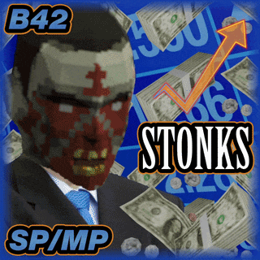{ .card-thumb }
    **[Zombies Have Money](mods/zombies-have-money.md)**
    B42SP/MP

    Adds a configurable chance for Zombies to drop Money and Money Bundles on Death.

-   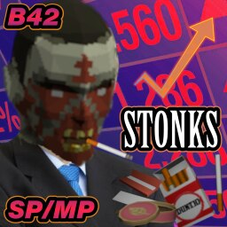{ .card-thumb }
    **[Zombies Have Smokes](mods/zombies-have-smokes.md)**
    B42SP/MP

    Adds a configurable chance for Zombies to drop Cigarettes, Cigars, Lighters/Matches and Tobacco Products on Death.

-   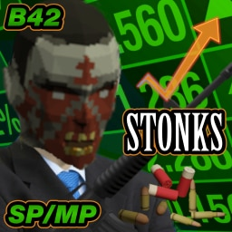{ .card-thumb }
    **[Zombies Have Ammo](mods/zombies-have-ammo.md)**
    B42SP/MP

    Adds a configurable chance for Zombies to drop loose Ammo and Ammo Boxes on Death. Includes support for specific Firearms Mods.

-   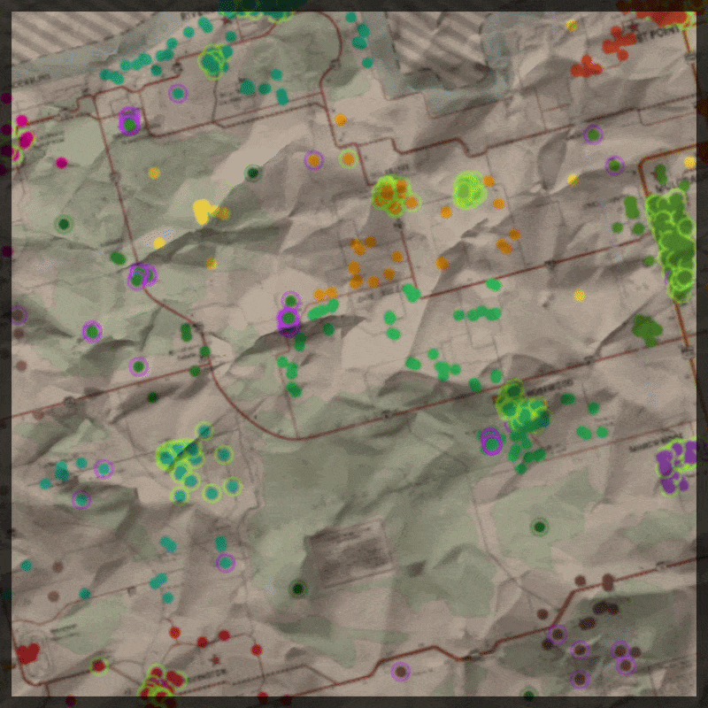{ .card-thumb }
    **[Random Spawn Locations](mods/random-spawn-locations.md)**
    B42SP/MP

    Every new Character spawns at a Random Location, drawn from 3,500+ verified Spawn Points across Knox Country, through a Random Spawn option on the 'Select Spawn Location' screen.

-   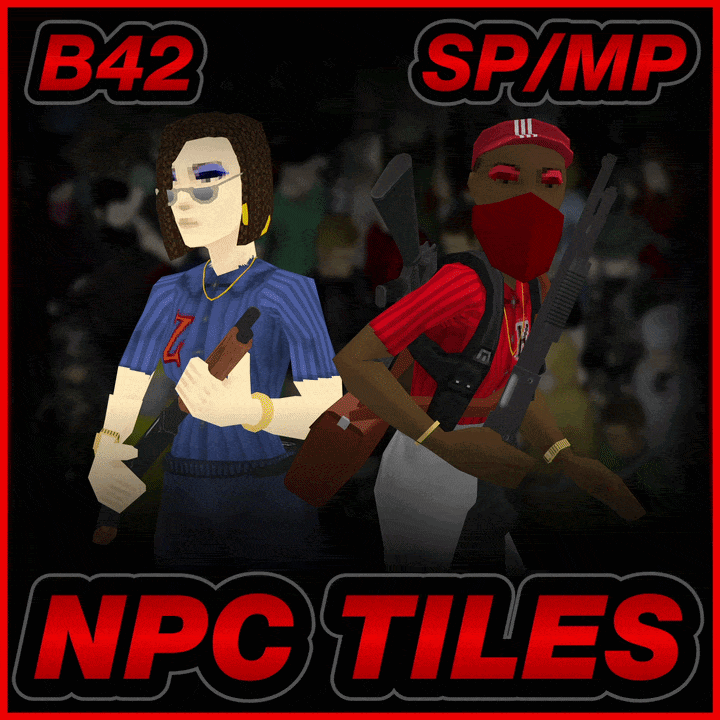{ .card-thumb }
    **[NPC Tiles](mods/npc-tiles.md)**
    B42SP/MP

    Contains 532 placeable human NPC Tiles for Singleplayer and Multiplayer Admins. Includes an 'NPC Tile Placer' script and exposes a public API for Mod Integration.

-   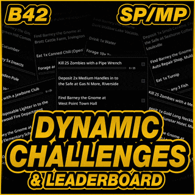{ .card-thumb }
    **[Dynamic Challenges & Leaderboard](mods/daily-challenge-system.md)**
    B42SP/MP

    Every Rotation brings 7 new Challenges, drawn from over 100,000 definitions. Earn Currency, keep a Streak, spend it at the Vendors and climb the Leaderboard. Includes a public API for Mod Integration.

-   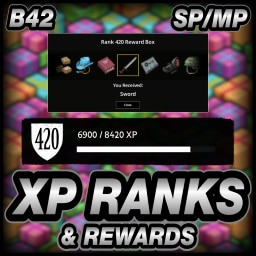{ .card-thumb }
    **[XP Ranks](mods/xp-ranks.md)**
    B42SP/MP

    Every action in the game feeds a single Global Rank from 1 to 999, with Reward Boxes and a per-category Leaderboard. Includes a public API for Mod Integration.

-   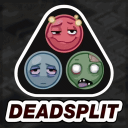{ .card-thumb }
    **[DeadSplit](mods/deadsplit.md)**
    B42SP

    An integrated Speedrun timer and AutoSplitter for Project Zomboid. Approved for Speedrun.com submissions. Covers every PZ Speedrun Category, with Run Export and Verification plus optional LiveSplit integration.

-   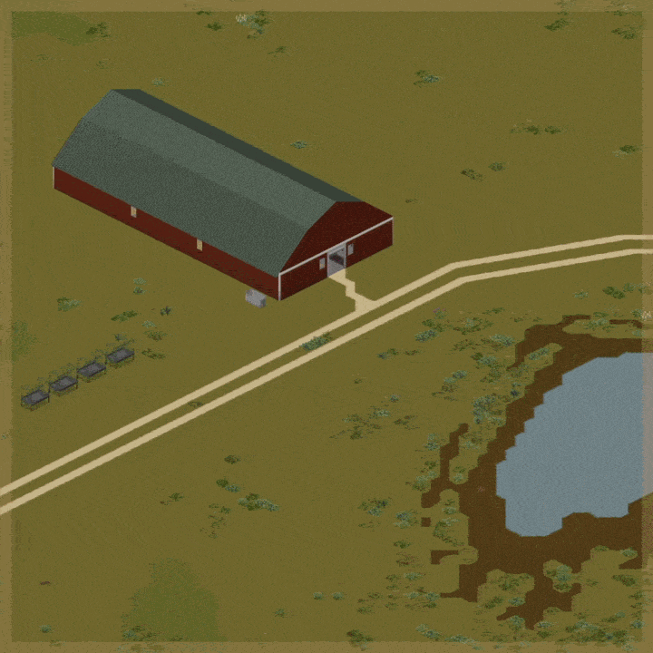{ .card-thumb }
    **[Livestock Traders](mods/livestock-traders.md)**
    B42SP/MP

    Travelling Traders buy and sell nine Animal types from rotating or Admin-placed locations. Currency, listing limits, Selling and Rank requirements are all configurable.

-   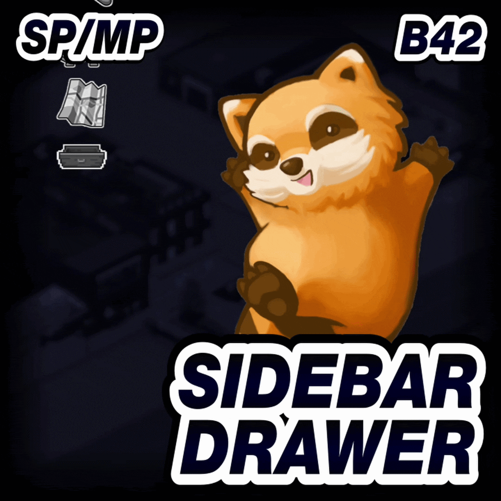{ .card-thumb }
    **[Sidebar Drawer](mods/sidebar-drawer.md)**
    B42SP/MP

    Moves compatible Mod Icons into a toggleable Drawer beside the vanilla Sidebar, with pages, a Vertical or Horizontal layout and a saved Icon order.

-   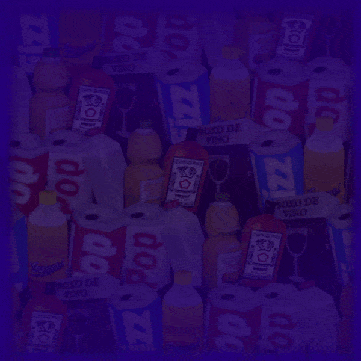{ .card-thumb }
    **[Auto-Drink Expanded](mods/auto-drink-expanded.md)**
    B42SP/MP

    Broadens the Auto-Drink functionality to enable Auto-Drinking from every safe Fluid type, including Milk, Juice, Soda and Alcohol.

-   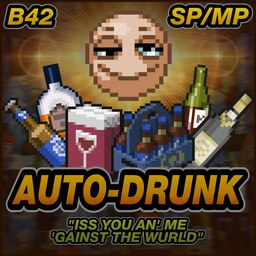{ .card-thumb }
    **[Auto-Drunk](mods/auto-drunk.md)**
    B42SP/MP

    Keeps a Character at a chosen Intoxication level, or drinks a set Alcohol dose on an interval, with Alcohol priority and per-Container controls.

-   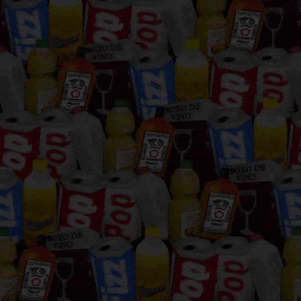{ .card-thumb }
    **[Auto-Drink Revert](mods/auto-drink-revert.md)**
    B42SP/MP

    Restores the pre-42.19 Auto-Drink rule for mixed Containers where Water is the main Fluid, with Container Priority and per-Container controls.

-   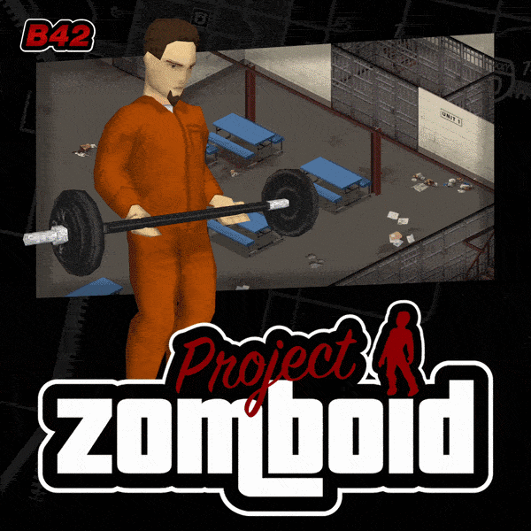{ .card-thumb }
    **[GTA Menu Theme](mods/gta-menu-theme.md)**
    B42SP/MP

    A Grand Theft Auto inspired Main Menu Theme with Menu Music, a layered Map-framed Parallax Slideshow, five Button Layouts and an optional GTA Logo. Requires Menu Theme Framework.

-   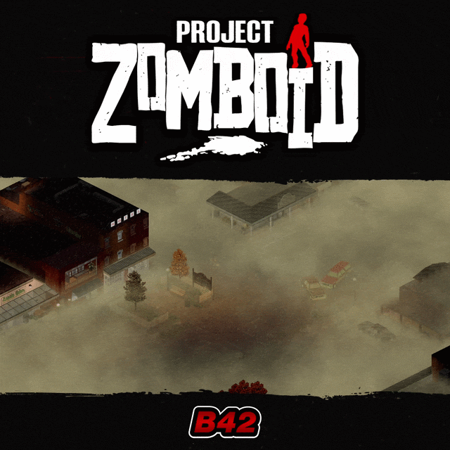{ .card-thumb }
    **[RDR Menu Theme](mods/rdr-menu-theme.md)**
    B42SP/MP

    A Red Dead Redemption inspired Main Menu Theme with Menu Music, looping Knox Country Videos, four Button Layouts and two Sub-Themes. Requires Menu Theme Framework.

-   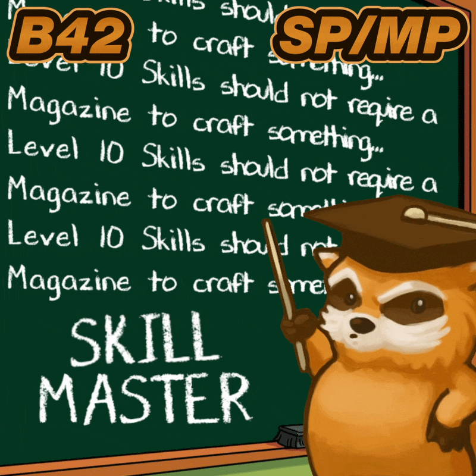{ .card-thumb }
    **[Skill Master](mods/skill-master.md)**
    B42SP/MP

    Unlocks magazine and research-gated recipes when a Skill reaches Level 10. Includes support to grant the matching Traits and includes support for recipes provided by other Mods.

-   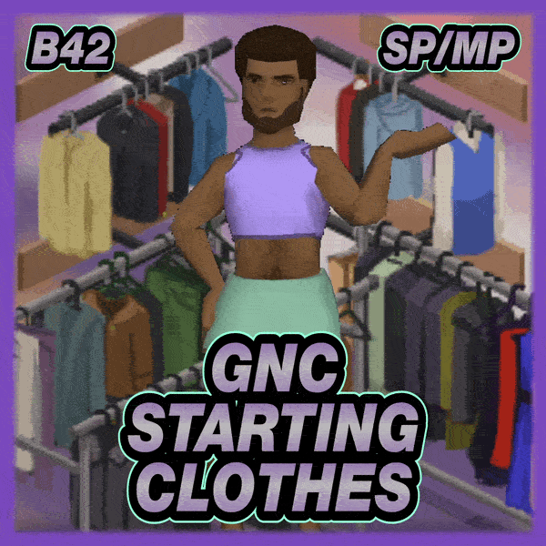{ .card-thumb }
    **[GNC Starting Clothes](mods/gnc-starting-clothes.md)**
    B42SP/MP

    Combines the Male and Female Default, Profession and Trait Clothing pools in Character Creation, for picking by hand or with Random.

-   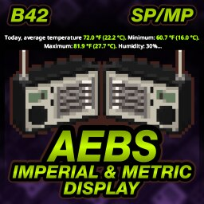{ .card-thumb }
    **[AEBS Imperial & Metric Display](mods/aebs-converter.md)**
    B42SP/MP

    Shows both Imperial and Metric temperature and wind speed in AEBS broadcasts, keeping the Server's native unit first.

-   { .card-thumb }
    **[Menu Theme Framework](mods/menu-theme-framework.md)**
    B42SP/MP

    A Lua-only Framework that hosts Main Menu Themes with custom Images, Video and Audio.

Documentation for Framework Mods and API References for Mods exposing a public API. Intended for Modders and Developers.

-   **[Menu Theme Framework](documentation/menu-theme-framework/index.md)**
    B42Framework

    A Framework for building Main Menu Themes with custom Audio, Images and Video. No Java and no manual installation.

-   **[Dynamic Challenges API](documentation/api/dynamic-challenges.md)**
    B42API

    Lets other Mods read Challenge progress and react to Challenge events.

-   **[NPC Tiles API](documentation/api/npc-tiles.md)**
    B42API

    Lets other Mods place and manage persistent NPC Tiles from server-side code.

-   **[XP Ranks API](documentation/api/xp-ranks.md)**
    B42API

    Lets other Mods award Rank XP, read Ranks and react to Rank Ups.

