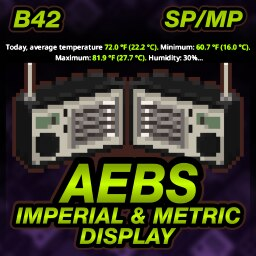
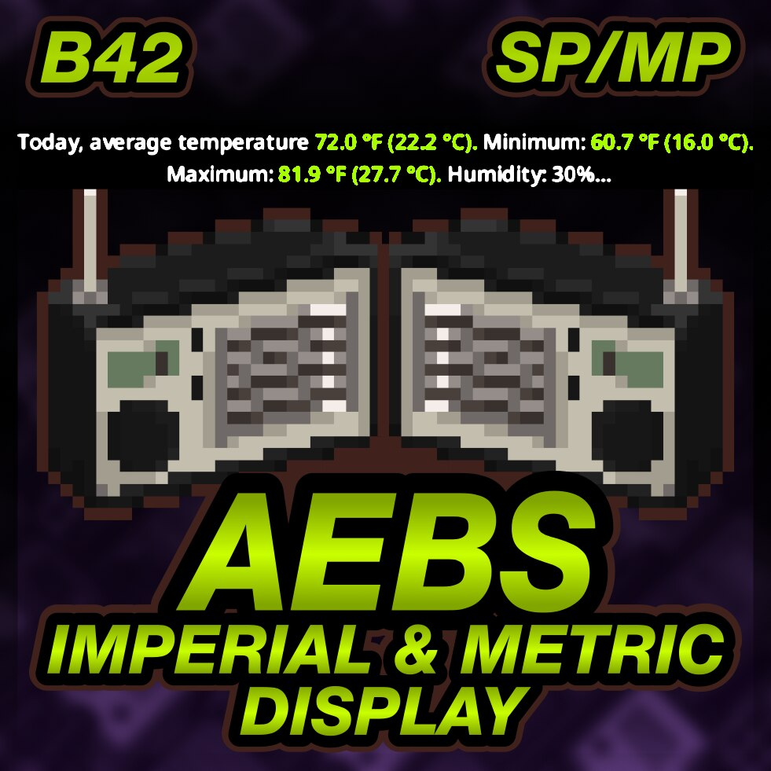
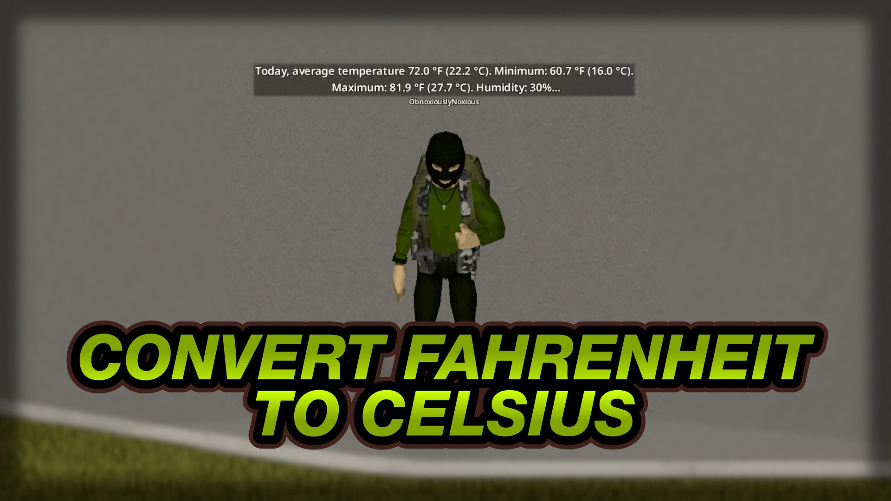
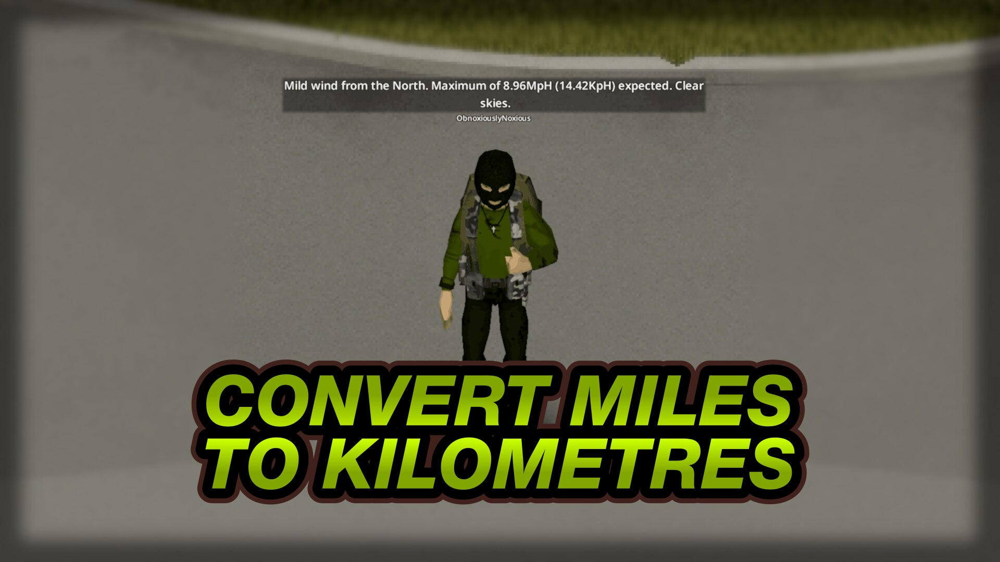
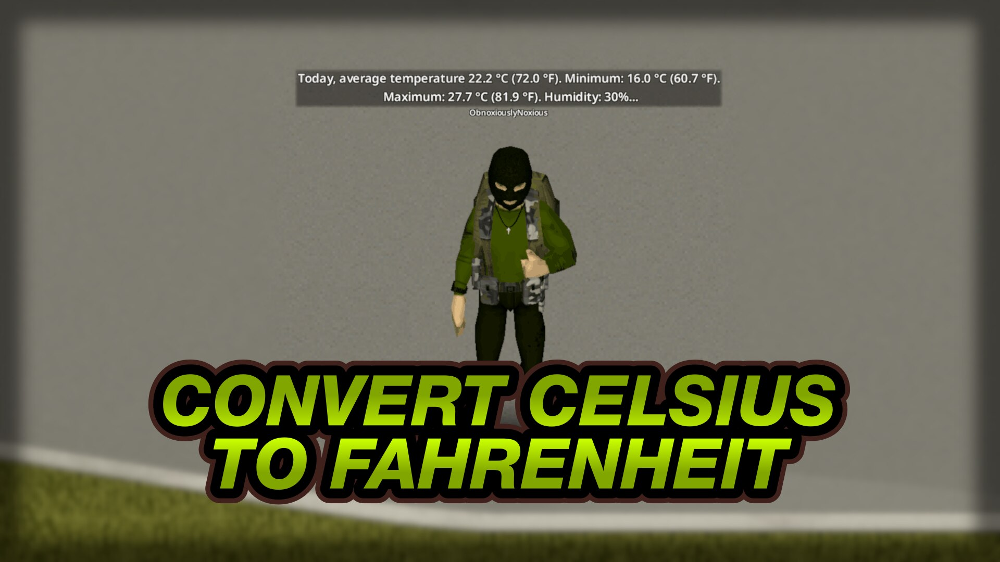
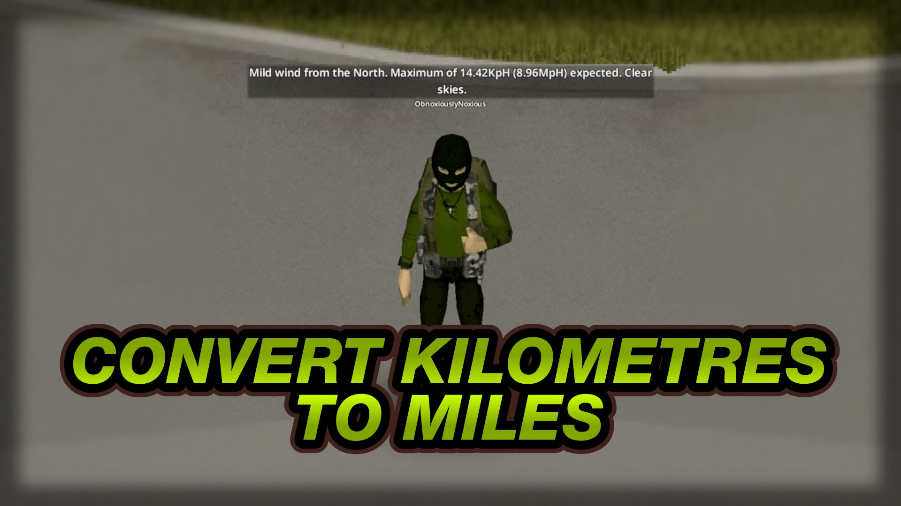

# **AEBS Imperial & Metric Display**

<div class="mod-hero" markdown>

{ .mod-icon }

<span class="pz-tag">B42</span><span class="pz-tag">SP/MP</span>

[:fontawesome-brands-steam-symbol: Steam Workshop](https://steamcommunity.com/sharedfiles/filedetails/?id=3733578471)

**Recommended Build:** 42.16+

</div>

## Overview

*'Whether the Helicopter has spotted you, you've got a Horde bashing down your door or you're about to go out Fishing, you haven't got time to convert the Imperial/Metric units from the AEBS Broadcast'*

In Multiplayer, AEBS temperature and wind speed broadcasts use the system region of the Server's computer. Individual Clients cannot change those broadcast units. AEBS Imperial & Metric Display appends the converted value to each temperature and wind speed broadcast, keeping the Server's native unit first.

The Mod is designed for Hosted and Dedicated Multiplayer, including international Server communities. It also works in Singleplayer, where the game's Temperature Display setting already controls the unit shown. Singleplayer does not need the Mod unless both units are preferred at once.

## Gallery

<div class="gallery-grid" markdown>







</div>

## Features

- **Both Temperature Units:** Show Fahrenheit and Celsius on each AEBS temperature broadcast
- **Both Wind Speed Units:** Show miles per hour and kilometres per hour on each AEBS wind speed broadcast
- **Native Unit First:** The unit set by the Server's system region comes first, followed by the converted value in parentheses
- **Automatic Detection:** The Mod detects the Server's unit setting with no configuration
- **Display Only:** Only the broadcast text changes. Game data and Saves are untouched
- **Radio Mod Friendly:** Radio scripts, distributions and broadcast data are not modified

## Mechanics

The Mod adjusts AEBS weather text as the broadcast is generated on the Server. It preserves the native temperature and wind speed values, then adds the converted values in parentheses. This lets Players read both units even when a Multiplayer Server uses a different system region from their own.

No conversion setting is required. The Server's region determines which unit appears first. Singleplayer continues to respect the Player's Temperature Display preference, with the other unit shown alongside it.

The conversion is presentational. It does not change weather, radio transmissions, world data or saved Characters. The Mod can be added to or removed from an existing save at any time.

## Installation

**Singleplayer:** Subscribe to the Mod on the Steam Workshop and enable it from the 'Choose Mods' screen.

**Multiplayer (Hosted and Dedicated):** Subscribe to the Mod on the Steam Workshop and add the lines below to the server's `.ini` file.

```ini
Mods=AEBSConverter
WorkshopItems=3733578471
```

## Configuration

AEBS Imperial & Metric Display has no gameplay settings or Sandbox options. It detects the Server's unit setting automatically.

## Compatibility

| Build | SP | Hosted MP | Dedicated MP |
|:---:|:---:|:---:|:---:|
| 42.16+ | ✅ | ✅ | ✅ |
| 41 | ❌ | ❌ | ❌ |

Designed for Hosted and Dedicated Multiplayer. In Singleplayer, the game already follows the Player's Temperature Display setting. The Mod is only needed there to see both units together.

!!! success "Is this Mod safe to add to or remove from existing Saves?"
    Yes, at any time. It does not touch world data.

!!! success "Is this Mod compatible with 'X' Mod?"
    It should work with every radio Mod. It does not modify radio scripts, distributions or broadcast data.

!!! success "Does this Mod support 'X' Language?"
    Yes. It has translations for all supported Project Zomboid languages.

## FAQ / Troubleshooting

!!! question "Why Does the AEBS Broadcast Ignore a Client's Temperature Display Setting in Multiplayer?"
    The broadcast unit is generated from the system region of the computer hosting the Server. AEBS Imperial & Metric Display appends the alternate unit so each Player can read both values.

!!! question "Does It Need Configuration?"
    No. The Mod detects the Server's unit setting and adds the converted temperature and wind speed values automatically.

!!! question "Will It Change Radio Content or My Save?"
    No. The Mod changes the displayed broadcast text. It does not alter radio scripts, distributions, world data or saved Characters.

## Credits

- Thanks to TIS Staff members [Beard and Blair](https://steamcommunity.com/app/108600/discussions/0/3372657330745784961/) for helping verify how AEBS units are generated in Multiplayer
- Translations: ifrit_47 (Spanish) and Nycotex (Italian)

## Changelog

[:fontawesome-brands-steam-symbol: View Patch Notes](https://steamcommunity.com/sharedfiles/filedetails/changelog/3733578471)
