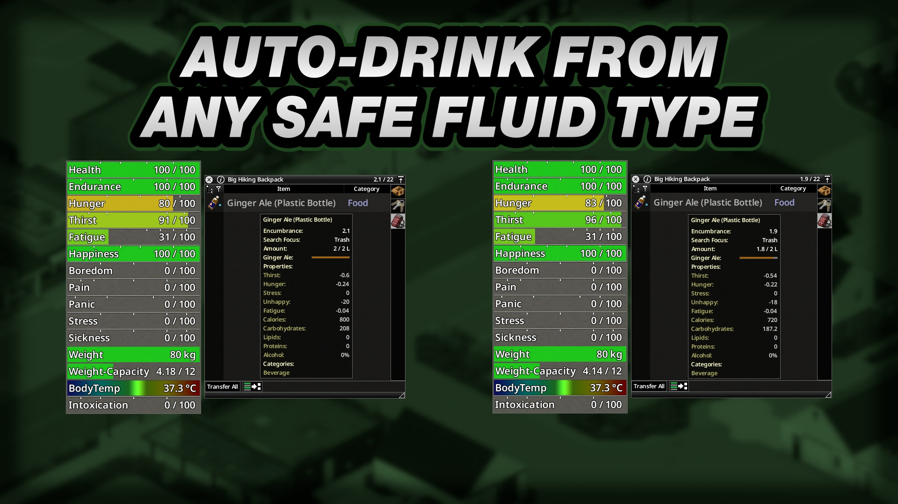
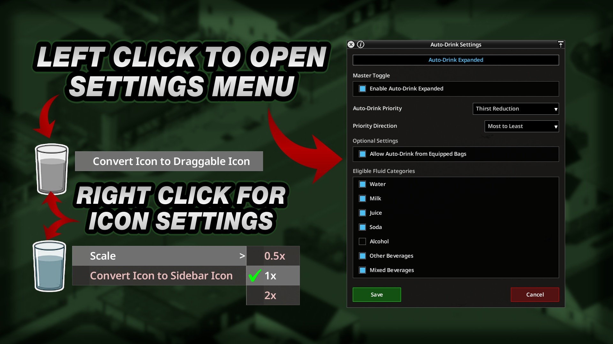
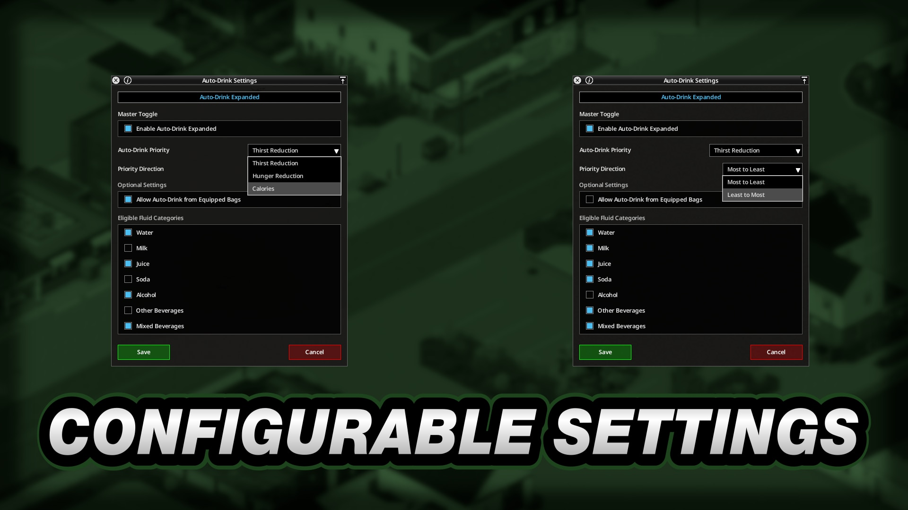
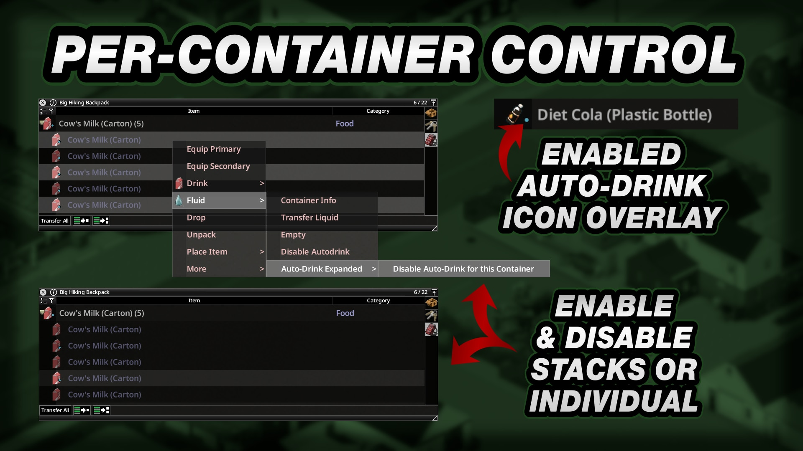

# **Auto-Drink Expanded**

<div class="mod-hero" markdown>

{ .mod-icon }

<span class="pz-tag">B42</span><span class="pz-tag">SP/MP</span>

[:fontawesome-brands-steam-symbol: Steam Workshop](https://steamcommunity.com/sharedfiles/filedetails/?id=3792887660)

**Recommended Build:** 42.19+

</div>

## Overview

*'Whenever you're thirsty, whatever the Fluid. If it's safe to drink, Auto-Drink it'*

Auto-Drink Expanded lets Characters automatically drink from safe Fluid Containers across more Fluid Categories, including Water, Milk, Juice, Soda, Alcohol and other Beverages. A separate Mixed Beverages option controls Containers holding more than one Fluid type.

The Mod adds per-Player settings, per-Container controls and a small blue indicator on eligible Containers. It supports Singleplayer and Multiplayer with server-authoritative drinking and synchronised Fluid Containers.

## Gallery

<div class="gallery-grid" markdown>
   
</div>

## Features

- **Safe Fluid Categories:** Auto-drinks eligible Water, Milk, Juice, Soda, Alcohol and other Beverages. Tainted Water and Hazardous, Industrial or Poisonous Fluids are excluded
- **Mixed Beverages:** Controls Containers made from more than one Fluid type with its own Setting
- **Container Priority:** Ranks eligible Containers by Thirst Reduction, Hunger Reduction or Calories, then selects from Most to Least or Least to Most effectiveness
- **Equipped Bags:** Optionally searches Equipped Bags after the main Inventory has no eligible Container
- **Container Controls:** Include or exclude individual Containers from the `Fluid` Context Menu
- **Blue Indicator:** Marks eligible Fluid Containers that currently have Auto-Drink enabled
- **Player Settings:** Saves preferences per Player or Character across relogs and Server restarts
- **Shared Dispatcher:** Works on its own or with Auto-Drunk and Auto-Drink Revert without competing for the Auto-Drink hook or consuming from multiple Containers in the same cycle
- **Draggable Sidebar Icon:** Move the Settings Icon away from other Mod Icons and adjust its scale
- **Settings Preset File:** Save Settings for new Worlds or Servers and load them into the active Settings Window

## Mechanics

Auto-Drink Expanded checks the Player's Inventory for eligible Fluid Containers when the base game's Auto-Drink hook runs. If **Allow Auto-Drink from Equipped Bags** is enabled and the main Inventory has no eligible Container, the Mod checks Equipped Bags.

Each eligible Container is classified by its Fluid Category. A container containing a single supported Fluid type uses that Category's Setting. A Container with multiple Fluid types uses **Mixed Beverages**. Other Beverages covers safe drinks outside the named Water, Milk, Juice, Soda and Alcohol categories, such as Coffee or Tea.

The chosen Container is ranked by the selected Priority. **Thirst Reduction**, **Hunger Reduction** and **Calories** compare the Container's effectiveness per amount of Fluid. **Priority Direction** decides whether the most or least effective Container is chosen first. The latest release lets a Character continue drinking from the selected Container until it is empty.

Pure Water remains available through the vanilla Water behaviour when the **Enable Auto-Drink Expanded** Setting is Off. Disable the **Water** Category or the base game's global Auto-Drink option to stop Water Auto-Drink.

The shared dispatcher coordinates Auto-Drink Expanded, Auto-Drunk, Auto-Drink Revert and the vanilla Water fallback. One provider handles each Auto-Drink cycle. The Server validates the Player's Settings, handles drinking and synchronises Fluid Containers in Multiplayer.

Player preferences are stored by username in world ModData and restored through relogs and Server restarts. Settings Preset Files are local to the installation. The Settings Window position and Sidebar Icon mode, position and scale are also saved locally under `Zomboid/Lua/AutoDrink/`.

## Installation

Subscribe to Auto-Drink Expanded on the [Steam Workshop](https://steamcommunity.com/sharedfiles/filedetails/?id=3792887660).

**Singleplayer:** Enable Auto-Drink Expanded from the Mods screen. Enable the base game's Auto-Drink option for automatic drinking.

**Hosted or Dedicated Multiplayer:** Subscribe to the Mod and add it to the Server's `.ini` file.

```ini
Mods=[B42]AutoDrinkExpanded
WorkshopItems=3792887660
```

Auto-Drink Revert and Auto-Drunk are optional. The three Mods can be installed separately or together.

## Configuration

Click the Auto-Drink Sidebar Icon to open the Settings Window. Settings changes apply to the active Player or Character after **Save**.

### Auto-Drink and Fluid Categories

| Setting | Default | Range | Description |
|:---|:---|:---|:---|
| Enable Auto-Drink Expanded | On | On or Off | Controls Auto-Drink Expanded for eligible non-Water Containers. Pure Water continues through the vanilla Water behaviour when this is Off |
| Water | On | On or Off | Allows Water Containers to be used automatically |
| Milk | On | On or Off | Allows Milk Containers to be used automatically |
| Juice | On | On or Off | Allows Juice Containers to be used automatically |
| Soda | On | On or Off | Allows Soda Containers to be used automatically |
| Alcohol | Off | On or Off | Allows Alcohol Containers to be used automatically |
| Other Beverages | On | On or Off | Allows other safe single-Fluid Beverages, such as Coffee or Tea |
| Mixed Beverages | On | On or Off | Allows Containers made from more than one Fluid type |

### Container Selection

| Setting | Default | Range | Description |
|:---|:---|:---|:---|
| Allow Auto-Drink from Equipped Bags | Off | On or Off | Searches the main Inventory first, then Equipped Bags if the main Inventory has no eligible Container |
| Auto-Drink Priority | Thirst Reduction | Thirst Reduction, Hunger Reduction or Calories | Ranks eligible Containers by the selected benefit per amount of Fluid |
| Priority Direction | Most to Least | Most to Least or Least to Most | Chooses whether the most or least effective eligible Container is used first |

### Individual Containers

By default, a Container follows its enabled Fluid Category. Right-click an eligible Fluid Container or a stack and use **Fluid > Auto-Drink Expanded > Enable Auto-Drink for this Container** or **Disable Auto-Drink for this Container**. A disabled Fluid Category remains unavailable until it is enabled in the Settings Window.

### Settings Preset File

Use the **Save** and **Load** file buttons at the bottom of the Settings Window. **Save** stores the current Auto-Drink Expanded Settings locally. Worlds or Servers without saved preferences apply those values automatically. **Load** brings the saved values into the Window; press **Save** to apply them to the active World or Server.

## Works With

| Mod | What It Adds |
|:---|:---|
| [Auto-Drink Revert](auto-drink-revert.md) | Registers its own provider with the shared dispatcher. Both Mods can run together without competing for the Auto-Drink hook or consuming from multiple Containers in one cycle |
| [Auto-Drunk](auto-drunk.md) | Adds a separate Auto-Drunk provider. Both Mods can run together without competing for the Auto-Drink hook or consuming from multiple Containers in one cycle |

## Compatibility

| Build | SP | Hosted MP | Dedicated MP |
|:---:|:---:|:---:|:---:|
| 42.19+ | ✅ | ✅ | ✅ |
| 41 | ❌ | ❌ | ❌ |

!!! success "Does it require another Mod?"
    No. Auto-Drink Revert and Auto-Drunk are optional

!!! success "Can it be added or removed mid-save?"
    Yes

!!! success "Does it modify game files?"
    No. The Mod does not alter any game files

!!! success "Does this Mod support 'X' Language?"
    Yes. It has translations for all supported Project Zomboid languages.

!!! success "How are Multiplayer drinks kept in sync?"
    The Server handles Auto-Drink and synchronises Fluid Containers

## FAQ / Troubleshooting

!!! question "Why Does the Mod Still Auto-Drink Water When the Master Toggle Is Off?"
    The vanilla Water behaviour remains available when **Enable Auto-Drink Expanded** is Off. Disable the **Water** Category or the base game's global Auto-Drink option to stop it.

!!! question "How Can a Specific Container Be Excluded?"
    Right-click the Container or its stack. Under **Fluid > Auto-Drink Expanded**, choose **Disable Auto-Drink for this Container**. To include it again, choose **Enable Auto-Drink for this Container**.

!!! question "How Can Settings Be Reused in Another World or Server?"
    Use **Save** to store an Auto-Drink Expanded Settings Preset File. Open the Settings Window in the other World or Server, select **Load** and press **Save** to apply the values.

!!! question "How Can the Sidebar Icon Be Moved?"
    Right-click the Sidebar Icon and choose **Convert Icon to Draggable Icon**. Drag the Icon to a new position. Its Context Menu can change its scale or convert it back to the Sidebar.

!!! question "What Does the Blue Dot Mean?"
    The blue dot marks a Fluid Container that is eligible and currently enabled for Auto-Drink.

## Credits

- Translations: ifrit_47 (Spanish) and Nycotex (Italian)

## Changelog

[:fontawesome-brands-steam-symbol: View Patch Notes](https://steamcommunity.com/sharedfiles/filedetails/changelog/3792887660)
