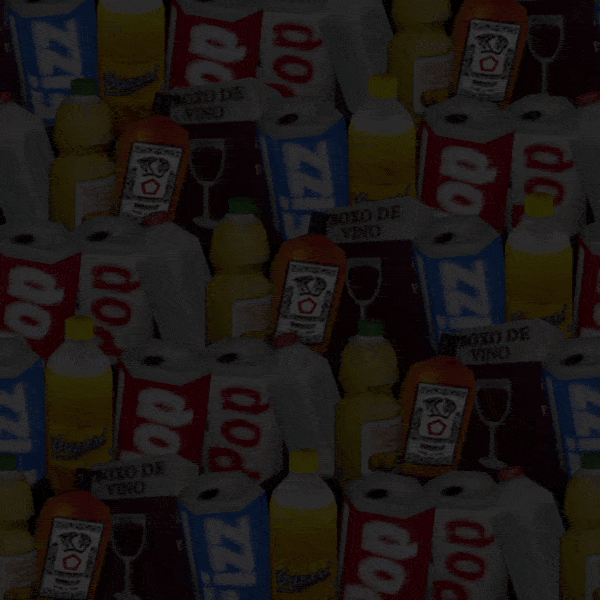
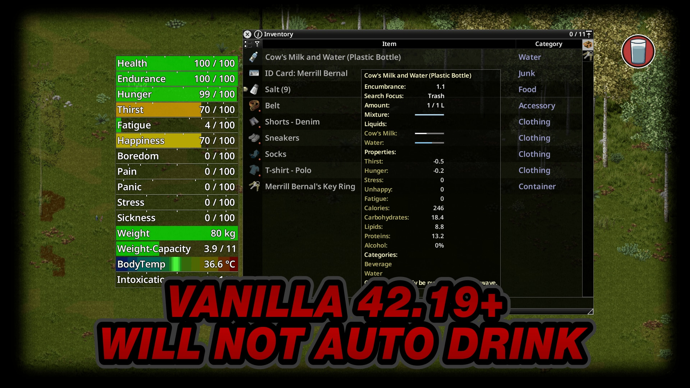
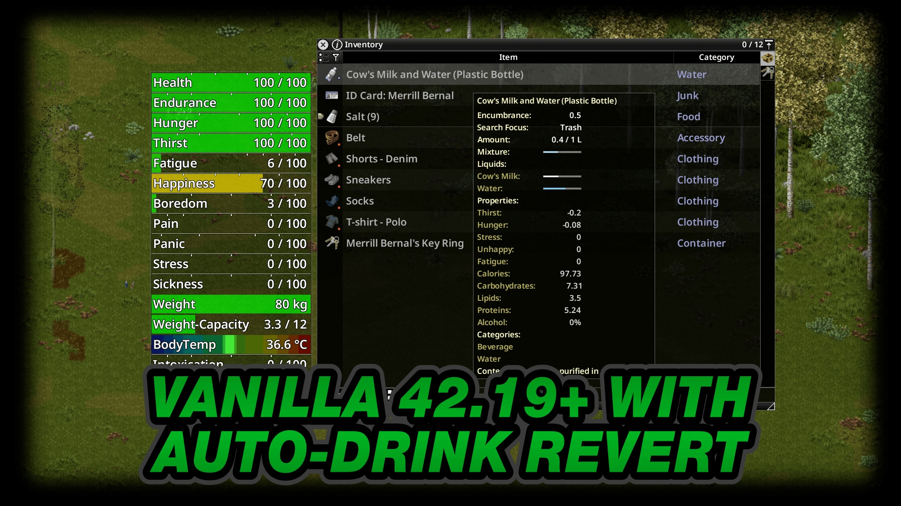
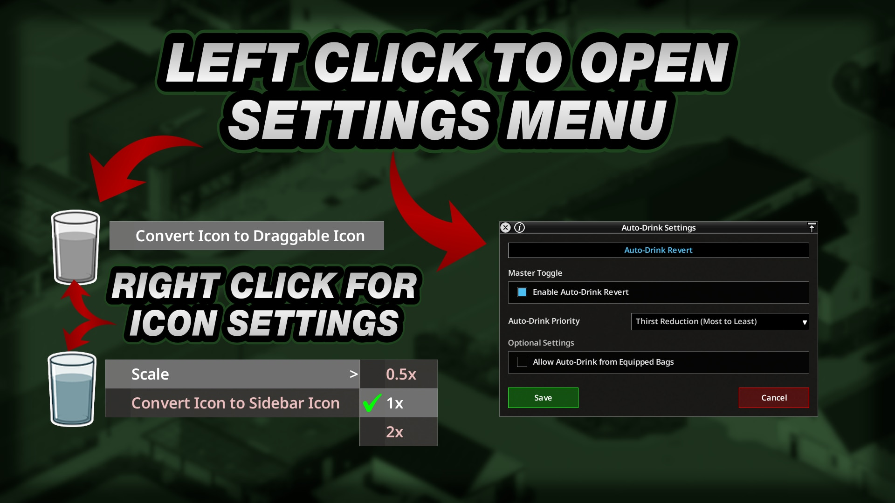
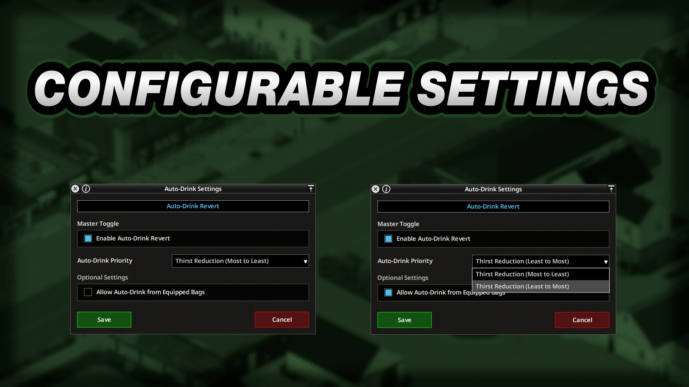
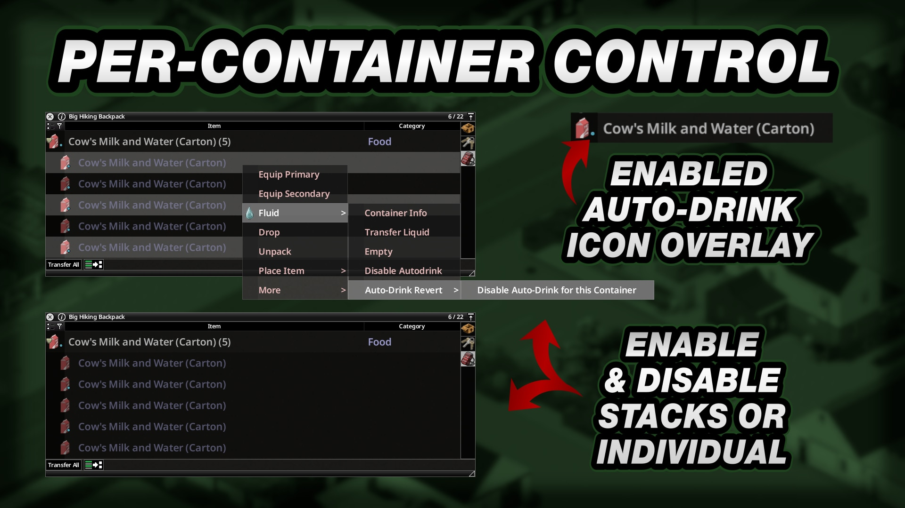

# **Auto-Drink Revert**

<div class="mod-hero" markdown>

{ .mod-icon }

<span class="pz-tag">B42</span><span class="pz-tag">SP/MP</span>

[:fontawesome-brands-steam-symbol: Steam Workshop](https://steamcommunity.com/sharedfiles/filedetails/?id=3737205872)

**Recommended Build:** 42.19+

</div>

## Overview

*'God Drink, Fight Milk, Combat Drink. Call it whatever you want. If it's mostly Water, Auto-Drink it. Just like old times'*

Build 42.19 changed Auto-Drink to accept only Water-only Containers. Auto-Drink Revert restores the earlier behaviour, allowing Characters to drink automatically from eligible Mixed Beverages where Water is the primary Fluid by volume.

The Mod adds per-Player Settings, Container Priority and individual Container controls. It supports Singleplayer and Multiplayer through server-authoritative drinking.

## Gallery

<div class="gallery-grid" markdown>
    
</div>

## Features

- **Water-Primary Auto-Drink:** Restores automatic drinking from eligible Containers where Water is the primary Fluid by volume, including Mixed Beverages
- **Master Toggle:** Controls Auto-Drink Revert for Mixed Beverages. Pure Water Containers continue to follow the base game's global Auto-Drink option
- **Auto-Drink Priority:** Selects Thirst Reduction from Most to Least or Least to Most, then prefers a higher Water proportion and a smaller remaining amount when results are tied
- **Equipped Bags:** Optionally searches Equipped Bags after the main Inventory has no eligible Container
- **Individual Container Controls:** Enable or disable eligible Containers from the `Fluid` Context Menu
- **Blue Item Indicator:** Marks eligible Fluid Containers currently enabled for Auto-Drink Revert
- **Shared Auto-Drink Dispatcher:** Coordinates Auto-Drink Revert with Auto-Drink Expanded and Auto-Drunk when those Mods are installed
- **Settings Icon:** Opens the shared Auto-Drink Settings Window and can be converted to a draggable Icon from its Context Menu

## Mechanics

The Mod checks the Player's Thirst during the shared Auto-Drink dispatch. It considers eligible Fluid Containers in the main Inventory first. When **Allow Auto-Drink from Equipped Bags** is enabled, Equipped Bags are searched only when the main Inventory has no eligible Container.

A Container must have Water as its primary Fluid and contain a positive amount. Containers with Hazardous, Industrial or Poison Fluids are excluded, including Tainted Water. The Mod does not drink when Thirst is at or below 0.1.

**Enable Auto-Drink Revert** controls Mixed Beverages. Pure Water Containers continue to use the base game's global Auto-Drink option. If the Mod selects a Container, it drinks an amount based on current Thirst and caps the dose at the Fluid remaining in that Container.

**Auto-Drink Priority** ranks Containers by Thirst Reduction per amount of Fluid. Choose Most to Least or Least to Most. When the result is tied, the Mod prefers the Container with the larger Water proportion, then the smaller remaining amount.

The Server runs the drinking logic in Multiplayer and synchronises the changed Fluid Container. Player preferences are stored by username in world ModData and restored across relogs and Server restarts.

## Installation

Subscribe to Auto-Drink Revert on the [Steam Workshop](https://steamcommunity.com/sharedfiles/filedetails/?id=3737205872).

**Singleplayer:** Enable Auto-Drink Revert from the Mods screen. The base game's global Auto-Drink option must also be enabled.

**Hosted or Dedicated Multiplayer:** Subscribe to the Mod and add it to the Server's `.ini` file.

```ini
Mods=[B42.19]AutoDrinkRevert
WorkshopItems=3737205872
```

Auto-Drink Expanded and Auto-Drunk are optional. All three Auto-Drink Mods can be installed separately or together.

## Configuration

Click the Auto-Drink Sidebar Icon to open the Settings Window. Auto-Drink Revert's options appear in its tab. **Save** applies changes to the active Player.

### Player Settings

| Setting | Default | Range | Description |
|:---|:---|:---|:---|
| Enable Auto-Drink Revert | On | On or Off | Enables Auto-Drink Revert for Mixed Beverages where Water is the primary Fluid |
| Allow Auto-Drink from Equipped Bags | Off | On or Off | Searches Equipped Bags when the main Inventory has no eligible Container |
| Auto-Drink Priority | Thirst Reduction (Most to Least) | Thirst Reduction (Most to Least) or Thirst Reduction (Least to Most) | Chooses the Container with the most or least Thirst Reduction first |

### Individual Containers

Right-click an eligible Fluid Container or a stack. Under **Fluid > Auto-Drink Revert**, choose **Enable Auto-Drink for this Container** or **Disable Auto-Drink for this Container**. Individual Container controls include or exclude a Container when Auto-Drink Revert is enabled.

## Works With

| Mod | What It Adds |
|:---|:---|
| [Auto-Drink Expanded](auto-drink-expanded.md) | Registers an additional provider with the shared dispatcher. Both Mods can run together without competing for the Auto-Drink hook |
| [Auto-Drunk](auto-drunk.md) | Registers an Alcohol provider with the shared dispatcher. Both Mods can run together without competing for the Auto-Drink hook |

## Compatibility

| Build | SP | Hosted MP | Dedicated MP |
|:---:|:---:|:---:|:---:|
| 42.19+ | ✅ | ✅ | ✅ |
| 41 | ❌ | ❌ | ❌ |

!!! success "Does it require another Mod?"
    No. Auto-Drink Expanded and Auto-Drunk are optional

!!! success "Can it be added or removed mid-save?"
    Yes

!!! success "Does it alter game files?"
    No. The Mod does not alter game files

!!! success "Does this Mod support 'X' Language?"
    Yes. It has translations for all supported Project Zomboid languages.

!!! success "Can it be used with other Auto-Drink Mods?"
    Yes. Auto-Drink Expanded and Auto-Drunk use the shared dispatcher

## FAQ / Troubleshooting

!!! question "Why Does the Master Toggle Not Disable Pure Water?"
    The Master Toggle controls the restored Mixed Beverage behaviour. The base game's global Auto-Drink option controls pure Water Containers.

!!! question "Why Is a Mixed Container Not Being Used?"
    Check that Water is the primary Fluid, the Container is not hazardous, industrial or poisonous, the base game's global Auto-Drink option is enabled and **Enable Auto-Drink Revert** is on.

!!! question "How Can a Container Be Excluded?"
    Right-click the Container or its stack. Under **Fluid > Auto-Drink Revert**, choose **Disable Auto-Drink for this Container**. Choose **Enable Auto-Drink for this Container** to include it again.

!!! question "How Does Auto-Drink Priority Choose a Container?"
    The Mod compares Thirst Reduction per amount of Fluid. The selected direction decides which result ranks first. Ties prefer the larger Water proportion, then the smaller remaining amount.

!!! question "How Can the Settings Icon Be Moved?"
    Right-click the Sidebar Icon and choose **Convert Icon to Draggable Icon**. Drag it to a new position. The Icon's Context Menu can return it to the Sidebar.

## Credits

- Translations: ifrit_47 (Spanish) and Nycotex (Italian)

## Changelog

[:fontawesome-brands-steam-symbol: View Patch Notes](https://steamcommunity.com/sharedfiles/filedetails/changelog/3737205872)
