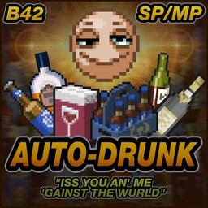
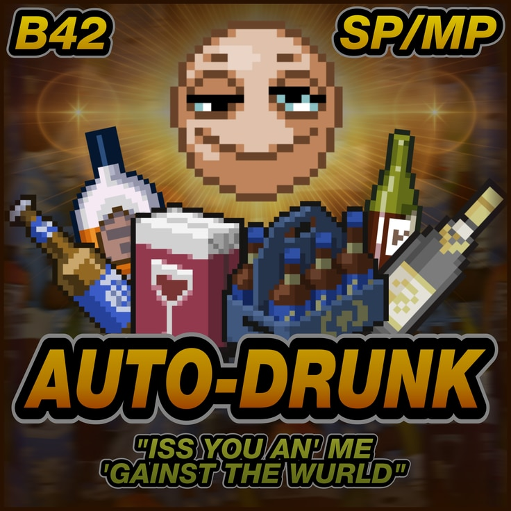
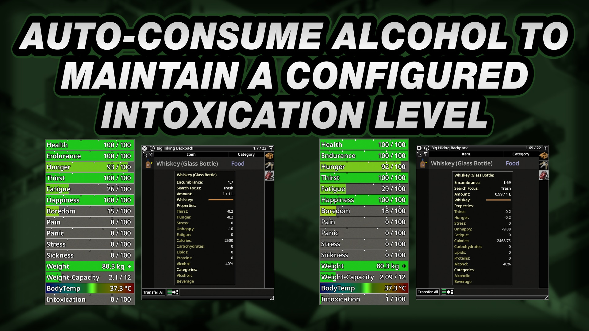
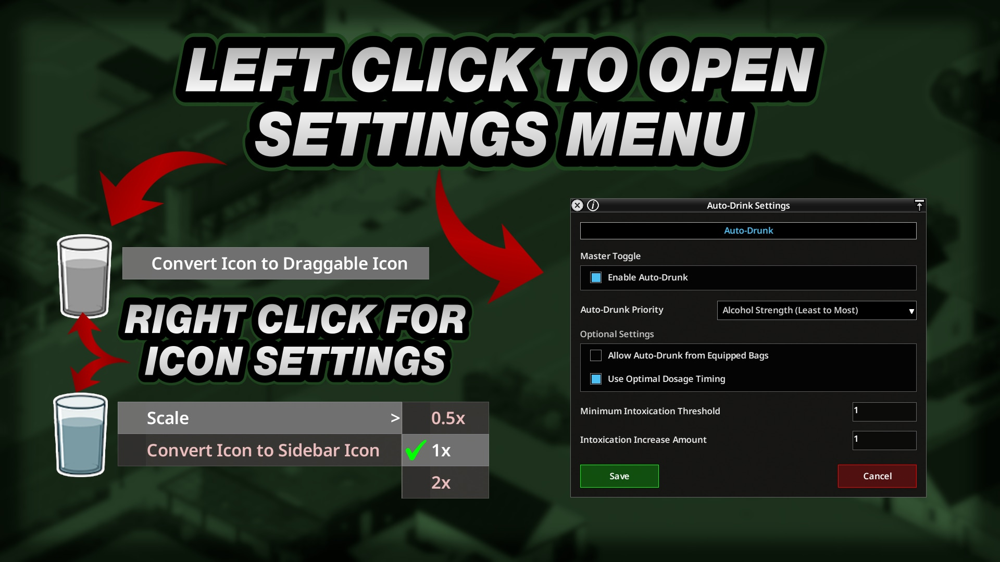
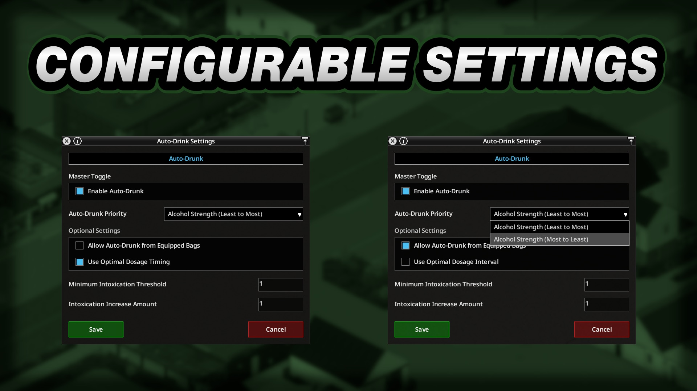
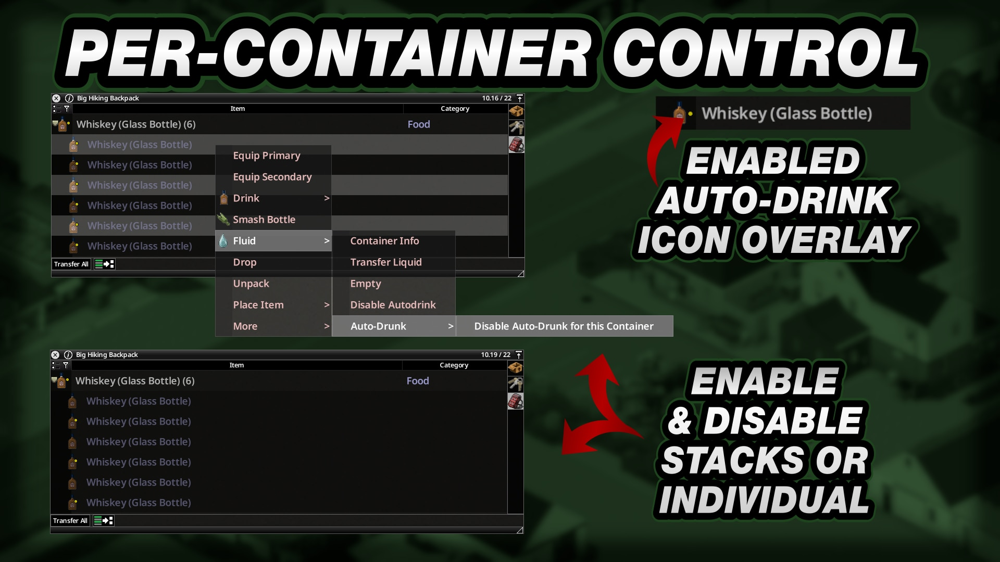

# **Auto-Drunk**

<div class="mod-hero" markdown>

{ .mod-icon }

<span class="pz-tag">B42</span><span class="pz-tag">SP/MP</span>

[:fontawesome-brands-steam-symbol: Steam Workshop](https://steamcommunity.com/sharedfiles/filedetails/?id=3792888505)

**Recommended Build:** 42.19+

</div>

## Overview

*'Do you suffer from symptomatic Moodles such as Pain, Panic & Unhappiness? Have you tried and failed to find relief with other name-brand Medicines like Angstipan or Deludamol?'*

Auto-Drunk monitors a Character's Intoxication and automatically drinks from eligible Alcohol Containers. **Maintain Intoxication** calculates the dose needed to reach a chosen threshold. **Fixed Volume** drinks a set amount each time the dosage interval expires.

Alcohol can reduce Panic, displayed Pain and Unhappiness while it is active. Auto-Drunk supports Singleplayer and Multiplayer with server-authoritative drinking and per-Player Settings.

## Gallery

<div class="gallery-grid" markdown>
    
</div>

## Features

- **Maintain Intoxication:** Automatically calculates an Alcohol dose to raise Intoxication above the selected Minimum Threshold by the configured Increase Amount
- **Fixed Volume:** Drinks a set number of millilitres when the dosage interval expires. The Maximum Intoxication Threshold skips a dose when the Character is already at or above the limit
- **Optimal Dosage Interval:** Waits at least three real-life minutes at default game speed before another dose. This avoids doses that add no extra Panic, Pain or Unhappiness relief
- **Alcohol Priority:** Chooses the weakest or strongest eligible Alcohol first, including mixtures with other Fluids
- **Equipped Bags:** Optionally searches the main Inventory first, then Equipped Bags when no valid Alcohol Container is found
- **Per-Container Controls:** Include or exclude individual Alcohol Containers from the `Fluid` Context Menu
- **Yellow Indicator:** Marks eligible Alcohol Containers currently enabled for Auto-Drunk
- **Player Settings:** Saves preferences by Player or Character across relogs and Server restarts
- **Draggable Sidebar Icon:** Move the Settings Icon away from other Mod Icons and adjust its scale
- **Shared Dispatcher:** Works alone or with Auto-Drink Expanded and Auto-Drink Revert without competing for the Auto-Drink hook or consuming from multiple Containers in one cycle

## Mechanics

Auto-Drunk checks the Character's Intoxication when the shared Auto-Drink dispatcher runs. With **Maintain Intoxication** selected, a dose starts when Intoxication falls below **Minimum Intoxication Threshold**. The Mod calculates the amount needed to reach the threshold plus **Intoxication Increase Amount**.

The dose calculation accounts for the Container's effective Alcohol strength and the Character's Hunger. **Alcohol Strength (Least to Most)** is the default priority. Choose **Alcohol Strength (Most to Least)** to use stronger Alcohol first. Mixed Containers are ranked by their effective strength.

With **Fixed Volume** selected, the Mod drinks the chosen millilitre amount regardless of current Intoxication or Alcohol strength. A dose is skipped when Intoxication is at or above **Maximum Intoxication Threshold**. If a Container holds less than the selected dose amount, Auto-Drunk drinks the remainder.

**Use Optimal Dosage Interval** delays another dose for at least three real-life minutes at default game speeds. Fixed Volume mode always uses this interval. Maintain Intoxication mode can turn the option off and redose as soon as Intoxication falls under the threshold.

Eligible Containers hold Alcohol and contain no Hazardous, Industrial or Poison Fluids. Tainted Water is never consumed. When the Master Toggle is on, eligible Alcohol Containers are enabled by default. Use the Context Menu to exclude a particular Container or include it again.

The Server handles drinking and synchronises Fluid Containers in Multiplayer. Player preferences are saved by username in world ModData and restored after relogs and Server restarts. The Settings Window position and Sidebar Icon mode, position and scale are saved locally under `Zomboid/Lua/AutoDrink/`.

### Alcohol Effects on Moodles

Unless stated otherwise, times are real-life time at Normal Game Speed.

- **Panic:** Alcohol reduces Panic at the same rate as Beta Blockers. The amount is relative to time survived, at about 10 times the Panic Reduction for a new survivor and about 1.7 times after five months. Each dose lasts three minutes and forty seconds
- **Pain:** Alcohol reduces displayed Pain at the same rate as Painkillers. It masks Pain instead of removing the underlying cause. Wound and Muscle Fatigue Pain remain underneath. Displayed Pain drains at 0.7 points per second for three minutes, then reasserts
- **Unhappiness:** Alcohol reduces Unhappiness at the same rate as Antidepressants, at 0.9 points per second. The first dose takes about five minutes and thirty-three seconds to take effect. Redosing within three minutes and forty seconds keeps the effect active without another delay. Each dose lasts three minutes and forty seconds

For comparison, Alcohol reduces Unhappiness by 198 over three minutes and forty seconds. A Book reduces it by 40, and petting an Animal by 15 to 35 once per in-game hour.

Alcohol also increases Tripping and Fatigue, and reduces Accuracy, vehicle control response and the Vision Cone.

## Installation

Subscribe to Auto-Drunk on the [Steam Workshop](https://steamcommunity.com/sharedfiles/filedetails/?id=3792888505).

**Singleplayer:** Enable Auto-Drunk from the Mods screen and enable the base game's Auto-Drink option.

**Hosted or Dedicated Multiplayer:** Subscribe to the Mod and add it to the Server's `.ini` file.

```ini
Mods=[B42]AutoDrunk
WorkshopItems=3792888505
```

Auto-Drink Expanded and Auto-Drink Revert are optional. All three Auto-Drink Mods can be installed separately or together.

## Configuration

Click the Auto-Drink Sidebar Icon to open the Settings Window. Auto-Drunk's settings appear in the **Auto-Drunk** tab. **Save** applies changes to the active Player or Character.

### Core Settings

| Setting | Default | Range | Description |
|:---|:---|:---|:---|
| Enable Auto-Drunk | Off | On or Off | Master Toggle for automatic Alcohol consumption |
| Auto-Drunk Mode | Maintain Intoxication | Maintain Intoxication or Fixed Volume | Selects calculated Intoxication doses or a set dose volume |
| Auto-Drunk Priority | Alcohol Strength (Least to Most) | Alcohol Strength (Least to Most) or Alcohol Strength (Most to Least) | Chooses the weakest or strongest eligible Alcohol first |
| Allow Auto-Drunk from Equipped Bags | Off | On or Off | Searches Equipped Bags if the main Inventory has no eligible Alcohol Container |
| Use Optimal Dosage Interval | On | On or Off in Maintain Intoxication mode | Waits at least three real-life minutes at default game speed between doses. Fixed Volume mode always uses the interval |

### Maintain Intoxication Settings

These Settings are available when **Auto-Drunk Mode** is **Maintain Intoxication**.

| Setting | Default | Range | Description |
|:---|:---|:---|:---|
| Minimum Intoxication Threshold | 1 | 0.1 to 80 | Intoxication level that triggers a dose. Drunk Moodles begin at 10, 30, 50 and 70 |
| Intoxication Increase Amount | 1 | 1 to 20 | Intoxication points added above the Minimum Threshold by the calculated dose |

### Fixed Volume Settings

These Settings are available when **Auto-Drunk Mode** is **Fixed Volume**.

| Setting | Default | Range | Description |
|:---|:---|:---|:---|
| Fixed Dose Amount (ML) | 10 ml | 1 to 100 ml | Amount of Alcohol to drink per dose. If the Container has less than the selected amount, the remainder is consumed |
| Maximum Intoxication Threshold | 50 | 1 to 100 | Skips a dose when Intoxication is at or above this value. Set it to 100 to prevent doses from being skipped |

### Individual Containers

When **Enable Auto-Drunk** is on, every eligible Alcohol Container is enabled by default. Right-click an eligible Container or a stack and use **Fluid > Auto-Drunk > Enable Auto-Drunk for this Container** or **Disable Auto-Drunk for this Container**.

## Works With

| Mod | What It Adds |
|:---|:---|
| [Auto-Drink Expanded](auto-drink-expanded.md) | Adds the safe Beverage provider to the shared dispatcher. Both Mods can run together without competing for the Auto-Drink hook or consuming from multiple Containers in one cycle |
| [Auto-Drink Revert](auto-drink-revert.md) | Adds another Auto-Drink provider to the shared dispatcher. The Mods can run separately or in any combination without competing for the Auto-Drink hook |

## Compatibility

| Build | SP | Hosted MP | Dedicated MP |
|:---:|:---:|:---:|:---:|
| 42.19+ | ✅ | ✅ | ✅ |
| 41 | ❌ | ❌ | ❌ |

!!! success "Does it require another Mod?"
    No. Auto-Drink Expanded and Auto-Drink Revert are optional

!!! success "Can it be added or removed mid-save?"
    Yes

!!! success "Does it alter game files?"
    No. The Mod does not alter game files

!!! success "Does this Mod support 'X' Language?"
    Yes. It has translations for all supported Project Zomboid languages.

!!! success "How are Multiplayer drinks kept in sync?"
    The Server handles Auto-Drunk and synchronises Fluid Containers

## FAQ / Troubleshooting

!!! question "Why Is Auto-Drunk Not Drinking?"
    Enable **Auto-Drunk** from the **Enable Auto-Drunk** Setting. The Master Toggle is Off by default. Check that the base game's Auto-Drink option is on and that at least one safe Alcohol Container is eligible.

!!! question "How Can One Alcohol Container Be Excluded?"
    Right-click the Container or its stack. Under **Fluid > Auto-Drunk**, choose **Disable Auto-Drunk for this Container**. To include it again, choose **Enable Auto-Drunk for this Container**.

!!! question "What Is the Difference Between the Two Auto-Drunk Modes?"
    **Maintain Intoxication** calculates each dose from current Intoxication, the Minimum Threshold and the Increase Amount. **Fixed Volume** drinks the same amount each time the interval expires, then skips doses at or above the Maximum Intoxication Threshold.

!!! question "Why Does Fixed Volume Ignore the Optimal Dosage Interval Checkbox?"
    Fixed Volume always waits for the interval. The checkbox is available in Maintain Intoxication mode, where it can be disabled.

!!! question "How Does the Alcohol Priority Setting Work?"
    **Alcohol Strength (Least to Most)** starts with the weakest eligible Alcohol. **Alcohol Strength (Most to Least)** starts with the strongest. Mixed Fluids use their effective Alcohol strength.

## Credits

- Translations: ifrit_47 (Spanish) and Nycotex (Italian)

## Changelog

[:fontawesome-brands-steam-symbol: View Patch Notes](https://steamcommunity.com/sharedfiles/filedetails/changelog/3792888505)
