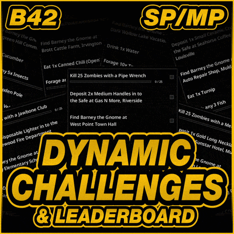
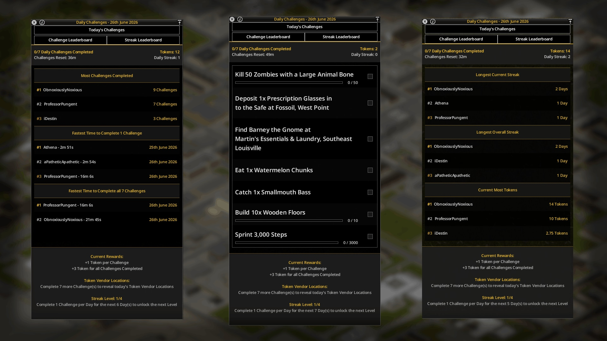
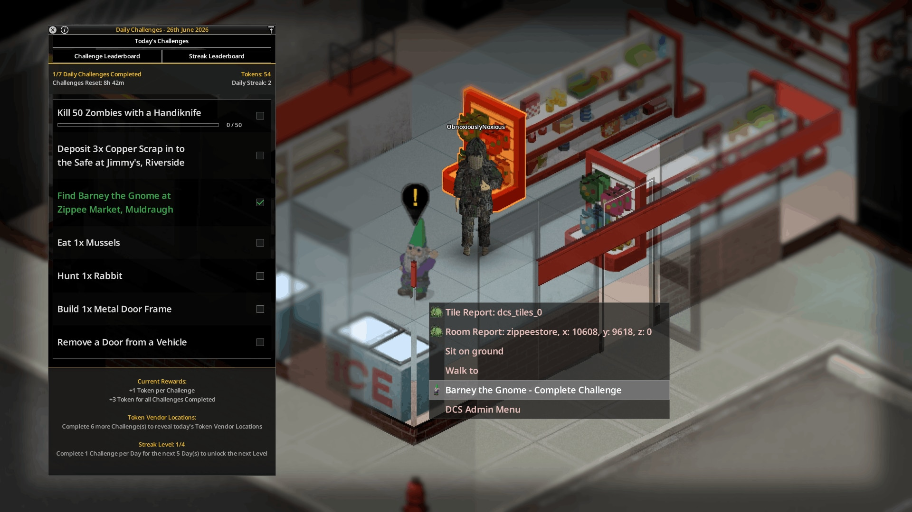
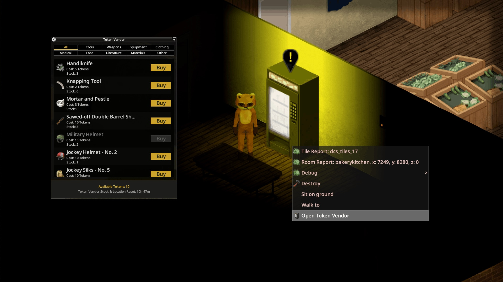
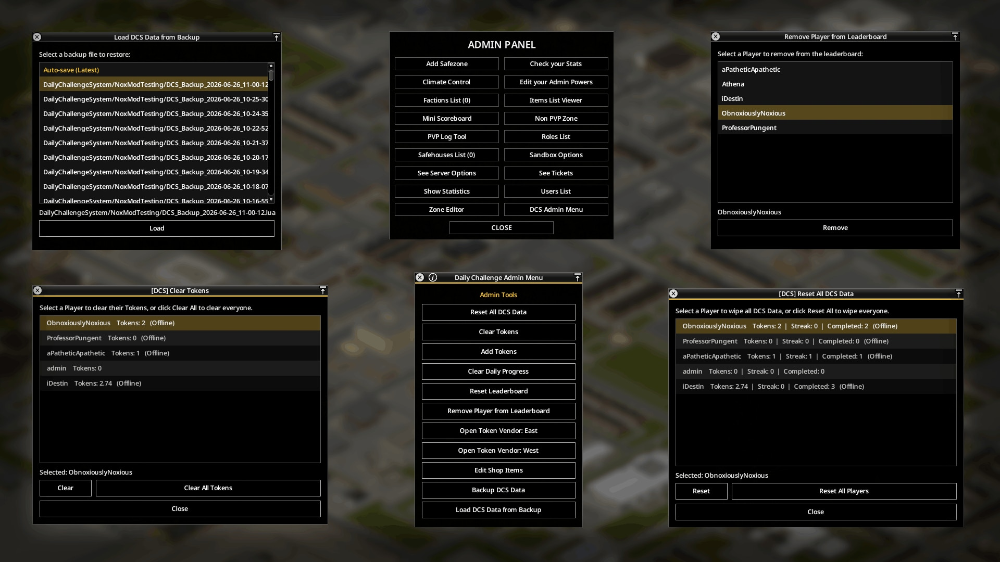
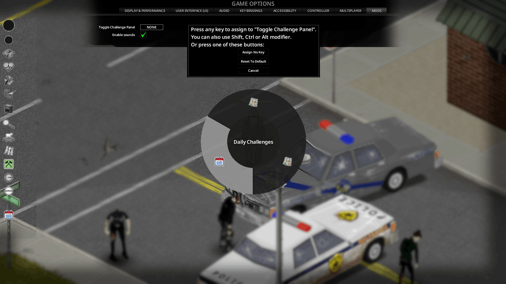
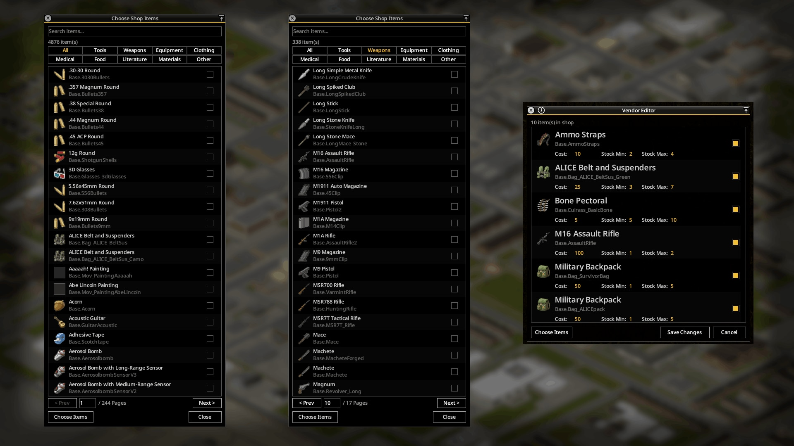
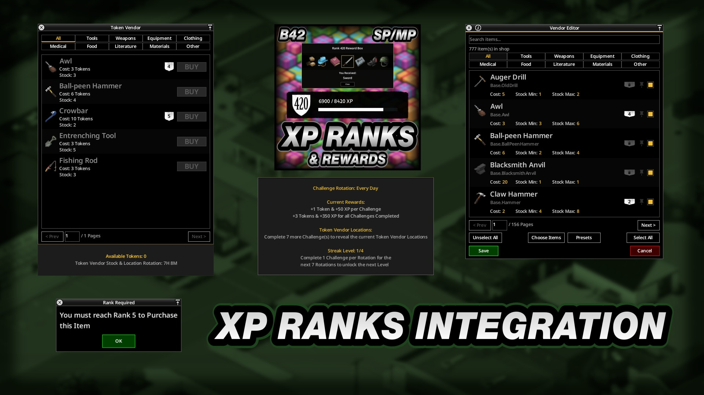

# **Dynamic Challenges & Leaderboard**

<div class="mod-hero" markdown>

{ .mod-icon }

<span class="pz-tag">B42</span><span class="pz-tag">SP/MP</span>

[:fontawesome-brands-steam-symbol: Steam Workshop](https://steamcommunity.com/sharedfiles/filedetails/?id=3752111970)

**Recommended Build:** 42.19+

</div>

## Overview

*'Because surviving the Zombie Apocalypse wasn't already enough of a Challenge...'*

Dynamic Challenges & Leaderboard (DCS) adds 7 new Challenges to every Rotation, drawn from over 100,000 Challenge definitions. No two Rotations feel the same. Completing Challenges earns Currency, which is spent on Items at the Vendors. Keeping a Streak raises the Currency paid per Challenge. In Multiplayer, a Leaderboard ranks every Player on the server. In Singleplayer, a Hall of Fame tracks the achievements of past and present Characters.

[**Today's Current Challenges**](https://obnox.dev/DynamicChallengeBot/){target="_blank"}

[](https://obnox.dev/DynamicChallengeBot/){target="_blank"}

## Gallery

<div class="gallery-grid" markdown>
       
</div>

## Features

**7 Challenge Categories** (one Challenge from each per Rotation):

- **Kills/Weapon:** Slay Zombies with anything from a Broom to an M16, with generic kill counts and weapon-specific Challenges (318 Challenges)
- **Quest/Deliver:** Find the required Item(s), travel to the Location and deliver them to the Target (93 Items across 1,193 Locations, 110,949 combinations)
- **Find the Gnome:** Explore Knox Country by finding the Target at the Location (1,193 Locations)
- **Eat/Drink:** Cook and eat specific meals, consume non-perishables, or forage and farm fresh produce (168 Challenges)
- **Fish/Hunt/Forage/Farm:** Reel in a specific fish, hunt a wild animal, forage for materials or tend a farm plot (66 Challenges)
- **Craft/Build:** Craft tools, weapons and clothes, or build walls, fences, doors, crates and other structures (223 Challenges)
- **Miscellaneous:** Travel set distances on foot or by Vehicle, read books and magazines, change hairstyle or makeup, install or remove vehicle parts and more (120 Challenges)

**More Features:**

- **Challenge Modes:** Legacy Mode (fully random) or Difficulty Mode, where Admins rate each Challenge None, Easy, Medium or Hard and set the share of each per Rotation. Admins can also exclude Challenge Types and Towns
- **Streak and Rewards:** Complete at least 1 Challenge per Rotation to keep the Streak and climb 4 Streak Levels, each paying more Currency per Challenge. Finishing every Challenge in a Rotation earns a bonus. A full Streak cycle (28 Rotations by default) earns a milestone bonus. Payouts, requirements, Streak Level length and an optional Grace Period are configurable
- **Vendors:** Exchange Currency for Items. Admins can let Players sell Items to Vendors (in Multiplayer with a per-Player, per-Rotation budget) and control what is bought and sold, with prices and stock, in the Vendor Editor. Every Vendor shows the same rotating selection each Rotation. Rotating Vendors per Rotation are configurable (0 to 8, default 2). Admins can also place up to 8 permanent Static Vendors
- **Vendor Locations:** Revealed on the World Map after completing a set number of Challenges (default 3), or by finding a Vendor Location Map dropped by Zombies
- **Currency:** Tokens (default), vanilla Money or any Item as a Custom Currency
- **Wallet and Earnings:** The Wallet holds spendable Currency, while Challenge Earnings tracks only what Challenges have paid. With Money or a Custom Currency, Admins can allow Wallet Deposit and Withdraw plus Remote Wallet Access (Vending Machines, PCs, ATMs). Remote Vendor Access (Vending Machines, PCs) works with any Currency
- **Token Transfers:** Optional transfers between Players from the Player context menu, at a Vendor, from remote objects or in the Trade with Player window
- **Leaderboard:** Most Challenges Completed, Fastest Completion Time, Longest Streak and Most Challenge Earnings, against other Players (Multiplayer) or past Characters (Singleplayer Hall of Fame)
- **Admin Tools:** Settings, Data Backup and Restore, the Vendor Editor (Pinned Items, Presets), Currency Migration, Leaderboard Reset, Teleports, bulk Player actions, Server Logging and per-user statistics
- **Integrations:** [XP Ranks](https://steamcommunity.com/sharedfiles/filedetails/?id=3799796873){target="_blank"} awards Rank XP for Challenges and Streaks and can gate Vendor Items behind a minimum Rank. [NPC Tiles](npc-tiles.md) can replace the Safe, Gnome and Vending Machine with NPC Characters
- **Also Included:** Custom tiles, icons, sounds and notifications, a draggable, scalable Sidebar Icon and repositionable Toast Notifications. Sounds can be turned off in Options > Mods
- A [public API](../documentation/api/dynamic-challenges.md) for other Mods to read Challenge progress and react to Challenge events
- Translations for all supported Project Zomboid languages

## Mechanics

By default all 7 Challenges refresh together at Midnight UTC. The Rotation length is configurable from 1 to 672 hours, always on fixed UTC hour boundaries. Every Player sees the same Challenges each Rotation. The server checks every completion: a modified client cannot fake progress.

In Multiplayer, data is tied to the Player's username. In Singleplayer, it is tied to the Save and Character. Progress persists through restarts. Whether the Wallet and Challenge Earnings survive death is set by **Wallet persists through Death** and **Challenge Earnings persist through Death**. Streaks and Challenge progress carry across deaths in Multiplayer but reset with a new Character in Singleplayer, unless **Challenge Progress persists through Death** is on.

Admins can export and restore all Mod data with the in-game backup system (exported to `Zomboid/Lua/DailyChallengeSystem`).

### Streak Levels

With the default settings (7 Rotations per Streak Level, Streak Tier Multiplier 1):

| Streak Level | Rotations | Currency per Challenge | All Challenges Bonus | Most per Rotation |
|:---:|:---:|:---:|:---:|:---:|
| 1 | 1-7 | 1 | 3 | 10 |
| 2 | 8-14 | 2 | 6 | 20 |
| 3 | 15-21 | 3 | 9 | 30 |
| 4 | 22-28 | 4 | 12 | 40 |

Completing a full 28-Rotation cycle pays a further **Streak Bonus** (default 25) before the Streak starts again at Level 1.

## Installation

**Singleplayer:** Subscribe to the Mod on the Steam Workshop and enable it from the 'Choose Mods' screen.

**Multiplayer (Hosted and Dedicated):** Subscribe to the Mod on the Steam Workshop and add the lines below to the server's `.ini` file.

```ini
Mods=[B42]DailyChallengeSystem
WorkshopItems=3752111970
```

### Getting Started

- **Players:** Hold **M** for the Radial Menu, click the Sidebar Icon, or set a hotkey in Options > Mods to open the Dynamic Challenges panel.
- **Admins:** Right-click the Sidebar Icon and choose **DCS Admin Menu** (Admin access is needed in Multiplayer). A default set of 777 Vendor Items, with prices and stock, is included. Edit or disable them in **Edit Shop Items**.

## Configuration

Open the **DCS Admin Menu** (right-click the Sidebar Icon) and choose Settings. Pick a **Settings Category** to show its options. Changes marked *Next Rotation* apply at the next Rotation or server restart.

### Admin Tools

Right-click the Sidebar Icon and choose **DCS Admin Menu** (Admin access is needed in Multiplayer).

| Tool | What It Does |
|:---|:---|
| DCS Settings | Opens the Settings described below |
| Reset All DCS Data | Wipes all DCS data (Currency, Streak, progress) for selected Players or every Player |
| Clear Currency | Clears the Currency balance of selected Players or every Player |
| Add Currency | Adds Currency to selected Players or every Player |
| Clear Challenge Progress | Clears the Challenge progress of selected Players or every Player |
| Reset Leaderboard | Resets every Leaderboard category |
| Remove Leaderboard Entry | Removes one entry from a Leaderboard category, such as a single incorrect speedrun time |
| Remove Player from Leaderboard | Removes one Player (for example a banned cheater) from every Leaderboard category |
| Open Vendor Shop | Opens the Vendor Shop. Purchases and sales still need a nearby Vendor unless **Enforce Vendor Proximity** is off |
| Edit Shop Items | Opens the Vendor Editor to turn Items on or off, set prices and stock ranges, pin Items and save Presets |
| Backup DCS Data | Exports all DCS data to a backup file in `Zomboid/Lua/DailyChallengeSystem` |
| Load DCS Data from Backup | Imports DCS data from a backup file, replacing the current data |
| Debug Logging | Singleplayer: **Enable Debug Logging** / **Disable Debug Logging**. Multiplayer: opens the Debug Logging page to enable it for selected Players. See [Debug Logging](#debug-logging) |
| Teleport to Vendors | Teleports to the current Vendor Locations |
| Teleport to Quest/Deliver | Teleports to the current Quest/Deliver Locations |

Reset, Clear and Add actions work on online and offline Players. Online Players see the change at once. Offline Players see it the next time they log in. Leaderboard positions update at the next Rotation.

### Debug Logging

Debug Logging writes everything DCS tracks (including actions only the server tracks) to the Player's `console.txt`. Use it to find out why a Challenge is not progressing or completing, and attach the log to a bug report.

- **Singleplayer:** press **Enable Debug Logging** in Admin Tools. It records until you press **Disable Debug Logging** and is always off again when the game starts.
- **Multiplayer:** an Admin enables it per Player (Online or Offline) in **Admin Menu > Debug Logging**. The Player then has 24 hours to right-click and choose **Start Debug Logging** from the Context Menu, up to 4 times for 15 minutes each. When the starts are used up, an Admin must enable it again. Admin accounts can always start Debug Logging for themselves.

### Challenge Options

| Setting | Default | Description |
|:---|:---:|:---|
| Choose Challenge Mode | Legacy Mode | **Legacy Mode** picks one Challenge from each enabled pool at random. **Difficulty Mode** picks Challenges by the Easy, Medium and Hard ratios and each Challenge's rating |
| Edit Challenge Difficulty Definitions | | Opens the Challenge Difficulty Manager to rate Challenges Easy, Medium, Hard or None. *Next Rotation* |
| Easy / Medium / Hard Challenge Ratio (%) | 33 / 34 / 33 | Share of Difficulty Mode Challenges at each difficulty. Ratios are normalised. *Next Rotation* |
| Rotation Hours Interval | 24 | Hours between Rotations (1 to 672), on fixed UTC hour boundaries. 24 = Midnight UTC. *Next Rotation* |
| Select Challenge Types | All | Which Challenge Types are generated. At least one must stay on. *Next Rotation* |
| Select Challenge Locations | All | Which Towns are used for Vendor, Visit and Quest Locations. *Next Rotation* |
| Challenge Progress persists through Death | Off | Keeps the Streak and current Challenge progress when a Character dies |
| Quest / Visit / Vendor Object Marker | Safe / Barney the Gnome / Vending Machine | The world object placed at Quest, Visit and Vendor Locations. NPC Tile needs [NPC Tiles](npc-tiles.md). Existing Static Vendors keep their look. *Next Rotation* |

### Streak Options

| Setting | Default | Description |
|:---|:---:|:---|
| Rotations to Increase Streak Level | 7 | Consecutive Rotations needed to reach the next Streak Level |
| Streak Grace Period (Rotations) | 0 | Rotations a Player can miss in a row without losing the Streak |
| Challenges Required to Keep Streak | 1 | Challenges per Rotation needed to keep the Streak |

### Currency Options

| Setting | Default | Description |
|:---|:---:|:---|
| Currency Mode | Tokens | **Tokens** (virtual), **Money** (`Base.Money`) or **Custom** (any Item). Money and Custom are also held in the Wallet |
| Custom Currency Item ID | | The full Item type used as Currency in Custom mode (for example `Base.Nails`) |
| Custom Currency Display Name | | The name shown for the Custom Currency. A plural name reads best |
| Currency Payout per Challenge | 1 | Currency paid for one Challenge |
| Currency Bonus for All Challenges Completed | 3 | Bonus paid when every Challenge in a Rotation is complete |
| Streak Tier Multiplier | 1 | Multiplier applied to payouts at higher Streak Levels |
| Streak Bonus | 25 | Bonus paid when a full Streak cycle is complete |
| Wallet persists through Death | On | Keeps the Wallet balance when a Character dies. Currency Items carried by the Character stay on the body |
| Challenge Earnings persist through Death | On | Keeps Challenge Earnings when a Character dies. Off also clears the Most Challenge Earnings Leaderboard row |
| Transfer Tokens: Player Context Menu | Off | Right-click a nearby Player to send Tokens |
| Transfer Tokens: At Vendor | Off | Send Tokens to any Player, including offline Players, at a Vendor |
| Transfer Tokens: Remote | None | Send Tokens to any Player from Vending Machines, Computers or ATMs |
| Transfer Tokens: Player Trading UI | Off | Add Tokens to an offer in the Trade with Player window |

### Vendor Options

| Setting | Default | Description |
|:---|:---:|:---|
| Allow Selling To Vendors | Off | Adds a SELL tab where Vendors buy the Items on the Sell List |
| Vendor Sell Budget Min / Max | 8 / 32 | The Currency a Vendor pays each Player per Rotation, picked at random between the two. *Next Rotation* |
| Vendor Buyback Protection (%) | 80 | A Vendor never pays more than this share of an Item's BUY price |
| Limit Shop Items | Buy | Limits how many Items Vendors offer per Rotation: Off, Buy, Sell or Both. Pinned Items are always offered |
| Limit Shop Items Amount (Buy / Sell) | 36 / 36 | Items offered per Rotation on each tab. Use a multiple of 9 (one Item per Shop category per round) |
| Enforce Vendor Proximity | On | Players must be next to a Vendor for a transaction |
| Show Map Markers | On | Vendor markers appear on the World Map once revealed |
| Remote Vendor Access | None | Opens the Vendor from Vending Machines, PCs/Computers or All. Players must stand next to the object |
| Remote Wallet Transactions | None | Which remote objects (Vending Machines, PCs/Computers, ATMs, All) show the Wallet menu. A Vendor always does |
| Wallet Transaction Types | Off | Deposit and Withdraw, Deposit only, Withdraw only or Off |
| Enable Server Logging / Enable Log Output | Off | Logs Wallet transactions, Vendor purchases and sales plus Admin actions. Errors, warnings and refused actions are always logged |

### Vendor Location Settings

| Setting | Default | Description |
|:---|:---:|:---|
| Vendor Location Mode | Rotate Locations | **Rotate Locations** picks new Vendor Locations each Rotation. **Static Locations** keeps them in place. *Next Rotation* |
| Vendor Locations per Rotation | 2 | 0 to 8, split as evenly as possible between East and West. *Next Rotation* |
| Challenges Completed to Reveal Vendor | 3 | Challenges needed before Vendor Locations show. 0 = always visible |
| Vendor Location Map Drop Chance (%) | 3 | Chance a dead Zombie drops a Vendor Location Map (0 to 100). Needs a reveal threshold above 0 |

Admins can also place up to 8 **Static Vendors** by right-clicking the ground and choosing **Add Static Vendor**.

## Integrations

| Mod | What It Adds |
|:---|:---|
| [XP Ranks](xp-ranks.md) | Rank XP for each Challenge (default 50), for completing every Challenge in a Rotation (350), for keeping a Streak into a new Rotation (100) and for a full Streak cycle (5000). Vendor Items can require a minimum Rank. The XP Ranks Leaderboard gains a Dynamic Challenges section. The amounts are on the XP Ranks page of DCS Settings |
| [NPC Tiles](npc-tiles.md) | The Quest, Visit and Vendor markers can be NPC Characters instead of the Safe, Gnome and Vending Machine (the NPC Tile option of each Object Marker setting) |

### XP Ranks

Needs [XP Ranks](https://steamcommunity.com/sharedfiles/filedetails/?id=3799796873){target="_blank"}.

| Setting | Default | Description |
|:---|:---:|:---|
| Enable XP Ranks Challenge Integration | On | Awards Rank XP for Challenges, all of a Rotation's Challenges and Streaks |
| XP per Challenge | 50 | Rank XP for one Challenge |
| XP per All Challenges Completed | 350 | Rank XP for completing all of a Rotation's Challenges |
| XP per Streak Retention | 100 | Rank XP when an existing Streak carries into another Rotation |
| XP per Maximum Streak Level Completed | 5000 | Rank XP for completing a full Streak cycle |

With XP Ranks installed, the Vendor Editor can also set a minimum Rank for each Item.

### NPC Tiles

Needs [NPC Tiles](https://steamcommunity.com/sharedfiles/filedetails/?id=3759853561){target="_blank"}. The **NPC Tiles** page of DCS Settings has three options, one for each world object DCS places. Each can be set to its normal object or to **NPC Tile**. Without NPC Tiles installed the page is locked.

| Setting | Default | With NPC Tile selected |
|:---|:---:|:---|
| Quest Object Marker | Safe | A named NPC replaces the Safe at the Quest Location. The Challenge reads "Deliver [Item] to [NPC] at [Location]". Right-click the NPC while carrying the Item to hand it over |
| Visit Object Marker | Barney the Gnome | A named NPC replaces the Gnome at the Visit Location. Right-click the NPC to complete the Visit |
| Vendor Object Marker | Vending Machine | A Vendor NPC replaces the Vending Machine at each Vendor Location. Right-click the NPC to open the Vendor Shop and the Wallet menu |

- Quest and Visit NPCs are drawn from 16 named characters (Mr and Mrs Blue, Green, Orange, Yellow, Brown, Pink, Red and White). They are picked each Rotation, and the Quest and Visit NPCs are never the same colour. Vendor NPCs come from a set of 10 Vendor characters.
- The World Map shows NPC markers for NPC Tile Locations.
- Each option works on its own, so any mix of NPCs and normal objects is possible.
- Changes apply at the next Rotation or Server Restart. Existing Static Vendors keep the look they were placed with. When the Vendor Object Marker is NPC Tile, **Add Static Vendor** lets the Admin choose the NPC.

Each integration becomes available when both Mods are enabled.

## Compatibility

| Build | SP | Hosted MP | Dedicated MP |
|:---:|:---:|:---:|:---:|
| 42.19+ | ✅ | ✅ | ✅ |
| 41 | ❌ | ❌ | ❌ |

!!! success "Is this Mod safe to add to or remove from existing Saves?"
    Yes.

!!! success "Is this Mod compatible with 'X' Mod?"
    Compatible with most other Mods. Modded Items can be added to the Vendor with the Vendor Editor (load this Mod last). Modded weapons do not count towards Kill Challenges yet.

!!! success "Does this Mod support 'X' Language?"
    Yes. It has translations for all supported Project Zomboid languages and supports every Font Size setting.

## FAQ / Troubleshooting

!!! question "When do Challenges reset?"
    At the end of each Rotation: Midnight UTC by default, or every **Rotation Hours Interval** hours on fixed UTC hour boundaries.

!!! question "Does the Streak reset after a missed Rotation?"
    Yes, unless the server has a **Streak Grace Period**. A Rotation counts towards the Streak when at least **Challenges Required to Keep Streak** Challenges are complete (default 1).

!!! question "Where are the Vendors?"
    Their Locations appear on the World Map once enough Challenges are complete in the current Rotation (default 3), or after reading a Vendor Location Map dropped by Zombies.

!!! question "A Challenge is not progressing or completing. What can I do?"
    Turn on [Debug Logging](#debug-logging) and repeat the action, then send the `console.txt` lines starting with `[DCS]` with your bug report.

!!! question "Can another Mod read Challenge progress?"
    Yes, through the [Dynamic Challenges API](../documentation/api/dynamic-challenges.md).

## Credits

- Special thanks to iDestin for commissioning this Mod. Visit his hardcore realistic PvPvE server, [Zombie Land](https://discord.gg/J2GFq35sj4){target="_blank"}
- Mod Testers: iDestin and Anthea
- Translations: ifrit_47 (Russian and Spanish), [itsbringr](https://www.youtube.com/@itsbringr){target="_blank"} (Chinese) and Nycotex (Italian)

## Changelog

[:fontawesome-brands-steam-symbol: View Patch Notes](https://steamcommunity.com/sharedfiles/filedetails/changelog/3752111970)
