# **DeadSplit**

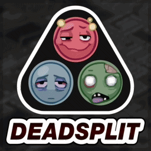{ .mod-icon }

B42SP

[:fontawesome-brands-steam-symbol: Steam Workshop](https://steamcommunity.com/sharedfiles/filedetails/?id=3795485367)

**Recommended Build:** 42.22+

## Overview

*'The Unofficial Project Zomboid Speedrunning Tool'*

DeadSplit is an integrated Speedrun timer and AutoSplitter for Project Zomboid, inspired by LiveSplit and made for the Project Zomboid Speedrunning Community.

*This Mod has been approved by the Project Zomboid Speedrun Moderators for use in submissions to the [Project Zomboid Speedrun Leaderboards](https://www.speedrun.com/Project_Zomboid){target="_blank"}.*

## Gallery

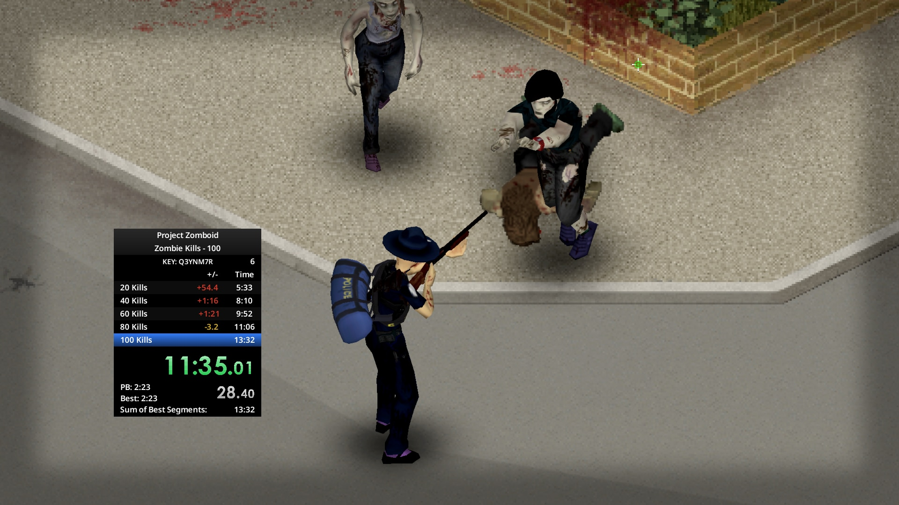 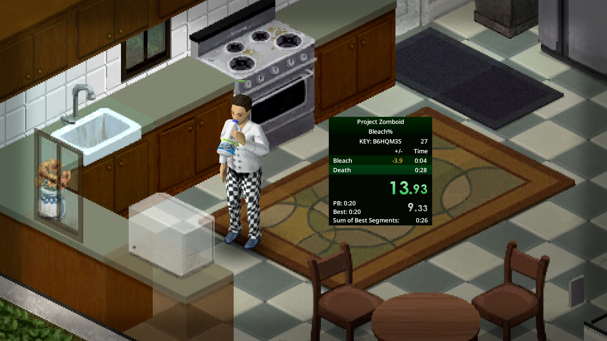 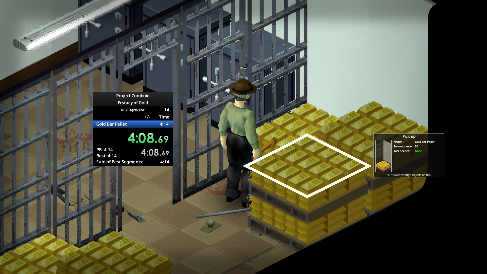 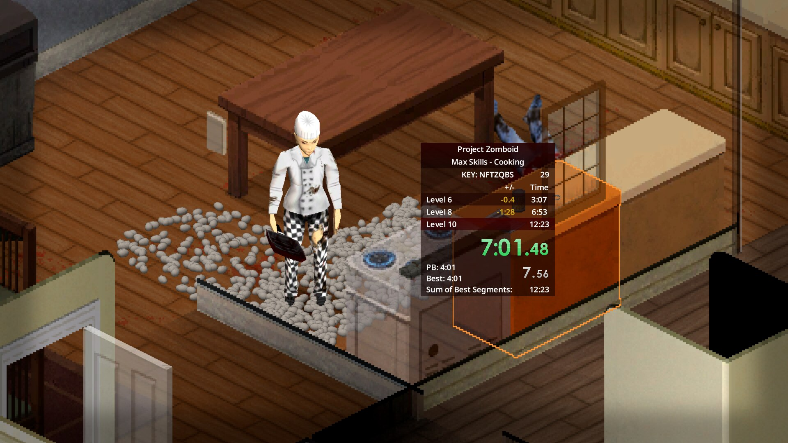 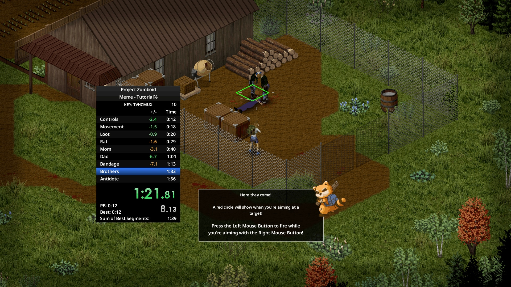 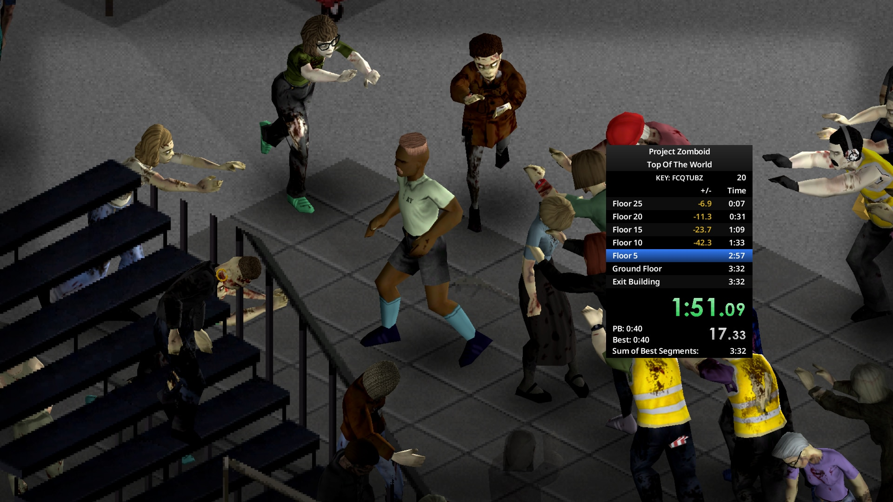 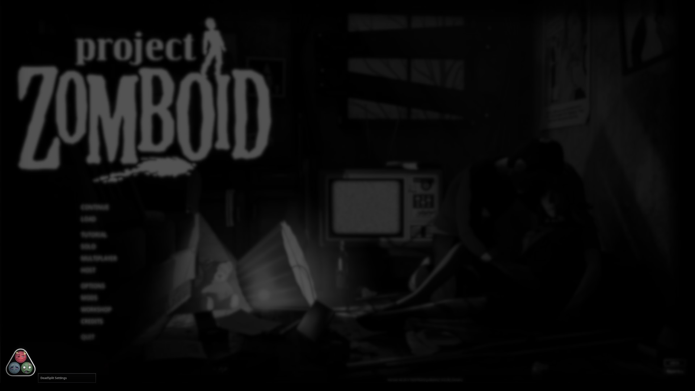 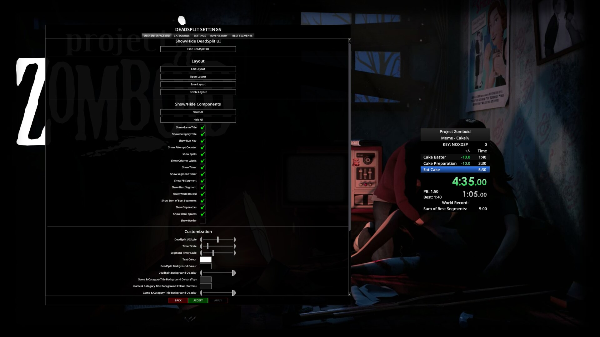 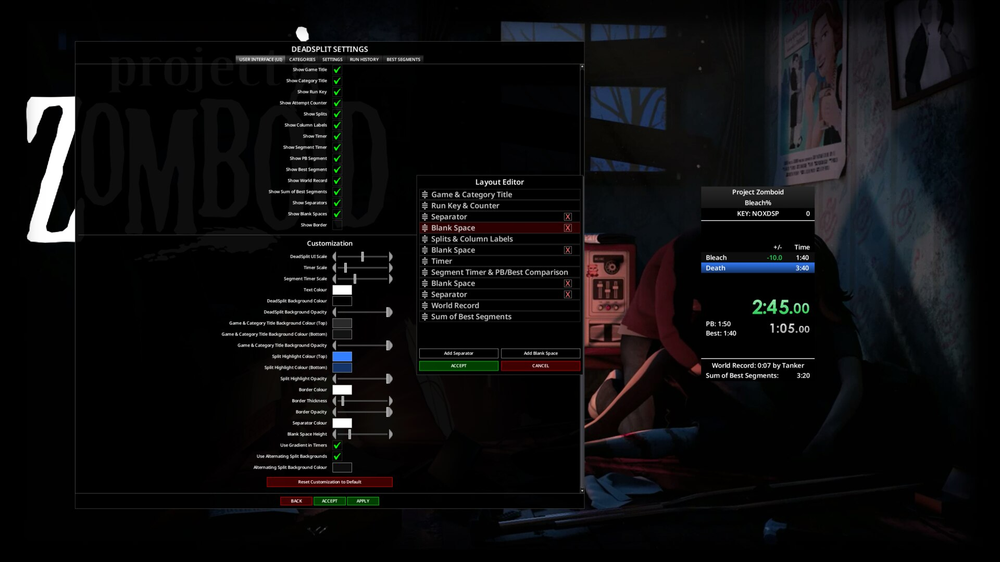 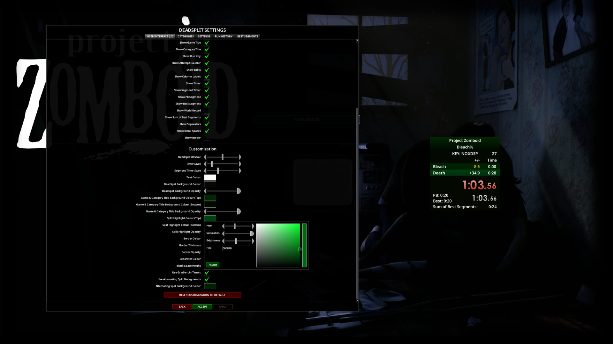 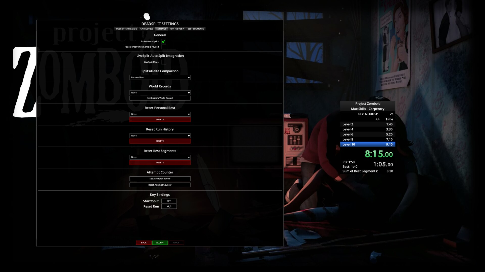 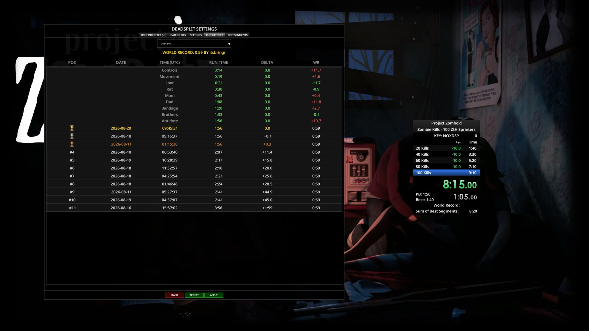 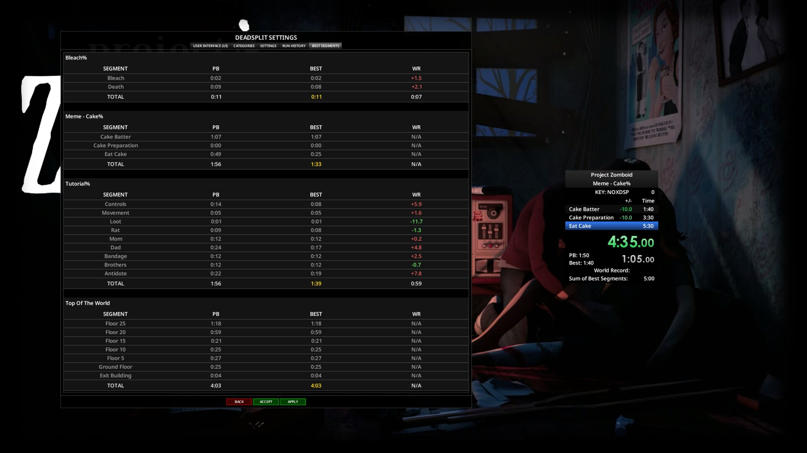

## Features

- A fully customisable Timer UI with a drag-and-drop Layout Editor
- AutoSplitting for every current Build 42 Speedrun Category: Max Skills, Zombie Kills, Bleach%, The Ecstacy of Gold, Assassinations, Cake%, Sledgehammer%, Tutorial% and Top of the World
- Automatic Category detection for Tutorial% and Top of the World
- An Attempt Counter
- World Record, Run History, Personal Best, Best Segment and Sum of Best comparison and tracking
- A Delta display against the chosen comparison
- Run Export and Verification for Speedrun.com submissions
- Custom Speedruns (with manual Splits)
- Start/Split and Reset Keybinds
- Optional LiveSplit Mode, with a `.asl` AutoSplitter for LiveSplit
- Translations for all supported Project Zomboid languages

## Mechanics

Select a Run Category in the DeadSplit Settings window and DeadSplit hooks into the matching game events automatically.

The Timer starts on the first visible frame of the world loading. Game events trigger a Split the moment each target is met. Every Split is compared against a Personal Best, Best Segment or World Record snapshot, which sets the Main Timer's colour and each Split's Delta as the Run progresses.

The Timer stops when:

- the Run is complete (the last Split's target is met)
- the Character dies (a completion condition for Tutorial% and Bleach%; for every other Category the Run ends incomplete)
- the Run is reset by exiting to the Main Menu

### Using DeadSplit

1. Select a Run Category (Max Skills, Zombie Kills, Bleach%, The Ecstacy of Gold, Assassinations, Cake% or Sledgehammer%) in the DeadSplit Settings window and press Apply. For Tutorial% and Top of the World, DeadSplit applies the Category and Splits by itself when the matching Game Mode starts.
2. Start a new World in Apocalypse, Custom Sandbox, Challenge or Tutorial Mode and play the Run as normal.

### Submitting to Speedrun.com

1. Open the Pause Menu and select **Export Speedrun**. DeadSplit packages the Run into a scrambled `run.txt` file, saved to `Zomboid/Lua/DeadSplit/Runs/<Category>/<Sub-Category>/<RunID>/run.txt`.
2. Press **SUBMIT RUN FILE** to open the PZ Speedrun Upload Portal (PZ-SUP) and upload the `run.txt` file.
3. PZ-SUP gives a 7-character **DeadSplit Verification Key**. Include it in the description of the Speedrun.com submission, linking the two.

Speedrun Moderators check the file with a dedicated Verifier Tool before approving the submission.

### LiveSplit Mode

The optional **LiveSplit Mode** writes a small signal file every time DeadSplit's Timer starts, splits or resets. The LiveSplit AutoSplitter script reads that file and mirrors every action in a real LiveSplit window. LiveSplit then serves as the overlay and DeadSplit's own panel hides itself. Instructions for the `.asl` AutoSplitter are on [GitHub](https://github.com/ObnoxiouslyNoxious/ProjectZomboidAutoSplitter){target="_blank"}.

LiveSplit integration is optional. DeadSplit works fully on its own.

## Installation

Subscribe to the Mod on the Steam Workshop and enable it from the 'Choose Mods' screen. DeadSplit is Singleplayer only.

## Configuration

### DeadSplit Settings Window

| Tab | Contents |
|:---|:---|
| User Interface (UI) | Show or hide the DeadSplit UI and each Component, Customisation and a reset to default |
| Categories | The Run Category, Custom Speedruns and the LiveSplit Auto Split Integration |
| Run History | Past Runs |
| Best Segments | Best Segment times |

Right-click the DeadSplit panel for quick options: UI Settings, Show Category Title, Show Attempt Counter, Show Blank Spaces, LiveSplit Mode, the Splits/Delta Comparison plus Set or Reset Attempt Counter.

### Options > Mods > DeadSplit

| Option | Description |
|:---|:---|
| Start/Split | Starts a Run if none is active, otherwise records a Split. On the last Split it also ends the Run |
| Reset | Discards the current Run and sets the Timer back to 0:00.0 |
| DeadSplit UI Scale | The panel's text size (1 Small, 2 Default, 3 Large), independent of the game's Font Size |
| Timer Scale / Segment Timer Scale | Resize the Main and Segment Timer digits |
| Text Colour | The colour of all DeadSplit text |
| Background Colour / Opacity | The panel background (0 = fully transparent) |
| Game & Category Title Background (Top / Bottom / Opacity) | The title block's background gradient |
| Split Highlight Colour (Top / Bottom / Opacity) | The active Split row's highlight gradient |
| Use Alternating Split Backgrounds / Colour | Every other Split row gets a lighter fill |
| Use Gradient in Timers | A LiveSplit-style gradient on the Timer digits |
| Separator Colour / Blank Space Height | For Separators and Blank Spaces added in the Layout Editor |
| Border Colour / Thickness / Opacity | The panel border (with Show UI Border on) |

## Compatibility

| Build | SP | Hosted MP | Dedicated MP |
|:---:|:---:|:---:|:---:|
| 42.22+ | ✅ | ❌ | ❌ |
| 41 | ❌ | ❌ | ❌ |

!!! note "Run Submissions"
    Build 42 Run submissions need the most recent Stable Build. A Build 41.78 Legacy version is in development for Build 41 submissions.

!!! success "Is this Mod safe to add to or remove from existing Saves?"
    Yes, at any time. It does not change any vanilla game files.

!!! success "Does this Mod support 'X' Language?"
    Yes. It has translations for all supported Project Zomboid languages.

## FAQ / Troubleshooting

!!! question "Do Tutorial% and Top of the World need a Category selected?"
    No. DeadSplit applies the Category and Splits by itself when those Game Modes start.

!!! question "Is LiveSplit required?"
    No. LiveSplit Mode is optional. DeadSplit's own Timer and Splits work without it.

!!! question "Where is the exported Run?"
    `Zomboid/Lua/DeadSplit/Runs/<Category>/<Sub-Category>/<RunID>/run.txt`.

## Credits

- The Project Zomboid Speedrun.com Moderator Team, *Jobee, itsbringr and Exzinel*, for approving this Mod for Speedrun.com submissions
- Mod Tester: [itsbringr](https://www.youtube.com/@itsbringr){target="_blank"}
- Translations: Nycotex (Italian)

## Changelog

[:fontawesome-brands-steam-symbol: View Patch Notes](https://steamcommunity.com/sharedfiles/filedetails/changelog/3795485367)
