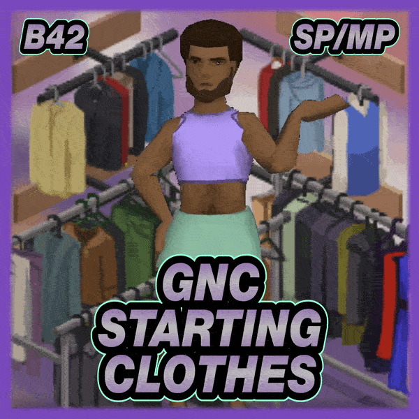
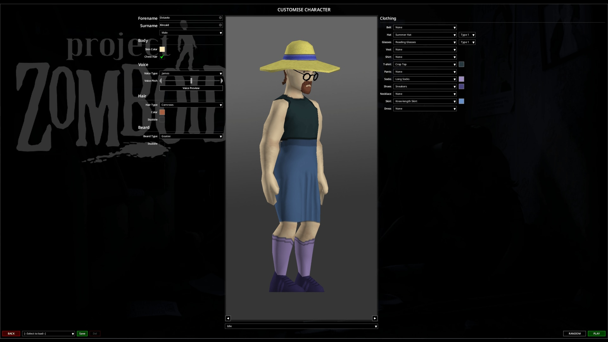

# **GNC Starting Clothes**

<div class="mod-hero" markdown>

{ .mod-icon }

<span class="pz-tag">B42</span><span class="pz-tag">SP/MP</span>

[:fontawesome-brands-steam-symbol: Steam Workshop](https://steamcommunity.com/sharedfiles/filedetails/?id=3822786582)

**Recommended Build:** 42.21+

</div>

## Overview

*'Kill Zombies, not Fashion Options'*

GNC Starting Clothes combines the Male and Female starting Clothing pools in Character Creation. Characters of either Gender can choose from both sets of Default, Profession and Trait Clothing, by hand or with the Random button.

It changes Character Creation only. It adds no Items and does not change Loot Tables or Zombie Outfits.

## Gallery

<div class="gallery-grid" markdown>



</div>

## Features

- **Combined Clothing Pools:** Male and Female options for Default, Profession and Trait Clothing, for every Character
- **Random Clothing:** The Random button picks a Starting Outfit from the combined pools
- **Live Lists:** The Clothing lists refresh whenever Gender, Profession or Traits change
- **Clothing Mod Support:** Clothing from other Mods is included when they add it to the game's Starting Clothing lists
- **Nothing Else Changes:** Gender, Body, Voice, Hair, Beards, Profession and Traits work as normal. The Random button keeps vanilla behaviour for Hair, Beards, Name, Voice and Stubble
- **No Sandbox Option Needed:** Works without **All Clothing Unlocked**

## Mechanics

During Character Creation, the Mod adds the opposite Gender's entries to the current Clothing lists: Default Clothing, the selected Profession and each selected Trait. The lists rebuild whenever Gender, Profession or Traits change. The Random button uses the same combined pools for Clothing only.

The Mod runs on each Player's game. In Multiplayer it still goes on the server's Mod list, which gives every Player a copy. It adds no server gameplay code.

## Installation

**Singleplayer:** Subscribe to the Mod on the Steam Workshop and enable it from the 'Choose Mods' screen.

**Multiplayer (Hosted and Dedicated):** Subscribe to the Mod on the Steam Workshop and add the lines below to the server's `.ini` file.

```ini
Mods=ObNoxGNCStartingClothesB42
WorkshopItems=3822786582
```

## Configuration

GNC Starting Clothes has no settings.

## Compatibility

| Build | SP | Hosted MP | Dedicated MP |
|:---:|:---:|:---:|:---:|
| 42.21+ | ✅ | ✅ | ✅ |
| 41 | ❌ | ❌ | ❌ |

!!! success "Is this Mod safe to add to or remove from existing Saves?"
    Yes. It only affects new Characters. Characters already created keep their Clothing if the Mod is removed.

!!! success "Is this Mod compatible with 'X' Mod?"
    Yes with Clothing Mods that add entries to the game's Starting Clothing lists. Mods that replace the whole Character Creation screen are untested.

!!! success "Does this Mod support 'X' Language?"
    Yes. It has translations for all supported Project Zomboid languages.

## FAQ / Troubleshooting

!!! question "Does Random change the whole Character?"
    No. Only the Starting Clothing pick changes. Hair, Beards, Name, Voice, Stubble and every other Random choice keep vanilla behaviour.

!!! question "Does it change Hair or Beards?"
    No. Gender restrictions for Hair and Beards still apply.

!!! question "Does the Mod need All Clothing Unlocked?"
    No. That Sandbox option is independent and does not need to be on.

## Changelog

[:fontawesome-brands-steam-symbol: View Patch Notes](https://steamcommunity.com/sharedfiles/filedetails/changelog/3822786582)
