# **Mods**

Mod Information including Overview, Features, Mechanics, Settings, Compatibility and Credits. Intended for Players and Server Owners. Mods are grouped by Topology.

## Singleplayer & Multiplayer

-   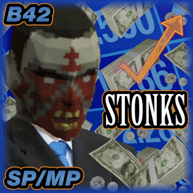{ .card-thumb }
    **[Zombies Have Money](zombies-have-money.md)**
    B42SP/MP

    Adds a configurable chance for Zombies to drop Money & Money Bundles on death, on top of vanilla drop behaviour.

-   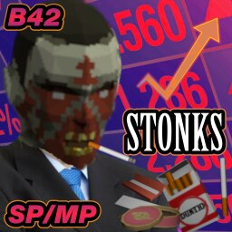{ .card-thumb }
    **[Zombies Have Smokes](zombies-have-smokes.md)**
    B42SP/MP

    Adds a configurable chance for Zombies to drop Cigarettes, Lighters & Tobacco Products on death, on top of vanilla drop behaviour.

-   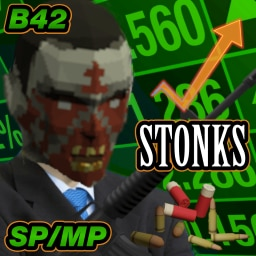{ .card-thumb }
    **[Zombies Have Ammo](zombies-have-ammo.md)**
    B42SP/MP

    Adds a configurable chance for Zombies to drop Ammo & Ammo Boxes on death, on top of vanilla drop behaviour.

-   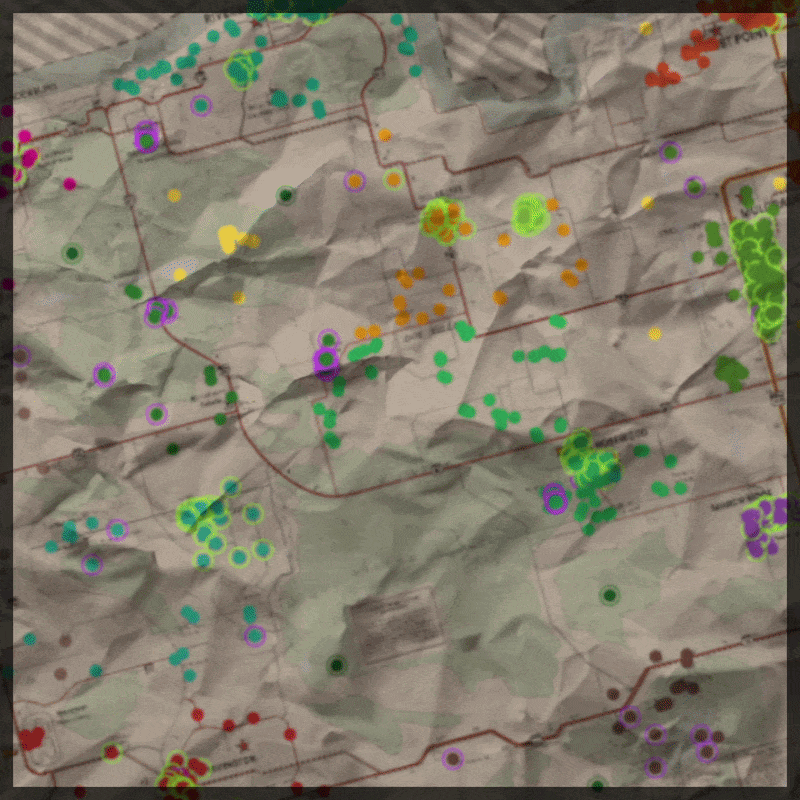{ .card-thumb }
    **[Random Spawn Locations](random-spawn-locations.md)**
    B42SP/MP

    Adds a Random Spawn option to the Select Spawn Location screen. Each new Character spawns at a random location from a pool of 3,500+ verified Spawn Points across Knox Country.

-   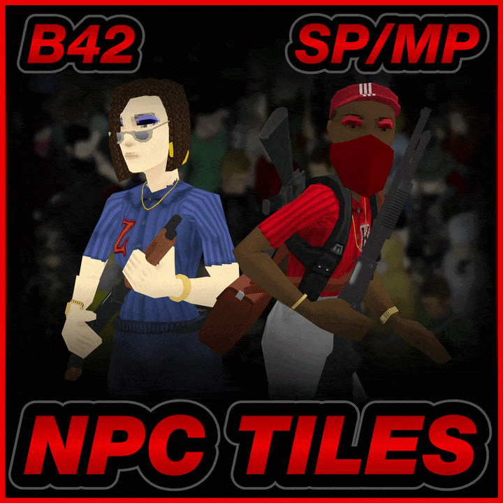{ .card-thumb }
    **[NPC Tiles](npc-tiles.md)**
    B42SP/MP

    532 Human NPC Tiles/Sprites, an 'NPC Tile Placer' script for Singleplayer and Multiplayer Admins and a small Public API for other Mods to place and manage NPC Tiles

-   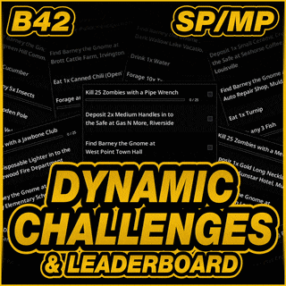{ .card-thumb }
    **[Dynamic Challenges & Leaderboard](daily-challenge-system.md)**
    B42SP/MP

    7 new Challenges every Rotation from over 100,000 definitions. Earn Currency, keep a Streak, spend at the Vendors and climb the Leaderboard. Includes a public API.

-   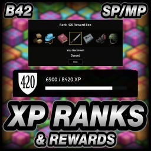{ .card-thumb }
    **[XP Ranks](xp-ranks.md)**
    B42SP/MP

    A Global Rank from 1 to 999 fed by every action in the game, with Reward Boxes, Item Rarity and a 10-category Leaderboard. Includes a public API.

-   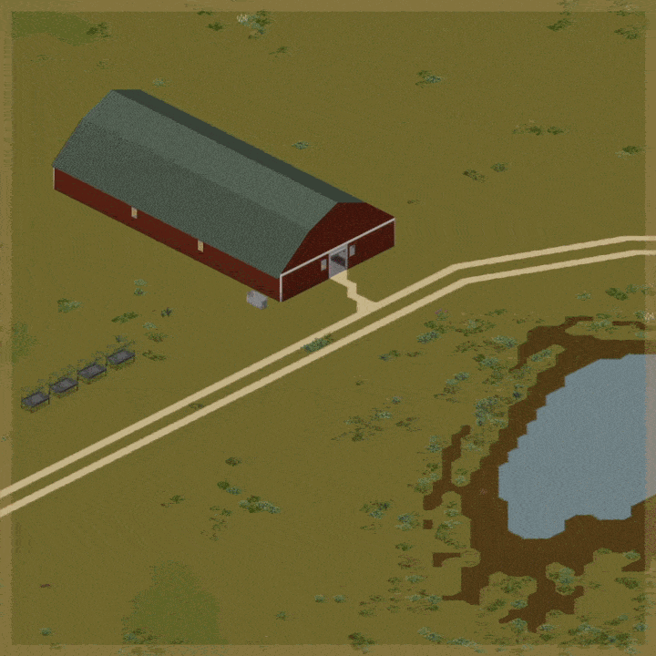{ .card-thumb }
    **[Livestock Traders](livestock-traders.md)**
    B42SP/MP

    Travelling Traders buy and sell nine Animal types from rotating locations or permanent Admin placements. Configure Currency, listing limits, Selling and Rank requirements.

-   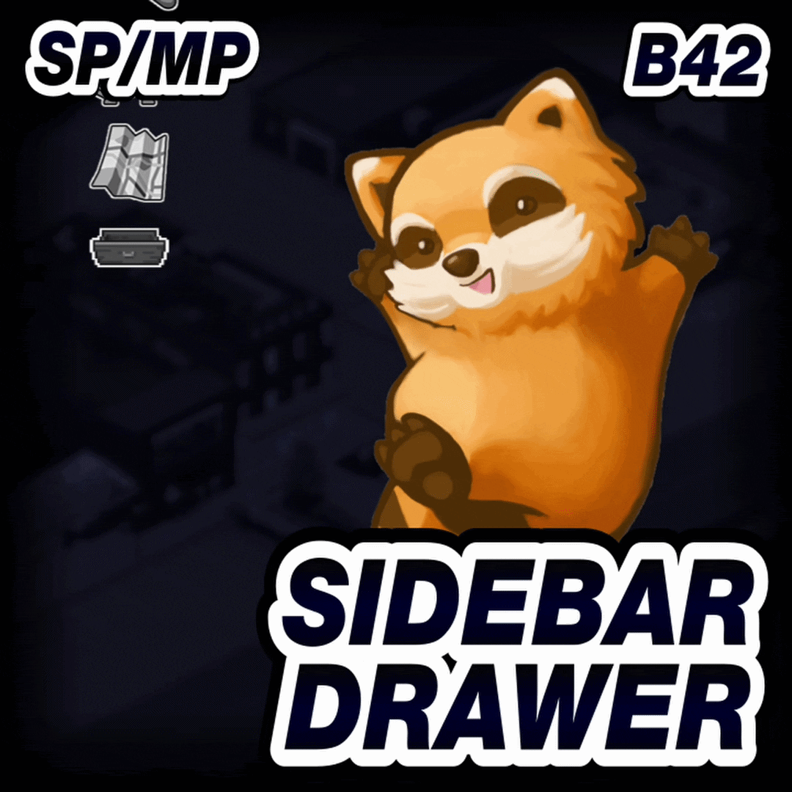{ .card-thumb }
    **[Sidebar Drawer](sidebar-drawer.md)**
    B42SP/MP

    Keep compatible Mod Icons in a Drawer, page through the list and arrange the layout around the vanilla Sidebar.

-   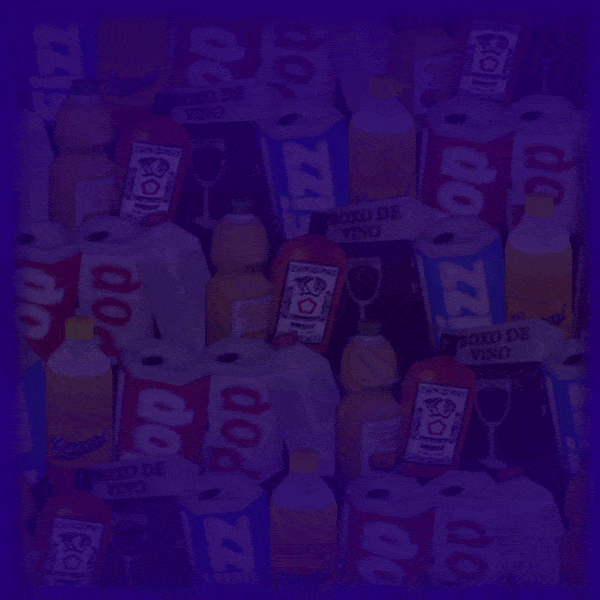{ .card-thumb }
    **[Auto-Drink Expanded](auto-drink-expanded.md)**
    B42SP/MP

    Automatically drink from safe Fluid Categories, including Water, Beverages and mixed Fluids. Set priorities, choose eligible Categories and toggle specific Containers.

-   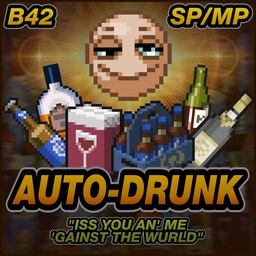{ .card-thumb }
    **[Auto-Drunk](auto-drunk.md)**
    B42SP/MP

    Maintain a target Intoxication level or drink a set Alcohol dose on an interval. Settings control the dose, Alcohol priority and eligible Containers.

-   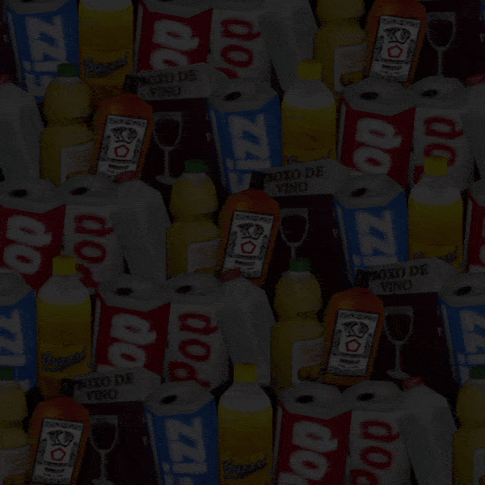{ .card-thumb }
    **[Auto-Drink Revert](auto-drink-revert.md)**
    B42SP/MP

    Restore the pre-42.19 Auto-Drink rule for Mixed Containers where Water is the primary Fluid. Includes Container Priority and per-Container controls.

-   { .card-thumb }
    **[GTA Menu Theme](gta-menu-theme.md)**
    B42SP/MP

    GTA-inspired Menu Music, layered Map Frames, five Button Layouts and an optional Main Menu Logo.

-   { .card-thumb }
    **[RDR Menu Theme](rdr-menu-theme.md)**
    B42SP/MP

    Red Dead Redemption Menu Music, looping Knox Country Videos, four Button Layouts and two Sub-Themes.

-   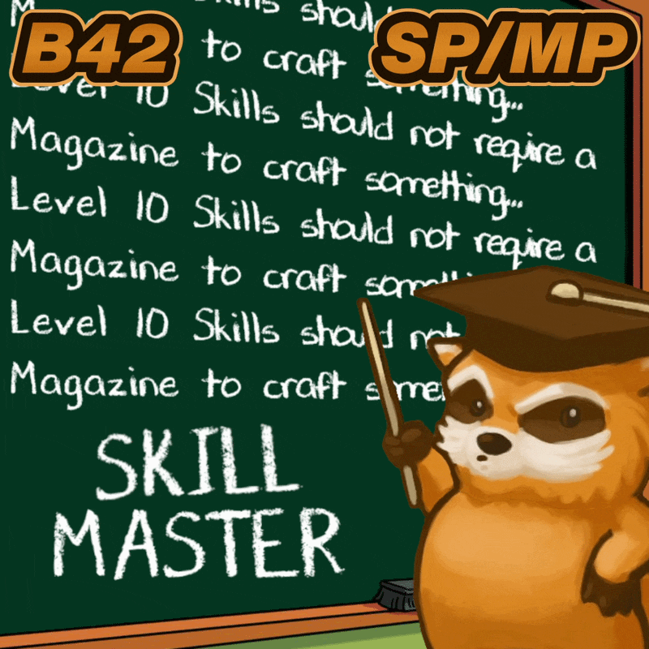{ .card-thumb }
    **[Skill Master](skill-master.md)**
    B42SP/MP

    Unlock magazine and research-gated recipes at Level 10. Gain associated Traits and include eligible recipes from other Mods.

-   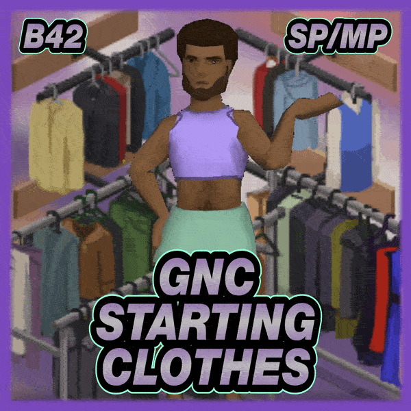{ .card-thumb }
    **[GNC Starting Clothes](gnc-starting-clothes.md)**
    B42SP/MP

    Combine Male and Female Default, Profession and Trait Clothing pools. Choose either set manually or use Random for a mixed Starting Outfit.

-   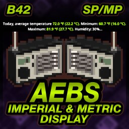{ .card-thumb }
    **[AEBS Imperial & Metric Display](aebs-converter.md)**
    B42SP/MP

    Show Imperial and Metric temperature and wind speed values in AEBS broadcasts. Keep the Server's native units first.

-   { .card-thumb }
    **[Menu Theme Framework](menu-theme-framework.md)**
    B42SP/MP

    A Lua-only Framework that hosts Main Menu Themes: custom Images, Video, Music and Button Layouts, with a Menu Theme Settings window for Players.

## Singleplayer

-   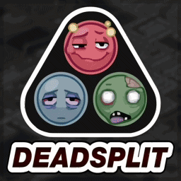{ .card-thumb }
    **[DeadSplit](deadsplit.md)**
    B42SP

    An integrated Speedrun timer and AutoSplitter, approved for Speedrun.com submissions. Every Build 42 Category, Run Export and Verification plus optional LiveSplit integration.

