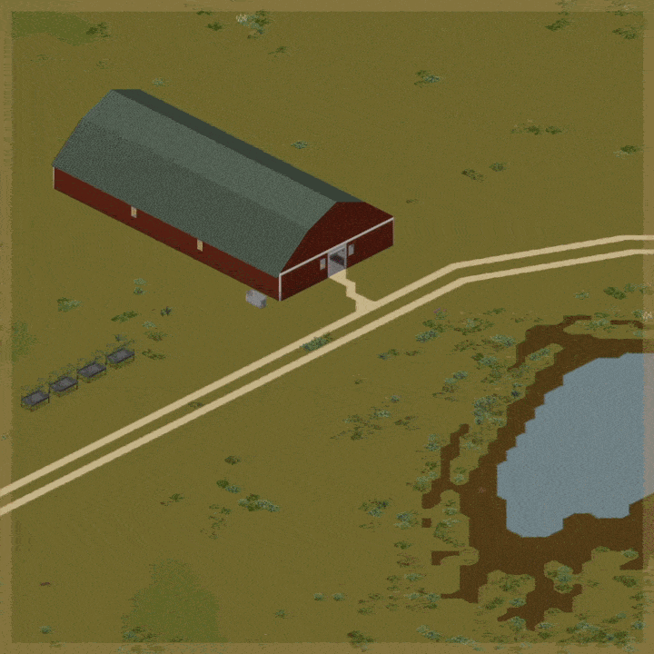
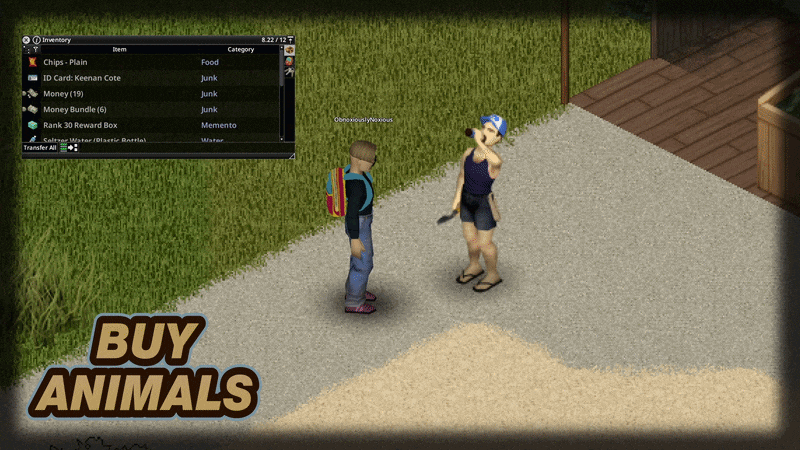
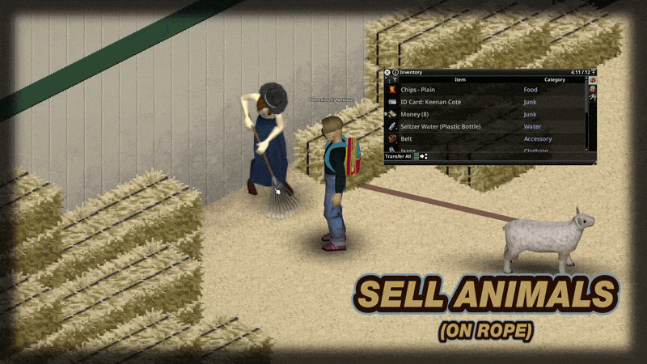
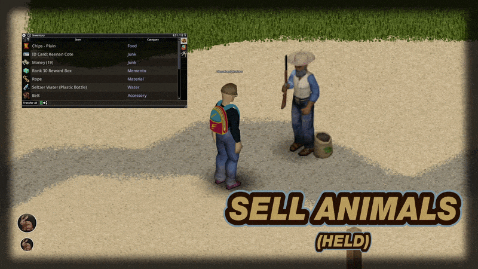
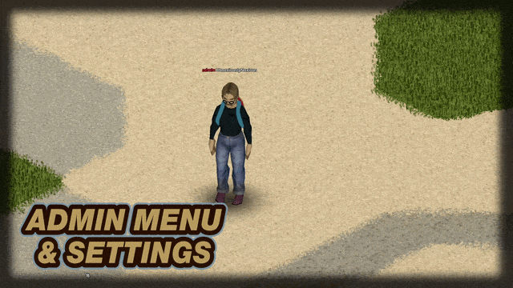
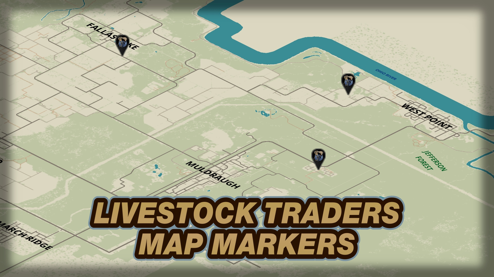
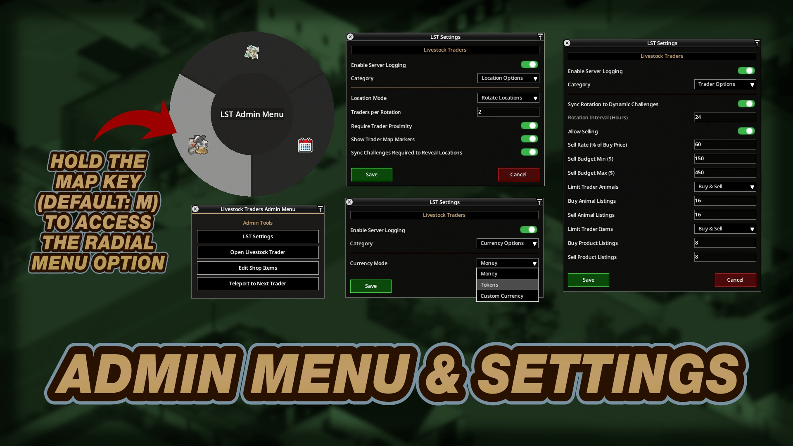

# **Livestock Traders**

<div class="mod-hero" markdown>

{ .mod-icon }

<span class="pz-tag">B42</span><span class="pz-tag">SP/MP</span>

[:fontawesome-brands-steam-symbol: Steam Workshop](https://steamcommunity.com/sharedfiles/filedetails/?id=3820745827)

**Recommended Build:** 42.20+

</div>

## Overview

*'They say you can't buy happiness. They've clearly never met a Livestock Trader'*

Livestock Traders adds travelling Animal Merchants to Knox Country. Players can buy and sell nine Animal types and trade farm Products at Traders who move between curated locations or stay at Admin-placed Static locations.

Suitable for long-term Playthroughs/Servers where Animals are no longer found alive in unexplored Ranch Zones (Animals in Ranch Zones first loaded after Day 60 have a chance of spawning Dead, increasing over time until it reaches 100% at Day 190 for Female/Baby Animals and Day 250 for Male Animals). It also suits Playthroughs/Servers that want to gate Livestock behind a Currency or an XP Rank.

The Mod supports Singleplayer, Hosted Multiplayer and Dedicated servers. [NPC Tiles](npc-tiles.md) is required for the Trader characters and Tile Placement.

## Gallery

<div class="gallery-grid" markdown>
     
</div>

## Features

- **Animal Trading:** Buy and sell Cows, Sheep, Chickens, Pigs, Turkeys, Rabbits, Raccoons, Rats and Mice across every breed and gender. Listings use Baby, Juvenile or Mature life stages. Age affects Buy Prices, with the youngest Mature Animals costing the most. Health and Age affect Sale Payouts
- **Product Trading:** Buy Animal care supplies, Skill Books and VHS tapes. Sell Produce (Eggs, Butter, Milk), Materials (Hides, Feathers, Wool) and Resources (Bones, Dung and Animal Parts)
- **Rotating Traders:** By default, two Traders appear every 24 real-life hours at Midnight UTC, one on the East side of the Map and one on the West. They move among 28 curated locations
- **Static Traders:** Switch to Static Locations and place up to eight permanent Traders through a Tile's Context Menu. Rotating or Static mode supports up to eight Traders
- **Listing Limits:** Limit the Animal and Product listings offered for Buying and Selling each Rotation. The defaults are 16 Animal listings and eight Product listings for each direction. Pinned listings stay available beyond the limit
- **Shop Editor:** Admins can enable or disable listings, change Buy Prices, Stock ranges and Sale Prices, pin Animals or Products and set XP Rank requirements when XP Ranks is installed
- **Currency Options:** Money (`Base.Money` and `Base.MoneyBundle`) is the default. Admins can choose a Custom Currency Item. Tokens appear as an option when Dynamic Challenges is installed
- **Map Markers:** Trader locations appear on the World Map by default. Dynamic Challenges can gate the markers until a Player completes the required number of current Challenges
- **Selling Controls:** Selling is enabled by default in Singleplayer and disabled in Multiplayer. Admins can enable it, set the Sell Rate and configure a per-Player budget for each Rotation
- **Admin Settings:** Open LST Admin Menu from the Radial Menu while holding the Map key (M by default). The Settings Window has Currency Options, Trader Options and Location Options

## Mechanics

Trader Locations and Stock use a shared Server seed. Every Player sees the same offers and each Animal Stock unit can be purchased once.

Each Animal listing receives an exact Age within its life stage when a Rotation is generated. Baby listings are litters that share one Age and Gender. Adult Animal Types carry their Gender. Baby Types are shared by both Genders. The Mod assigns the listing's Gender before the Animal enters the World. Genetics are rolled at random, using the same approach as Animals spawned in Ranch Zones.

The Trader delivers a purchased Animal to the nearest free Tile in a 7 by 5 Livestock Zone in front of the Trader. The Purchase is refused if no Tile is free. Animal Purchases are also refused while a Zombie is within 15 Tiles of the Trader.

The Server verifies the Listing and Stock unit exist, that the unit is unsold and that its Animal Age is in range. It checks the Player's distance to the Trader and calculates the Price. Currency is removed before an Animal spawns, then refunded if spawning fails. XP Rank requirements for Buying and Selling are checked on the Server.

For a Sale, the Server accepts a living Animal held by the Player or led on a Rope within 3 Tiles of the Trader. The Animal must be on the Trader's list. The Server validates the Player's remaining Rotation Budget, removes the Animal and then pays the Player. Sale Payouts account for Animal Age and Health. Dying Animals receive a reduced payout.

The Shop Editor saves listing changes for all Traders. Admin-only settings and Shop Editor actions are validated on the Server. Trader commands are rate-limited per Player.

## Installation

Subscribe to Livestock Traders and the required [NPC Tiles](npc-tiles.md) Mod.

**Singleplayer:** Enable both Mods from the Choose Mods screen.

**Multiplayer (Hosted and Dedicated):** Subscribe to both Mods and add Livestock Traders to the server's `.ini` file.

```ini
Mods=ObNoxLivestockTradersB42
WorkshopItems=3820745827
```

## Configuration

In Singleplayer or Multiplayer, hold the Map key and choose **LST Admin Menu** from the Radial Menu. In Multiplayer, Admin access is required. Choose a Settings category and press Save to apply the changes.

The logging toggle appears above the category selector.

### Admin Logging

| Setting | Default | Range / Options | Description |
|:---|:---:|:---|:---|
| Enable Log Output (Singleplayer) / Enable Server Logging (Multiplayer) | Off | On or Off | Writes an audit line for each Purchase, Sale, Rotation and Settings change. Multiplayer lines appear in the Server log |

### Currency Options

| Setting | Default | Range / Options | Description |
|:---|:---:|:---|:---|
| Currency Mode | Money | Money, Tokens with Dynamic Challenges or Custom Currency | Currency accepted for Purchases and paid for Sales |
| Custom Currency ID | Empty | Up to 128 characters | Item ID used when Custom Currency is selected, for example `Base.Money` |
| Custom Currency Name (Plural) | Custom Currency | Up to 128 characters | Display name for the Custom Currency |
| Dollars per Custom Currency | 1 | 1 to 100,000 | Dollar value assigned to each Custom Currency Item |

### Trader Options

| Setting | Default | Range / Options | Description |
|:---|:---:|:---|:---|
| Sync Rotation to Dynamic Challenges | Off | On or Off, with Dynamic Challenges | Uses the Rotation Interval configured in Dynamic Challenges |
| Rotation Interval (Hours) | 24 | 1 to 672 hours | Time between Trader Rotations |
| Allow Selling | On in Singleplayer, Off in Multiplayer | On or Off | Shows or hides the Sell tab and its settings |
| Sell Rate (% of Buy Price) | 60% | 1% to 100% | Maximum Sale Price for an Animal as a share of its Buy Price |
| Sell Budget Min | 15 | 1 to 100,000 | Minimum amount the Trader can pay each Player during a Rotation in the selected Currency |
| Sell Budget Max | 45 | 1 to 100,000 | Maximum amount the Trader can pay each Player during a Rotation in the selected Currency |
| Limit Trader Animals | Buy & Sell | Off, Buy, Sell or Buy & Sell | Limits Animal listings by direction. Pinned Animals remain available beyond the limit |
| Buy Animal Listings | 16 | 8 to 64, in steps of 8 | Maximum Animal Type listings offered for Buying each Rotation |
| Sell Animal Listings | 16 | 8 to 64, in steps of 8 | Maximum Animal Type listings offered for Selling each Rotation |
| Limit Trader Items | Buy & Sell | Off, Buy, Sell or Buy & Sell | Limits Product listings by direction. Pinned Products remain available beyond the limit |
| Buy Product Listings | 8 | 1 to 500 | Maximum Product listings offered for Buying each Rotation |
| Sell Product Listings | 8 | 1 to 500 | Maximum Product listings offered for Selling each Rotation |

The Sync Rotation setting appears only when Dynamic Challenges is available. Selling options appear when Allow Selling is enabled. The Animal and Product limits can be set separately for Buying and Selling.

### Location Options

| Setting | Default | Range / Options | Description |
|:---|:---:|:---|:---|
| Location Mode | Rotate Locations | Rotate Locations or Static Locations | Rotating locations move Traders each Rotation. Static Locations allow Admins to place Traders through the Context Menu |
| Traders per Rotation | 2 | 0 to 8 | Number of rotating Traders. Available in Rotate Locations mode |
| Require Trader Proximity | On | On or Off | Requires Players to stand near a Trader for a Transaction |
| Show Trader Map Markers | On | On or Off | Shows Trader locations on the World Map |
| Sync Challenges Required to Reveal Locations | Off | On or Off, with Dynamic Challenges | Keeps Trader Map Markers hidden until the Player reaches Dynamic Challenges' current reveal requirement |

Static location changes take effect at the next Rotation or Server Restart. Up to eight Static Traders can be placed.

### Admin Tools

Hold the Map key and choose **LST Admin Menu** from the Radial Menu (Admin access is needed in Multiplayer).

| Tool | What It Does |
|:---|:---|
| LST Settings | Opens the Settings Window with the Currency, Trader and Location Options above |
| Open Livestock Trader | Opens the Trader's shop from anywhere, for checking listings and prices |
| Edit Shop Items | Opens the Livestock Trader Editor. Its four tabs (Buy Animals, Buy Products, Sell Animals, Sell Products) enable or disable listings, set prices, stock ranges, sell prices, batch sizes and XP Rank requirements, plus pinning listings so they are always offered |
| Add / Remove Static Livestock Trader | In Static Locations mode, right-click a Tile to place a Trader facing a chosen direction (up to 8), or right-click a Static Trader to remove it |

### Player Options

In **Options > Mods > Livestock Traders**:

| Option | Default | Description |
|:---|:---:|:---|
| Hide Notifications | Off | Hides Livestock Traders Toast Notifications, including transaction results and Shop Editor saves |

## Works With

| Mod | What It Adds |
|:---|:---|
| [NPC Tiles](npc-tiles.md) (required) | Provides the Trader characters and Tile Placement |
| [Dynamic Challenges & Leaderboard](daily-challenge-system.md) (optional) | Adds Tokens as a Currency option, synchronises Trader Rotations and gates Trader Map Markers by Challenge completion |
| [XP Ranks](xp-ranks.md) (optional) | Adds minimum Rank requirements for Buying or Selling each listing in the Shop Editor |

## Compatibility

| Build | SP | Hosted MP | Dedicated MP |
|:---:|:---:|:---:|:---:|
| 42.20+ | ✅ | ✅ | ✅ |
| 41 | ❌ | ❌ | ❌ |

!!! success "Is this Mod safe to add to or remove from existing Saves?"
    Yes.

!!! success "Is this Mod compatible with 'X' Mod?"
    NPC Tiles is required. Dynamic Challenges and XP Ranks provide optional integrations when installed.

!!! success "Does this Mod support 'X' Language?"
    Yes. It includes Translations for all supported Project Zomboid languages and supports every Font Size setting.

## FAQ / Troubleshooting

!!! question "Why is the Sell tab missing?"
    Selling is disabled by default in Multiplayer. An Admin can enable **Allow Selling** in LST Settings.

!!! question "Why are Tokens missing from Currency Mode?"
    Tokens appear when Dynamic Challenges is installed and available to Livestock Traders.

!!! question "Why was an Animal Purchase refused?"
    The Player must be near the Trader. A Zombie within 15 Tiles or a full Livestock Zone also prevents an Animal Purchase.

!!! question "Can Traders stay in one place?"
    Yes. Change **Location Mode** to **Static Locations** then place up to eight Traders through a Tile's Context Menu.

!!! question "Why can Livestock Traders help in a long-running Save?"
    Animals in Ranch Zones first loaded after Day 60 can spawn Dead. The chance reaches 100% by Day 190 for Female and Baby Animals. For Male Animals, it reaches 100% by Day 250. Traders provide another way to obtain Livestock in those Saves.

## Changelog

[:fontawesome-brands-steam-symbol: View Patch Notes](https://steamcommunity.com/sharedfiles/filedetails/changelog/3820745827)
