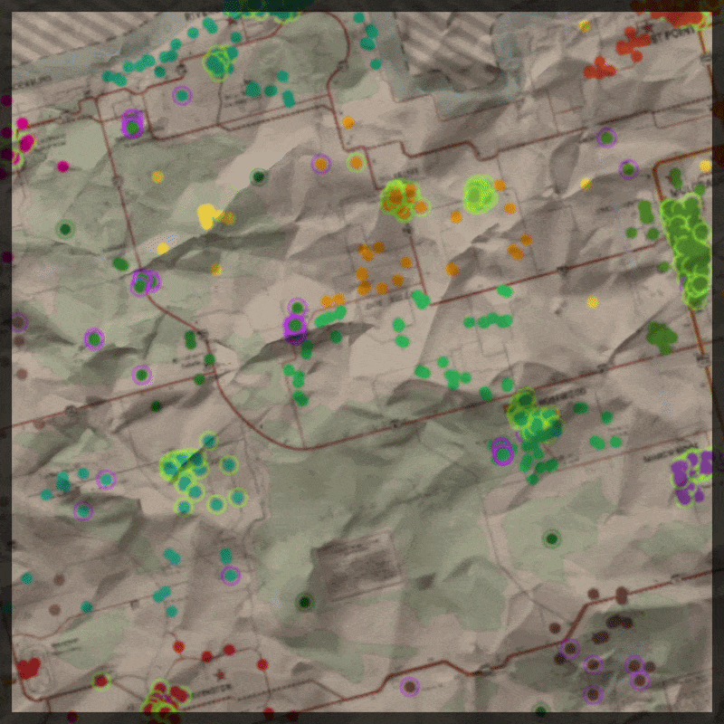
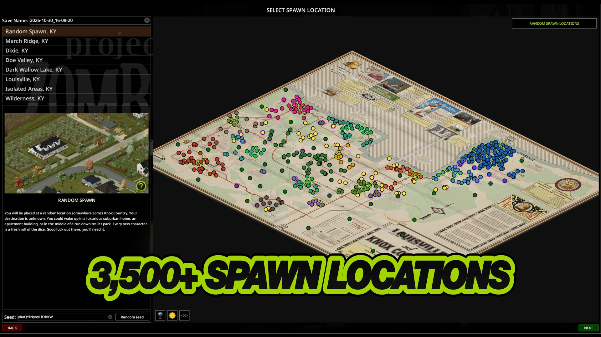
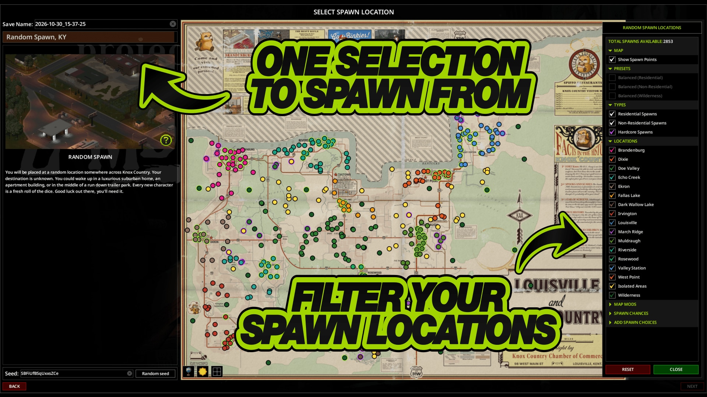
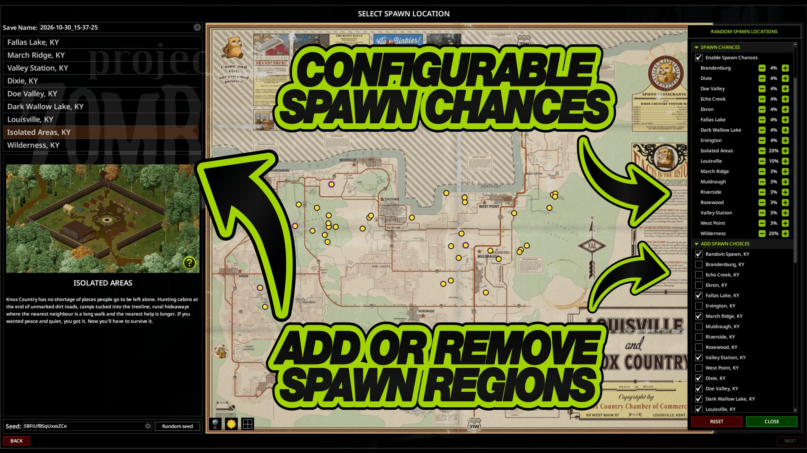
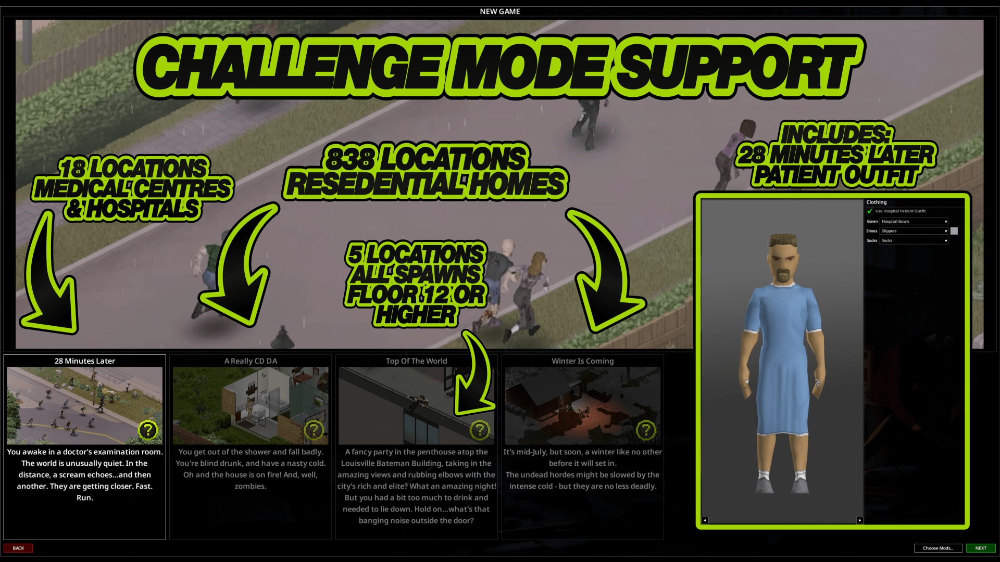
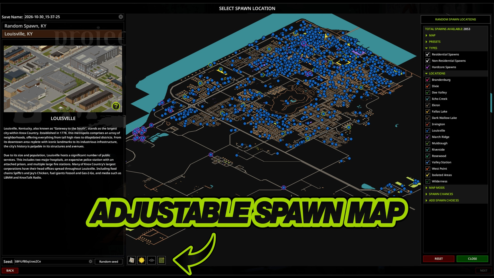
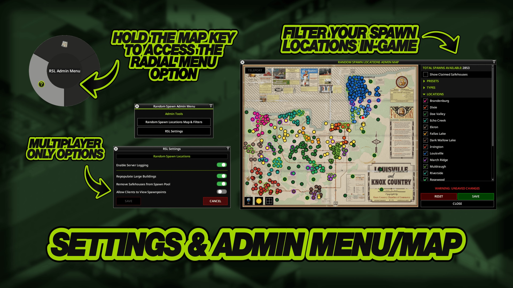
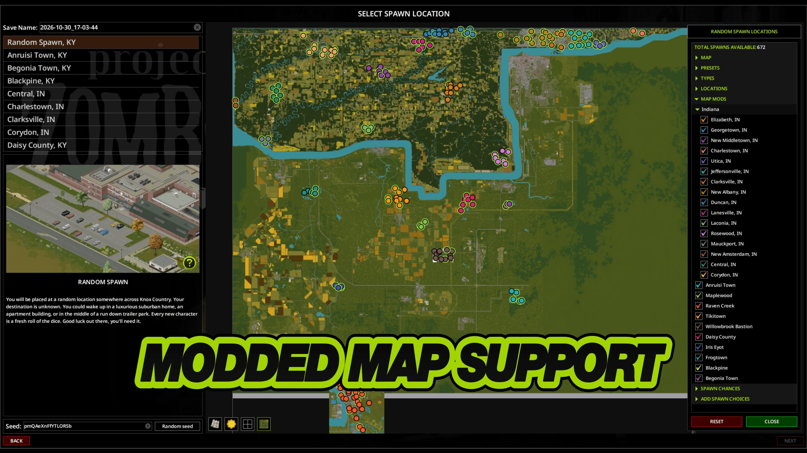
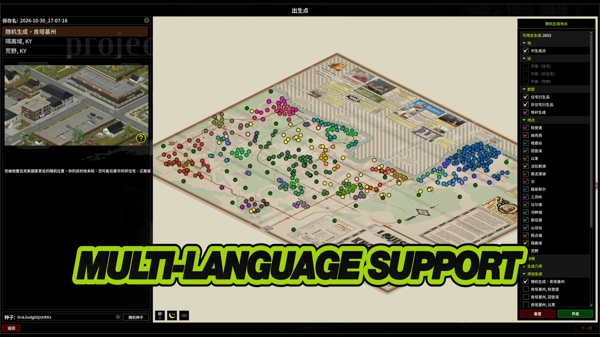

# **Random Spawn Locations**

<div class="mod-hero" markdown>

{ .mod-icon }

<span class="pz-tag">B42</span><span class="pz-tag">SP/MP</span>

[:fontawesome-brands-steam-symbol: Steam Workshop](https://steamcommunity.com/sharedfiles/filedetails/?id=3730705272)

**Recommended Build:** 42.19+

</div>

## Overview

*'They say that variety is the spice of life. But in Knox Country, it's also the spice of death'*

Adds a **Random Spawn** option to the 'Select Spawn Location' screen. Each new Character spawns at a randomly selected location drawn from a curated pool of **3,525 verified Spawn Points** across Knox Country, supported Map Mods and the Project Indiana towns. No two Characters are guaranteed to start in the same place.

Singleplayer Players filter their own Spawn Pool with the Random Spawn Locations panel on the 'Select Spawn Location' screen. The Random Spawn Admin Menu lets Singleplayer Players and Multiplayer Admins configure the World's Spawn Pool, including live changes on a running server.

## Resources

[**Random Spawn Locations Interactive Map**](https://obnox.dev/RSLMapProject/)

[**Random Spawn Locations Index/Spreadsheet**](https://obnox.dev/RSLSheet/)

## Gallery

<div class="gallery-grid" markdown>
       
</div>

## Features

**'Select Spawn Location' Screen**

- Random Spawn Locations panel: Choose Presets, Types, Locations and Map Mods for the Spawn Pool, outside the Custom Sandbox Game Mode
- Add or remove individual Spawn Regions (for example Echo Creek, KY) next to Random Spawn, with descriptions and preview images for all Vanilla Locations, Isolated Areas and Wilderness
- Spawn Chances: Set the chance of spawning in each Location of the selection
- Map Dots overlay: Shows every Spawn Point in the selection, coloured by Location. Hardcore Spawn Points have a purple ring and Balanced Spawn Points a lime-green ring
- Paper Map / World Map, Dark/Light Mode and Isometric/Top Down toggles
- Selectable Spawn Regions for all supported Map Mods and all 16 Project Indiana towns

**Admin Menu (Singleplayer and Multiplayer)**

- Hold **M** (or the rebound Map key) and choose **RSL Admin Menu** to open RSL Settings and Map & Filters
- Changes an Admin applies on a server reach Clients without a reconnect
- Admin Map with a TELEPORT button: Right-click a Location to drop a pin, then teleport to it

**Spawn Handling**

- Players spawn directly on their Spawn Point
- Zombies are cleared in a 21x21 area around the Spawn Point
- The doors of the spawn room are unlocked and its working lights turned on (if the power is still on)
- A house alarm does not go off when a Player spawns in an alarmed building
- Optional repopulation of Large Buildings once the Player spawns
- Safehouses that contain a Spawn Point can be claimed. Spawn Points inside a claimed Safehouse leave the pool until the claim ends
- Optional Server Logging of every spawn
- Challenge Mode support: 28 Minutes Later, A Really CD DA, Top of the World and Winter Is Coming
- UI and Sandbox translations for all supported Project Zomboid languages

## Mechanics

When a Player creates a new Character, the 'Select Spawn Location' screen shows the **Random Spawn** row, plus any extra Spawn Regions the Singleplayer Player or the server Admin has ticked. Picking Random Spawn places the Player at one Spawn Point drawn at random from the active pool. All professions draw from the same pool.

The game's own spawn system places the Player and removes nearby Zombies according to the Sandbox Setting *Player Spawn Area*. The Mod then clears Zombies in a 21x21 area around the Spawn Point, unlocks the doors of the spawn room, turns on its working lights and stops a house alarm from going off.

**Singleplayer:** the Player sets the pool on the 'Select Spawn Location' screen with the Random Spawn Locations panel. At least one Preset or Type must be selected before Next is enabled. The Random Spawn Admin Menu changes the pool for the current World.

**Multiplayer:** the Admin sets the pool in the Random Spawn Admin Menu and presses **Apply**. The pool lives on the server, which validates every request. The full Spawn Point list is never sent to Clients unless the Admin enables **Allow Clients to View Spawnpoints**, which sends the points needed to draw the Map Dots on the 'Select Spawn Location' screen.

## Installation

**Singleplayer:** Subscribe to the Mod on the Steam Workshop and enable it from the 'Choose Mods' screen.

**Multiplayer:**

=== "Step 1, Subscribe"

    Subscribe to **[B42] Random Spawn Locations [MP]** on the Steam Workshop. If the server also runs a supported Map Mod, subscribe to that too.

    Every supported Map Mod, with its Workshop ID and Mod ID, is listed under [Supported Map Mods](#supported-map-mods).

    Every connecting Client must be subscribed to the same Map Mods as the server.

=== "Step 2, Server .ini"

    Edit the server's `.ini` file:

    !!! note "Location"

        ```text
        Windows: C:\Users\<YourName>\Zomboid\Server\<ServerName>.ini
        Linux:   /home/<user>/Zomboid/Server/<ServerName>.ini
        ```

    !!! note "[ServerName].ini"

        ```ini
        Mods=RandomSpawnLocations
        WorkshopItems=3730705272
        Map=Muldraugh, KY
        SpawnPoint=0,0,0
        ```

    `Random Spawn, KY` does **not** need to be on the `Map=` line. With Map Mods, `RandomSpawnLocations` must be first in `Mods=`. Each Map Mod's own map names go **before** `Muldraugh, KY`, which stays last:

    !!! note "Example"

        ```ini
        Mods=RandomSpawnLocations;RavenCreekB42;AnruisiTown;Maplewood
        Map=RavenCreekB42;AnruisiTown;Maplewood;Muldraugh, KY
        ```

    !!! tip
        An older version of this page said to add `Random Spawn, KY` to `Map=`. It can be removed. Leaving it does no harm, but removing the Mod later while it is still on the `Map=` line logs one error.

    !!! warning
        The Server Settings UI may overwrite the `.ini` when changes are saved in game. Keep a backup copy of the edited `.ini` elsewhere.

=== "Step 3, Start the Server"

    !!! note "Start the Server"

        Start the server, then set the filters in the Random Spawn Admin Menu (hold **M**, then **Map & Filters** and **Settings**). Players now see **Random Spawn** on the 'Select Spawn Location' screen, plus any Spawn Regions the Admin offers.

## Configuration

Open the Random Spawn Admin Menu by holding **M** (or the rebound Map key) and choosing **RSL Admin Menu**. It has two parts, **Settings** and **Map & Filters**. In Multiplayer only Admins can open it. **Apply** sends the change to the server. In the Settings window, **Save** is enabled once something has changed and **Cancel** discards the changes.

### Settings

| Setting | Default | Description |
|:---|:---:|:---|
| Server Logging | `Off` | Writes a `[RSL][LOG]` line for each spawn: Player, coordinates, Location ID, Building size and whether the Building was repopulated. In Multiplayer it also logs when a Safehouse is claimed and which Spawn Points left the pool. See [Server Logging](#server-logging). |
| Repopulate Large Buildings | `On` | The game removes Zombies around a Spawn Point according to the Sandbox Setting *Player Spawn Area*, which can empty a whole Building. When On, Large Buildings (16+ rooms, 800+ tiles reachable from the Spawn Point, or 6+ floors) repopulate with Zombies once the Player spawns, while the rooms around the Player (up to two nearby floors) stay empty. When Off, the game's own setting applies and Zombies are not repopulated. |
| Allow Clients to View Spawnpoints | `Off` | Multiplayer only. Lets connecting Players see the Spawn Point dots on the 'Select Spawn Location' screen, including Players who join after an Admin changed it. |
| Remove Safehouses from Spawn Pool | `On` | Multiplayer only. Spawn Points inside a claimed Safehouse are removed from the pool and added back when the claim ends. See [Safehouses](#safehouses). |

### Map & Filters

| Section | What It Does |
|:---|:---|
| Presets | Balanced (Residential), Balanced (Non-Residential) and Balanced (Wilderness). See [Presets](#presets) |
| Types | Residential, Non-Residential, Hardcore, Isolated Areas and Wilderness. See [Types](#types) |
| Locations | Toggle individual Vanilla towns: Brandenburg, Dixie, Doe Valley, Echo Creek, Ekron, Fallas Lake, Dark Wallow Lake, Irvington, Louisville, March Ridge, Muldraugh, Riverside, Rosewood, Valley Station and West Point. Dixie, Doe Valley and Dark Wallow Lake are off by default |
| Map Mods | Toggle supported Map Mods. Only maps active on the server can be used. The others are greyed out with the reason |
| Spawn Regions | Extra rows on the 'Select Spawn Location' screen: Vanilla towns, Isolated Areas, Wilderness, Map Mod towns and the Project Indiana towns. Players who pick one spawn at a random Spawn Point inside it |
| Spawn Chances | Optional percentage per Location for how often Players spawn there (1% per click, hold to repeat). With it off, Locations with more Spawn Points are picked more often |
| Show Map Dots | Draws the Spawn Points of the selection on the map |
| Show Claimed Safehouses | Multiplayer Admin Map only: shows only the Spawn Points currently removed by a Safehouse claim |

Combinations that cannot work are greyed out with a tooltip explaining why. For example, Balanced (Residential) and Balanced (Non-Residential) cannot be combined with Isolated Areas or Wilderness. Selecting nothing does not fall back to a Balanced pool: pick at least one Preset or Type.

### Presets

Balanced Presets use hand-picked, verified Spawn Points with an equal number (12) per Location for an even spread across the map, instead of letting large Locations such as Louisville dominate. Only Balanced (Residential) is on by default (recommended for Multiplayer).

- **Balanced (Residential):** 12 Spawn Points in each of 12 towns (every town except Dixie, Doe Valley and Dark Wallow Lake)
- **Balanced (Non-Residential):** 12 Spawn Points in each of the same 12 towns
- **Balanced (Wilderness):** A smaller hand-picked set of Wilderness Spawn Points

Untick a town in Locations to remove it from the Balanced Presets. Selected Map Mods are added on top.

### Types

All Types are off by default.

- **Residential:** Houses, apartments, trailers and farmhouses
- **Non-Residential:** Businesses, warehouses, offices and civic buildings
- **Hardcore:** Dangerous locations such as police stations, jails and military zones
- **Isolated Areas:** Remote Spawn Points such as cabins, camps and rural hideaways
- **Wilderness:** Spawn Points in the middle of the woods, at least 200 tiles from any road or structure

### Safehouses

When **Remove Safehouses from Spawn Pool** is On, Players can claim a Safehouse that contains a Spawn Point. Spawn Points inside it leave the Spawn Pool for as long as the claim lasts. Spawning or respawning inside a claimed Safehouse does not unlock its doors or turn its lights on. The Claim button shows the real vanilla reason when a claim is not allowed (for example the Player already owns a Safehouse, has not survived long enough, or the building is not residential). Claims expire according to the server's `SafeHouseRemovalTime`. The Admin Map shows the removed Spawn Points with a house icon and a red ring.

### Server Logging

With **Server Logging** On, the log (`console.txt` or the server log) contains lines like:

```text
[RSL][LOG][SPAWN] <Player> spawned at (11870, 6916, 0) (Location ID: 3104) // Building Size: Large // Building Repopulated: True
[RSL][LOG][SPAWN] Options: Presets: None // Types: Residential, NonResidential // Locations: All // Map Mods: None // Regions: Louisville, KY // Settings: ServerLogging
```

The Location ID is the Spawn Point's ID in the [Random Spawn Locations Interactive Map](https://obnox.dev/RSLMapProject/) and the [Index/Spreadsheet](https://obnox.dev/RSLSheet/). In Multiplayer, the **Options** line is logged when an Admin applies a change instead of with each spawn.

### Supported Map Mods

| Map Mod | Workshop ID | Mod ID |
|:---|:---:|:---|
| [Maplewood [B42]](https://steamcommunity.com/sharedfiles/filedetails/?id=3644794945){target="_blank"} | `3644794945` | `Maplewood` |
| [Raven Creek B42](https://steamcommunity.com/sharedfiles/filedetails/?id=3484263516){target="_blank"} | `3484263516` | `RavenCreekB42` |
| [AnruisiTown (Military Bastion)](https://steamcommunity.com/sharedfiles/filedetails/?id=3659676359){target="_blank"} | `3659676359` | `AnruisiTown` |
| [Tikitown & Powerplant](https://steamcommunity.com/sharedfiles/filedetails/?id=3037854728){target="_blank"} | `3037854728` | `tikitown` |
| [Willowbrook Bastion!](https://steamcommunity.com/sharedfiles/filedetails/?id=3479667649){target="_blank"} | `3479667649` | `Willowbrook Bastion!` (or its `2` / `MO` versions) |
| [Daisy County B42 version](https://steamcommunity.com/sharedfiles/filedetails/?id=3390753141){target="_blank"} | `3390753141` | `Daisy County B42 version` |
| [Iris Eyot [B42]](https://steamcommunity.com/sharedfiles/filedetails/?id=3545473388){target="_blank"} | `3545473388` | `IrisEyot` |
| [Frogtown by TwinCrows](https://steamcommunity.com/sharedfiles/filedetails/?id=3449473111){target="_blank"} | `3449473111` | `Frogtown` |
| [Blackpine County B42 Stable](https://steamcommunity.com/sharedfiles/filedetails/?id=3565649631){target="_blank"} | `3565649631` | `BlackpineCounty` |
| [Begonia Town](https://steamcommunity.com/sharedfiles/filedetails/?id=3736155379){target="_blank"} | `3736155379` | `Begonia_Town` |
| [Project Indiana Expansion B42 DEMO](https://steamcommunity.com/sharedfiles/filedetails/?id=3507117617){target="_blank"} | `3507117617` | `PIE42` |

Project Indiana adds 16 towns, each a separate Spawn Region: Elizabeth, Georgetown, New Middletown, Charlestown, Utica, Jeffersonville, Clarksville, New Albany, Duncan, Lanesville, Laconia, Rosewood, Mauckport, New Amsterdam, Central and Corydon (all IN).

The [Supported Map Mods Collection](https://steamcommunity.com/sharedfiles/filedetails/?id=3830890031){target="_blank"} holds every Map Mod above. Every Map Mod is **off by default**. Clients must be subscribed to the same Map Mods as the server. Map Mods are not available in Challenge Modes for now.

!!! tip
    Consider letting Players spawn with a flashlight, especially with Non-Residential, Hardcore or Isolated Areas spawns enabled.

### Challenge Modes

Random Spawn Locations supports **28 Minutes Later** (hospitals and medical centres), **A Really CD DA** and **Winter Is Coming** (the Residential pool) and **Top of the World** (skyscrapers in Louisville). In A Really CD DA and Winter Is Coming the Mod picks the Location first and the Spawn Point second, giving every Location an equal chance instead of favouring Locations with many Spawn Points such as Louisville. 28 Minutes Later adds a **Use Hospital Patient Outfit** option (default On) to Character Creation, limiting the clothing to a Hospital Gown, Slippers and Socks. Untick it to choose any clothing.

### Deprecated Sandbox Options

!!! warning "The Sandbox Options Are Deprecated"

    The Sandbox tabs (**Random Spawn - Presets**, **Locations**, **Types** and **Map Mods**) are deprecated and will be removed in a future update. Existing Sandbox values are carried over into the Random Spawn Locations UI the first time it opens. Changing them afterwards has no effect. Set the filters in the Random Spawn Admin Menu instead.

## Compatibility

| Build | SP | Hosted MP | Dedicated MP |
|:---:|:---:|:---:|:---:|
| 42.19+ | ✅ | ✅ | ✅ |
| 41 | ❌ | ❌ | ❌ |

!!! success "Is this Mod safe to add to or remove from existing Saves?"
    Yes. Existing Characters are unaffected.

!!! success "Is this Mod compatible with 'X' Mod?"
    It may conflict with other Mods that change the 'Select Spawn Location' screen or `spawnpoints.lua`.

!!! success "Does this Mod support 'X' Language?"
    Yes. It has translations for all 28 supported Project Zomboid languages.

## FAQ / Troubleshooting

!!! question "Why is the 'Select Spawn Location' screen skipped entirely?"
    Check that `RandomSpawnLocations` is in the `Mods=` line and that the server console shows no Random Spawn Locations errors at start. The Mod always adds two Spawn Regions itself. No `<ServerName>_spawnregions.lua` edit is needed.

!!! question "Why do both 'Random Spawn, KY' and 'Muldraugh, KY' appear on the 'Select Spawn Location' screen?"
    The Client UI hook is not loading. Confirm every Player is subscribed and `RandomSpawnLocations` is in `Mods=`.

!!! question "Why does the map not load on the 'Select Spawn Location' screen, with no description or video?"
    Check that `RandomSpawnLocations` is in `Mods=` and that the connecting Player is subscribed to the Mod. `Random Spawn, KY` does not need to be on the `Map=` line.

!!! question "Players spawn outside buildings or in the ground."
    Check the server console for "Spawn not in building" errors and report the IDs on the Workshop page or in Nox's Discord Server.

!!! question "Do changes apply while the server is running?"
    Yes. Changes made in the Random Spawn Admin Menu and applied with **Apply** take effect immediately and are sent to every Client. Changes to the deprecated Sandbox options have no effect.

!!! question "Why can't Next be pressed on the 'Select Spawn Location' screen?"
    Next is disabled while the Random Spawn Locations panel is open or while the selection is not valid. Pick at least one Preset or Type. The tooltip on Next explains what is missing.

!!! question "Why is an option greyed out?"
    It conflicts with something else in the selection, or it belongs to a Map Mod that is not active. Hover over it to see the reason.

!!! question "How is a Map Mod added to an existing Save?"
    This may need a full Save wipe. If Players have already explored areas near the new map region, the world may not load correctly. Back up the Save first (`Zomboid\Saves\Multiplayer\<ServerName>\` and `Zomboid\Server\<ServerName>_player.db`).

### Uninstalling

1. Remove `RandomSpawnLocations` from `Mods=` in the `.ini`
2. If `Random Spawn, KY` was added to `Map=` for an older version, remove it
3. If `<ServerName>_spawnregions.lua` was edited for an earlier version, delete it and the game regenerates its default
4. Existing Characters are unaffected and the Save itself does not change

## Roadmap

- **Player Spawn Proximity Check:** Avoid spawning new Characters near existing Players
- **Single Use Spawn Points:** Remove Spawn Points once used, resetting the pool when all are used up
- **Larger Balanced Pools:** More than 12 Spawn Points per Location
- **More Map Mods:** Further community Map Mods (requests welcome on the Workshop page)

## Credits

- A huge thank you to **Pillow** ([Pillow's Random Spawns](https://steamcommunity.com/sharedfiles/filedetails/?id=1911132112)) for making their extensive spawn location data openly available under the [GNU General Public License v3.0](https://github.com/crispiboi/Pillow-s-Many-Spawns-Pack). The Spawn Pool in this Mod is built on their work curating thousands of verified Spawn Points across Knox Country.

This Mod is open source and available under the [GNU General Public License v3.0](https://github.com/ObnoxiouslyNoxious/RandomSpawnLocations-MP-/blob/main/LICENSE).

## Changelog

[:fontawesome-brands-steam-symbol: View Patch Notes](https://steamcommunity.com/sharedfiles/filedetails/changelog/3730705272)
