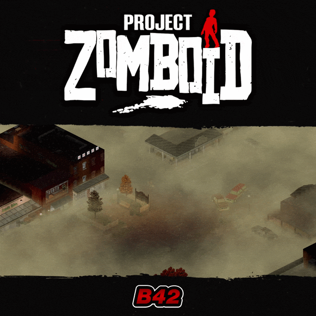

# **RDR Menu Theme**

<div class="mod-hero" markdown>

{ .mod-icon }

<span class="pz-tag">B42</span><span class="pz-tag">SP/MP</span>

[:fontawesome-brands-steam-symbol: Steam Workshop](https://steamcommunity.com/sharedfiles/filedetails/?id=3836837888)

**Recommended Build:** 42.22+

</div>

## Overview

*'Outbreak. Outlast. Outlaws'*

RDR Menu Theme brings Red Dead Redemption 2 Music, Knox Country Videos and Menu styling to Project Zomboid. It includes two Sub-Themes, four Button Layouts and three Menu Fonts.

It requires [Menu Theme Framework (MTF)](../documentation/menu-theme-framework/index.md) and Build 42.22 or newer. The Theme runs on the client and affects the Main Menu.

## Gallery

<div class="gallery-grid" markdown>
</div>

## Features

- **Menu Music:** Choose from 16 handpicked Tracks from Red Dead Redemption 2. Random selects one Track for a Main Menu session and loops it until the Menu closes. Select a specific Track to loop it instead
- **Nine Knox Country Videos:** Play looping Video scenes from Brandenburg, Ekron, Isolated, Louisville, Fallas Lake, Muldraugh, Rosewood, Riverside and West Point. A Video is selected at random each time the Main Menu opens
- **Video Sound:** Each Video has a paired looping soundtrack. Some Videos also add location ambience
- **Sub-Themes:** Choose Redemption or Undead Nightmare. The Sub-Theme changes the Logo style and Video colour grading
- **Button Layouts:** Choose Zomboid, Strip, Carousel or Horizontal Cards. All four Layouts support Mouse and Controller input. The Scroll Wheel moves through Cards and Carousel options
- **Menu Font:** Choose Lino, Gothica or the classic Zomboid Menu Font. Unsupported language scripts use the game default Font
- **RDR Logo:** Replace the Main Menu Logo with the optional RDR style Logo
- **Menu Button Visibility:** Hide Main Menu options that are not needed. Exit remains visible
- **Intro Sequence:** Play a short intro once each time the game launches, or skip it from Menu Theme Settings
- **Hide Game Version:** Hide the game version line at the bottom of the Main Menu
- **Client-side Theme:** Change the Main Menu without adding Server code or modifying vanilla game files

## Mechanics

RDR Menu Theme registers with MTF. The Framework manages the Theme Settings window, Main Menu Button Layouts, Music controls and Video playback. Only one Menu Theme can be active at a time through MTF.

Each time the Main Menu opens, MTF selects one of nine looping Videos at random. Every Video has a paired 30-second sound track. Several clips also include a separate location ambience sound. The Video Sound Volume control changes the paired track level. Music Volume controls the separate Red Dead Redemption 2 playlist.

The Redemption Sub-Theme uses the standard RDR style Logo without a Video tint. Undead Nightmare applies the colour grading overlay and switches to its alternate Logo when Replace Main Menu Logo is enabled.

The Theme appears on the Main Menu and its sub-screens, including Solo, Multiplayer, Mods and Options. Video and Audio stop when the game loading state begins. RDR Menu Theme runs on each Player's client and contains no Server code.

## Installation

Subscribe to Menu Theme Framework and RDR Menu Theme on Steam Workshop. Enable both from the Mods screen. In Multiplayer, enable both on each client that needs the themed Main Menu. The Theme is client-side and does not require Server-side code.

The Workshop IDs below can be added to a Server mod list when a host wants to distribute these client-side Mods through Steam Workshop. Server installation is optional.

```ini
Mods=ObnoxMenuThemeFrameworkB42;ObnoxRDRMenuThemeB42
WorkshopItems=3836836552;3836837888
```

## Configuration

Open **Menu Theme Settings** from the button at the bottom-left of the Main Menu. The window groups controls under Display, Audio, UI and Credits.

### Theme Display Settings

| Setting | Default | Range | Description |
|:---|:---|:---|:---|
| Sub-Theme | Redemption | Redemption or Undead Nightmare | Changes the Logo style and Video colour grading |
| Menu Font | Lino | Lino, Gothica or Zomboid | Sets the Main Menu Button Font. Unsupported language scripts use the game default Font |
| Skip Intro Sequence | Off | On or Off | Skips the intro sequence at game launch when enabled |

### Main Menu Display Settings

| Setting | Default | Range | Description |
|:---|:---|:---|:---|
| Replace Main Menu Logo | On | On or Off | Shows the RDR style Logo instead of the vanilla Main Menu Logo |
| Hide Game Version | On | On or Off | Shows or hides the game version line |
| Button Layout | Horizontal Cards | Zomboid, Strip, Carousel or Horizontal Cards | Changes the position and style of the Main Menu Buttons |

### Audio Settings

| Setting | Default | Range | Description |
|:---|:---|:---|:---|
| Music Track | Random | Random or one of 16 Tracks | Random selects one Track for the Main Menu session. A selected Track loops until the Menu closes |
| Music Volume | 50% | 0 to 100% | Sets the Red Dead Redemption 2 Menu Music volume |
| Video Sound Volume | 50% | 0 to 100% | Sets the Video soundtrack volume |
| UI Sound Volume | 50% | 0 to 100% | Sets the Menu interface Sound volume |

The available Music Tracks are:

- Brandywine
- Calumet Ravine
- Cholla Springs
- Colter
- Great Plains
- Grizzlies
- Guarma
- Heartlands
- Larned Sod
- Lemoyne
- Mexico
- Rattlesnake Hollow
- Roanoke
- Scarlett Meadows
- Tall Trees
- Wapiti

The Video locations are:

- Brandenburg
- Ekron
- Isolated
- Louisville
- Fallas Lake
- Muldraugh
- Rosewood
- Riverside
- West Point

### Menu Button Visibility

| Setting | Default | Range | Description |
|:---|:---|:---|:---|
| Main Menu Buttons | All shown | Show or Hide, except Exit | Hide Latest Save, Singleplayer, Load, Tutorial, Multiplayer, Co-op, Options, Mods, Workshop or Credits |

## Works With

| Mod | What It Adds |
|:---|:---|
| [Menu Theme Framework](../documentation/menu-theme-framework/index.md) | Required Framework for registering and displaying the Theme. MTF supplies the Settings window, Music controls, Video playback and Button Layouts |

## Compatibility

| Build | SP | Hosted MP | Dedicated MP |
|:---:|:---:|:---:|:---:|
| 42.22+ | ✅ | ✅ | ✅ |
| 41 | ❌ | ❌ | ❌ |

!!! success "Does it require another Mod?"
    Yes. Menu Theme Framework is required

!!! success "Can it be added or removed from an existing Save?"
    Yes. The Theme changes only client-side Main Menu Audio and Graphics. It stops at game loading, adds no gameplay data and does not modify vanilla game files

!!! success "Can it run with another Menu Theme?"
    Only one Theme is active at a time through MTF

!!! success "Can it run with other Mods that modify the Main Menu?"
    No. Other Mods that modify the Main Menu are listed as incompatible

!!! success "Does it support all Aspect Ratios and Controllers?"
    Yes. It supports all Aspect Ratios, Resolutions and Font Sizes plus Controller input

!!! success "Does this Mod support 'X' Language?"
    Yes. It has translations for all supported Project Zomboid languages. Fonts that lack characters for a language fall back to the game default Font

## FAQ / Troubleshooting

!!! question "Why Is Build 42.22 or Newer Required?"
    The Theme uses custom Bink Video files, which need Build 42.22 or later.

!!! question "How Can the Menu Music Be Changed?"
    Open **Menu Theme Settings**, choose the **Audio** tab and select **Random** or one of the 16 Tracks. Random chooses one Track for the session. A specific Track loops until the Main Menu closes.

!!! question "How Can the Sub-Theme Be Changed?"
    Open **Menu Theme Settings**, choose the **Display** tab and select **Redemption** or **Undead Nightmare**. Undead Nightmare applies the Video colour grading overlay and uses the alternate Logo when logo replacement is enabled.

!!! question "How Can the Intro Be Skipped?"
    Open **Menu Theme Settings**, choose the **Display** tab and enable **Skip Intro Sequence**.

!!! question "Does the Server Need the Theme?"
    No. The Theme is client-side and contains no Server code. Each client that wants the themed Main Menu enables the Framework and RDR Menu Theme locally.

## Credits

- Special thanks to [RedChili - PZ Survivor Studio](https://pz-icon-maker.vercel.app/)

This is an unofficial fan-made Theme. It is not affiliated with or endorsed by Rockstar Games or Take-Two Interactive.

## Changelog

[:fontawesome-brands-steam-symbol: View Patch Notes](https://steamcommunity.com/sharedfiles/filedetails/changelog/3836837888)
