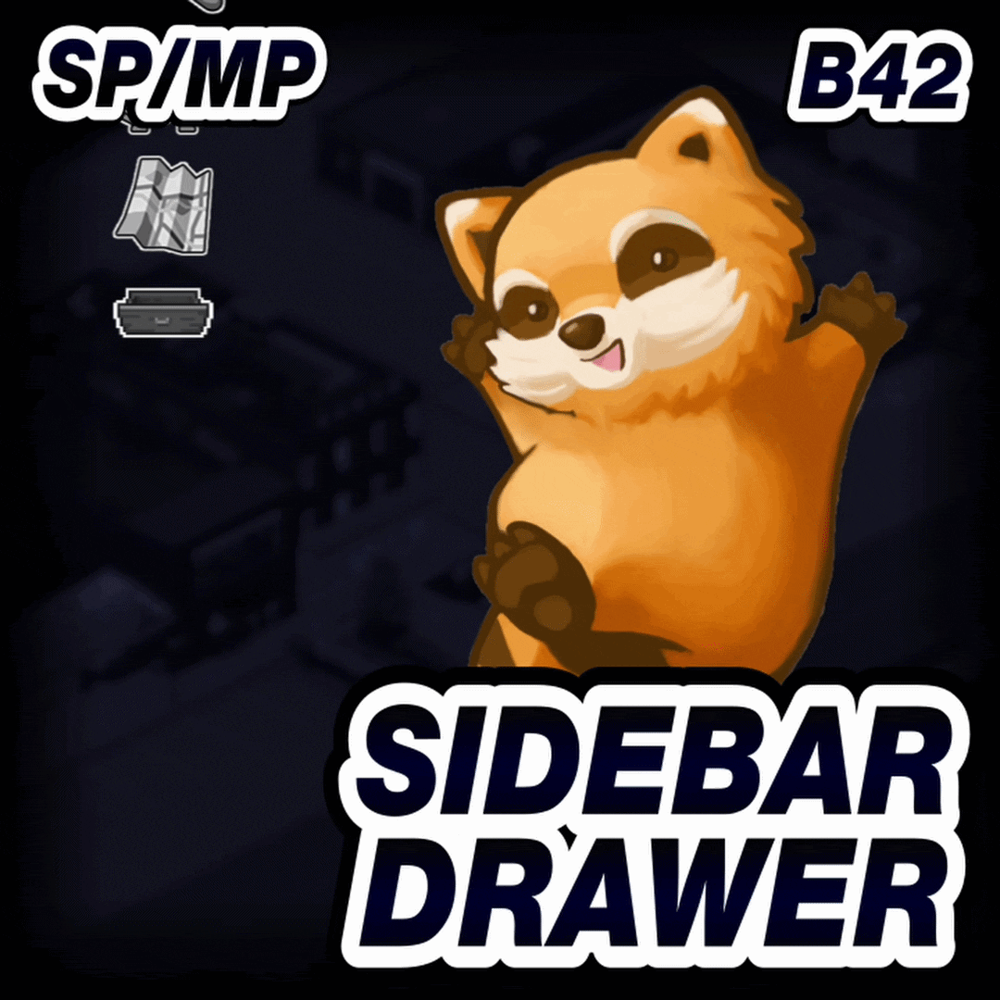
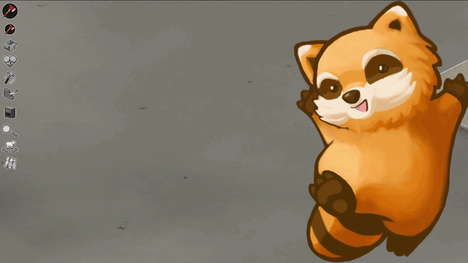
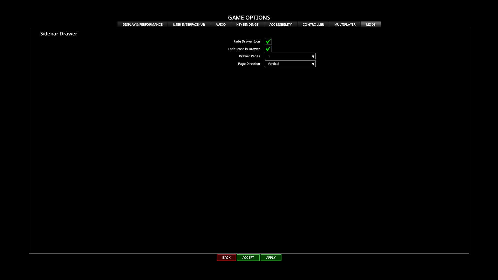

# **Sidebar Drawer**

<div class="mod-hero" markdown>

{ .mod-icon }

<span class="pz-tag">B42</span><span class="pz-tag">SP/MP</span>

[:fontawesome-brands-steam-symbol: Steam Workshop](https://steamcommunity.com/sharedfiles/filedetails/?id=3800957566)

**Recommended Build:** 42.19+

</div>

## Overview

*'Open the Drawer, Close the Chaos'*

Sidebar Drawer keeps the vanilla Sidebar tidy when Mods add their own Icons. Compatible Mod Icons go into one toggleable Drawer, while vanilla Icons keep their normal position unless a Player moves them.

Click the toggle beneath the last visible vanilla Sidebar Icon to open or close the Drawer. The Mod supports Singleplayer, Hosted Multiplayer and Dedicated Multiplayer with client-side code only.

## Gallery

<div class="gallery-grid" markdown>
 
</div>

## Features

- **One Toggle:** Opens and closes the Drawer from beneath the last visible vanilla Sidebar Icon. Its Icon and Tooltip show the current state
- **Mod Icons in the Drawer:** Compatible Mod Icons are kept in the Drawer. Vanilla Icons stay in their normal Sidebar positions by default
- **Choose Vanilla Icons:** Hold Shift and right-click a vanilla Icon to move it into or out of the Drawer
- **Drawer Pages:** Show Off or between one and eight Icons at a time. The default is three. Arrow buttons or Shift plus the Mouse Wheel move between pages, wrapping from the last Icon to the first
- **Page Direction:** Arrange the Drawer as a Vertical column or Horizontal row. Vertical layout also works with Drawer Pages Off
- **Reorder Icons:** Hold Shift and drag an Icon with the left mouse button to move it within the visible page
- **Saved Layout:** Remembers the Drawer state, vanilla Icon membership, Icon order and scroll position across Saves and Servers. Horizontal and Vertical scroll positions are saved separately
- **Proximity Fade:** Set separate fade options for the Drawer toggle and the Icons inside an open Drawer
- **Real Buttons:** Moves each live Icon Button into the Drawer, preserving its existing clicks, right-clicks, Tooltips and Context Menus
- **Consistent Sizing:** Matches expanded Icons to the current vanilla Sidebar Icon size and rebuilds the layout when that size changes

## Mechanics

Sidebar Drawer checks the direct children of the vanilla Sidebar Icon panel. It recognises vanilla Icons by their direct references. Other live `ISButton` controls and their subclasses are treated as Mod Icons.

Compatible Mod Icons always belong to the Drawer. Vanilla Icons remain in the Sidebar unless a Player moves them with Shift and right-click. When the Drawer closes, the Mod hides its compatible Icons. Opening it moves those same live Button instances into a panel beside the toggle.

The Drawer preserves the original Buttons, allowing their existing interactions to continue working. Open Icons match the current vanilla Sidebar Icon size. If that size changes mid-game, Sidebar Drawer rebuilds the layout.

The Mod stores the Drawer state, selected vanilla Icons, Icon order and each layout direction's page position locally in `Zomboid/Lua/SidebarDrawer/SBD_DrawerLayout.txt`. The settings persist across Saves and Servers on that installation.

## Installation

Subscribe to Sidebar Drawer on the [Steam Workshop](https://steamcommunity.com/sharedfiles/filedetails/?id=3800957566).

**Singleplayer:** Enable Sidebar Drawer from the Mods screen.

**Hosted or Dedicated Multiplayer:** Subscribe to the Mod and add it to the server's `.ini` file.

```ini
Mods=[B42]SidebarDrawer
WorkshopItems=3800957566
```

## Configuration

Open **Options > Mods > Sidebar Drawer** to change the client-side display settings.

| Setting | Default | Range | Description |
|:---|:---|:---|:---|
| Fade Drawer Icon | Off | On or Off | Fades the Drawer toggle when the mouse is not nearby, whether the Drawer is open or closed |
| Fade Icons in Drawer | On | On or Off | Fades the Icons inside an open Drawer when the mouse moves away. This works with or without Minimal Sidebar |
| Drawer Pages | 3 | Off or 1 to 8 | Sets how many Icons appear at once. Off disables paging |
| Page Direction | Vertical | Horizontal or Vertical | Sets the Drawer layout and paging direction. Vertical layout also works when Drawer Pages is Off |

## Compatibility

| Build | SP | Hosted MP | Dedicated MP |
|:---:|:---:|:---:|:---:|
| 42.19+ | ✅ | ✅ | ✅ |
| 41 | ❌ | ❌ | ❌ |

!!! success "Will it change a Save?"
    The Drawer layout is stored locally and does not modify vanilla game files

!!! success "Can it be added or removed mid-save?"
    Yes

!!! success "Which Mod Icons are supported?"
    An Icon must be a direct `ISButton` child of the vanilla Sidebar or a subclass of `ISButton`

!!! success "Does this Mod support 'X' Language?"
    Yes. It has translations for all supported Project Zomboid languages.

## FAQ / Troubleshooting

!!! question "How Are Vanilla Icons Added to the Drawer?"
    Hold Shift and right-click a vanilla Icon in the Sidebar or the open Drawer. Repeat the action to move it back.

!!! question "Why Is a Mod Icon Missing?"
    Sidebar Drawer only captures direct `ISButton` children of the vanilla Sidebar. An Icon managed by a separate top-level panel or by another UI type is outside that supported group. See [Compatibility](#compatibility) for the supported button types.

!!! question "Why Does an Icon Conflict With the Drawer?"
    Move Sidebar Drawer to the last position in the Mod Order. A Mod that repositions its Icon every frame without checking its current parent can conflict after Sidebar Drawer moves that Button.

## Credits

- Translations: Nycotex (Italian)

## Changelog

[:fontawesome-brands-steam-symbol: View Patch Notes](https://steamcommunity.com/sharedfiles/filedetails/changelog/3800957566)
