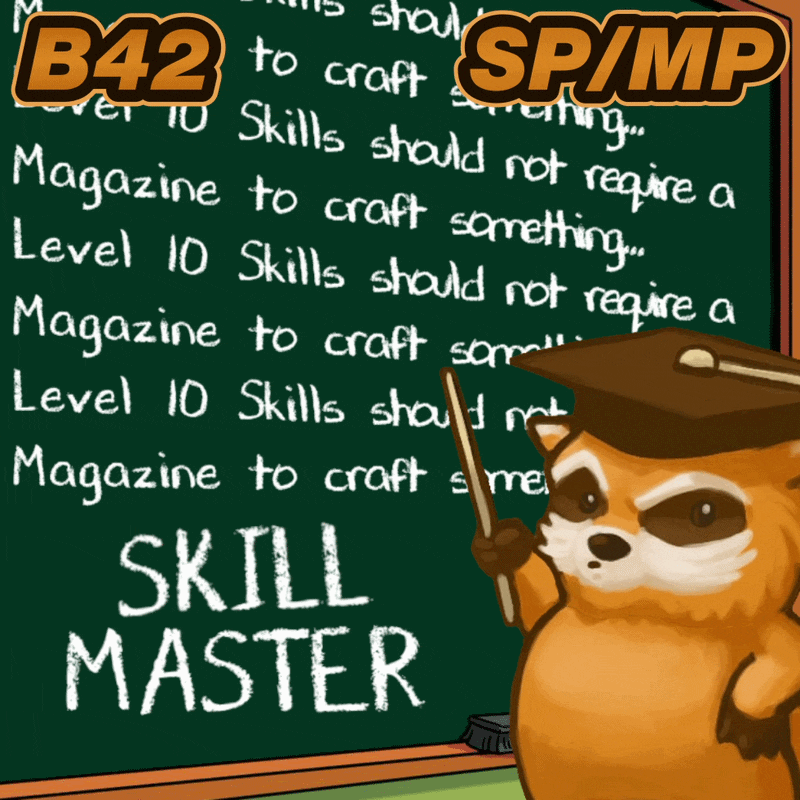
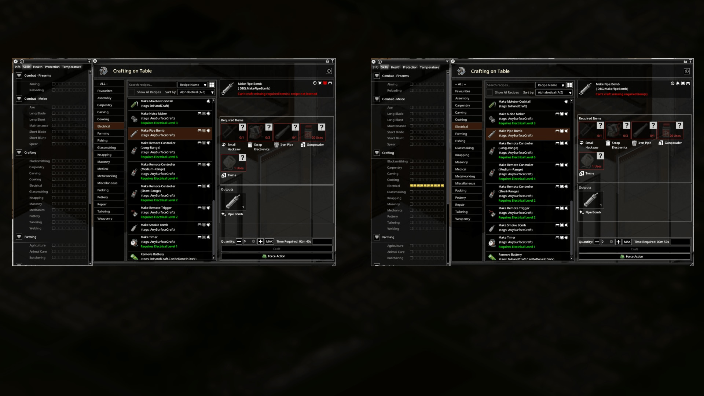
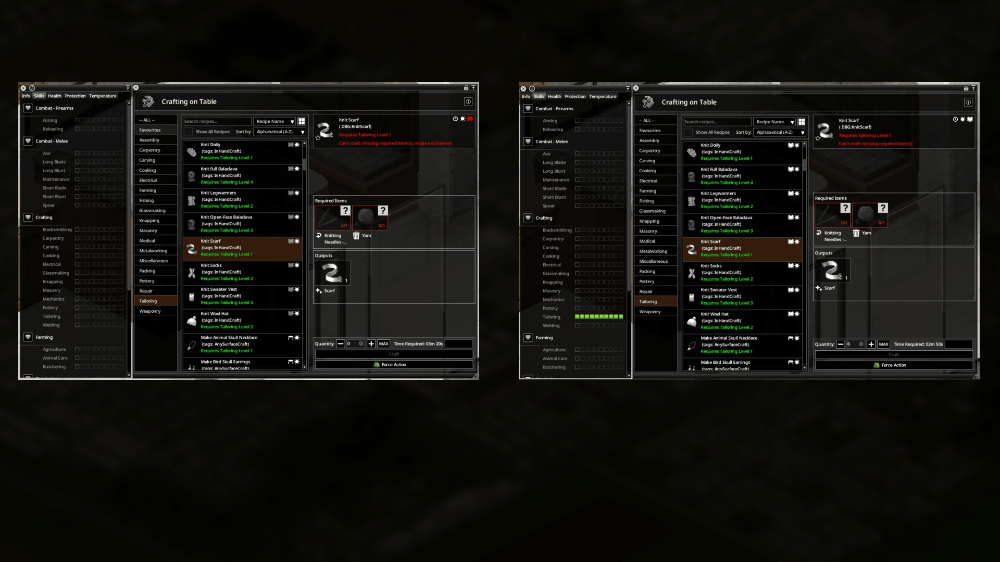
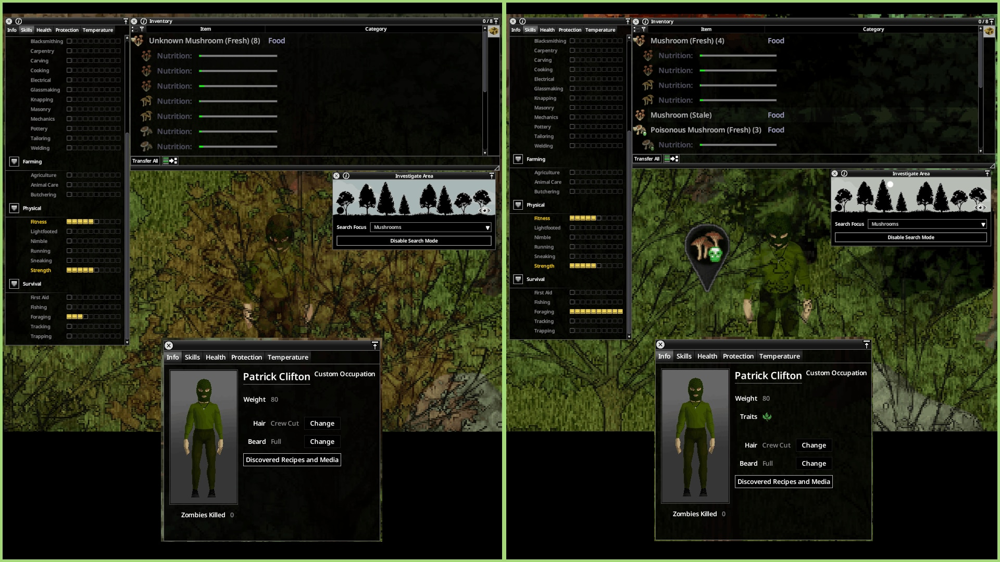
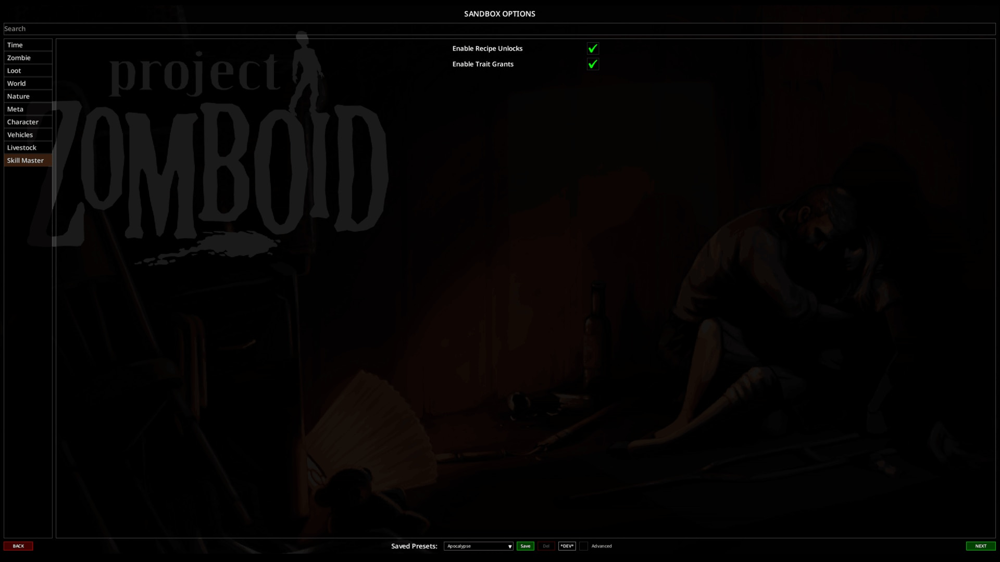

# **Skill Master**

<div class="mod-hero" markdown>

{ .mod-icon }

<span class="pz-tag">B42</span><span class="pz-tag">SP/MP</span>

[:fontawesome-brands-steam-symbol: Steam Workshop](https://steamcommunity.com/sharedfiles/filedetails/?id=3736268686)

**Recommended Build:** 42.15+

</div>

## Overview

*'You've patched more holes than there are Zombies trying to make new ones, you're Level 10 in Tailoring, but somehow you still don't know how to knit a Scarf... bEcAuSe YoU hAvEn'T rEaD tHe RiGhT mAgAzInE. NOT IF YOU'RE A SKILL MASTER!'*

Skill Master unlocks magazine-gated and research-gated recipes for a Skill when a Character reaches Level 10. Where a matching Trait applies, it can be granted at the same time. No magazine or research item is needed to learn an eligible recipe.

It works across every Skill and includes compatible recipes added by other Mods. The [Skill Master Unlocks spreadsheet](https://docs.google.com/spreadsheets/d/1x7gENzsmInoTABxbqRh_CR-d0xdaM6pnuaYCjVcqeM4/edit?usp=sharing) lists the recipe and Trait unlocks.

## Gallery

<div class="gallery-grid" markdown>






</div>

## Features

- **Recipe Unlocks:** Magazine-gated and research-gated recipes for a Skill unlock at Level 10
- **Trait Grants:** The matching Character Trait is granted at Level 10 where one applies, including Herbalist for Foraging and Tailor for Tailoring
- **Modded Recipes:** Recipes added by other Mods are included when they belong to a Skill
- **Existing Characters:** Characters already at Level 10 receive their unlocks when a Save loads or a Player joins
- **Per-Character Progress:** In Multiplayer, unlocks belong to the Character who reached Level 10

## Mechanics

When a Skill reaches Level 10, the server checks every crafting recipe that belongs to that Skill and unlocks those that still need magazine or research knowledge. Recipes the Character already knows, or can craft freely, are skipped.

When a game starts or a Player joins, the Mod also checks for Skills already at Level 10. Existing Saves and returning Multiplayer Characters catch up this way.

Recipe unlocks and Trait grants are saved with the Character. In Multiplayer, other Players are unaffected.

## Installation

**Singleplayer:** Subscribe to the Mod on the Steam Workshop and enable it from the 'Choose Mods' screen.

**Multiplayer (Hosted and Dedicated):** Subscribe to the Mod on the Steam Workshop and add the lines below to the server's `.ini` file.

```ini
Mods=SkillMasterB42
WorkshopItems=3736268686
```

## Configuration

Found under the **Skill Master** tab in the Sandbox options.

| Setting | Default | Range | Description |
|:---|:---|:---|:---|
| Enable Recipe Unlocks | On | On/Off | Unlocks eligible magazine-gated and research-gated recipes at Level 10 |
| Enable Trait Grants | On | On/Off | Grants associated Traits at Level 10 where available |

The two options work independently, except for the Herbalist Trait: it comes with the Foraging recipe unlocks and needs both options On. Turning an option off stops future unlocks. It does not remove recipes or Traits a Character already has.

## Compatibility

| Build | SP | Hosted MP | Dedicated MP |
|:---:|:---:|:---:|:---:|
| 42.15+ | ✅ | ✅ | ✅ |
| 41 | ❌ | ❌ | ❌ |

!!! success "Is this Mod safe to add to or remove from existing Saves?"
    Yes. Characters already at Level 10 receive their unlocks when the Save loads. After removal, recipes and Traits already unlocked stay with the Character.

!!! success "Is this Mod compatible with 'X' Mod?"
    Yes. Recipes added by other Mods are included when they belong to a Skill.

!!! success "Does this Mod support 'X' Language?"
    Yes. It has translations for all supported Project Zomboid languages.

## FAQ / Troubleshooting

!!! question "Does Skill Master remove the Skill requirement to craft an Item?"
    No. It unlocks the recipe knowledge. Any Skill level needed to craft the Item still applies.

!!! question "Does a Character already at Level 10 get the unlocks?"
    Yes, when the game starts or the Player joins. No further Skill levels are needed.

!!! question "Are Multiplayer unlocks shared between Players?"
    No. Each Character receives its own unlocks on reaching Level 10.

!!! question "Can recipe unlocks and Trait grants be controlled separately?"
    Yes, except for Foraging's Herbalist Trait, which needs both options On.

## Credits

- Translations: Nycotex (Italian)

## Changelog

[:fontawesome-brands-steam-symbol: View Patch Notes](https://steamcommunity.com/sharedfiles/filedetails/changelog/3736268686)
