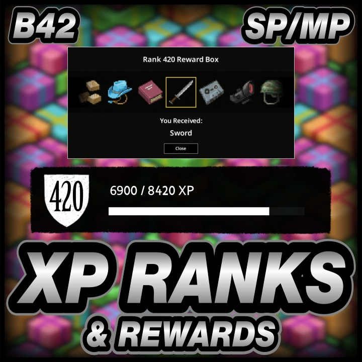
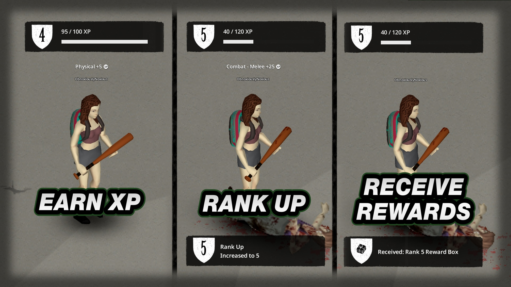
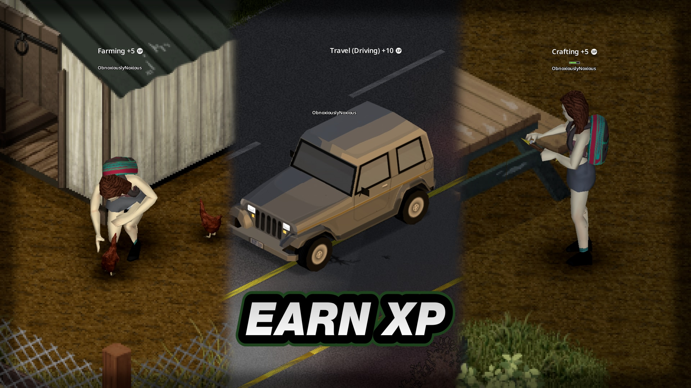
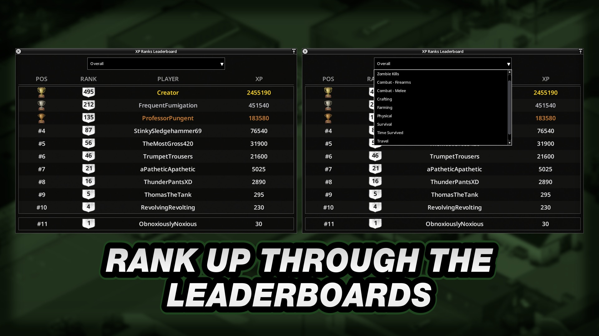
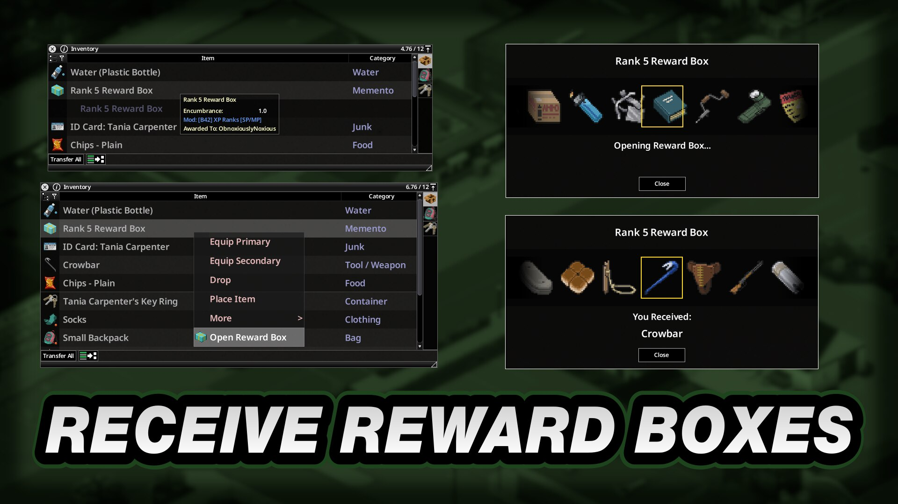
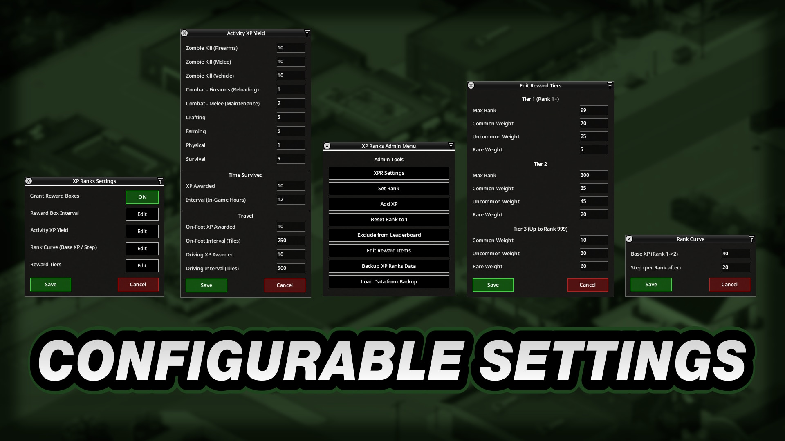
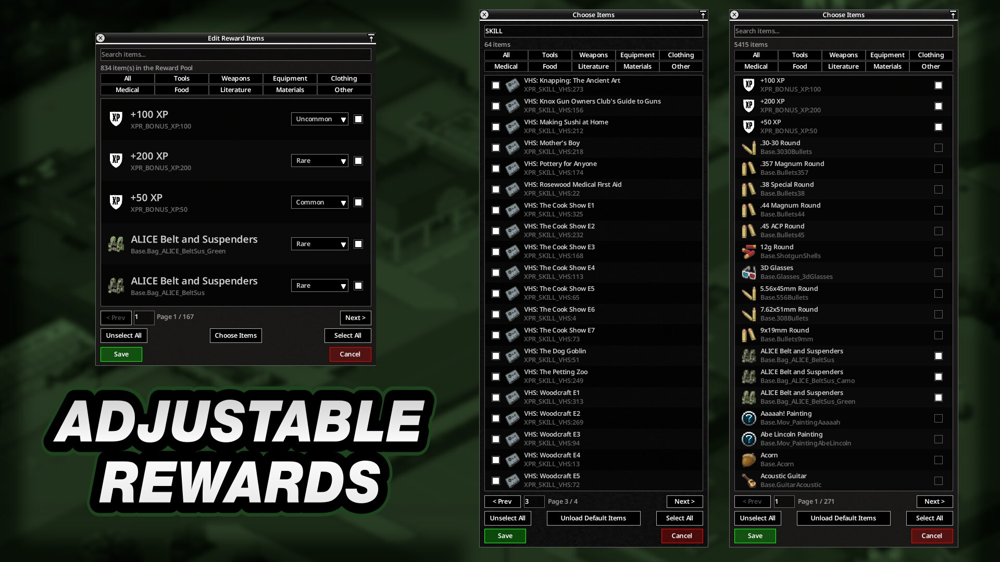
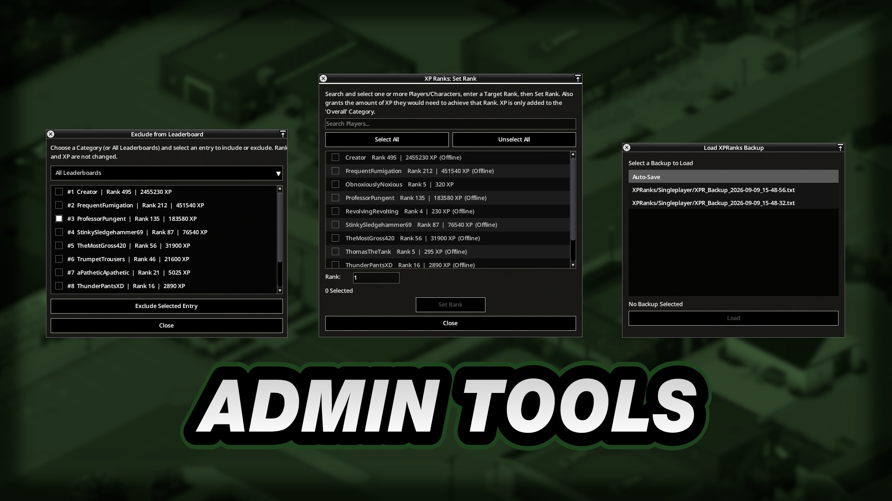
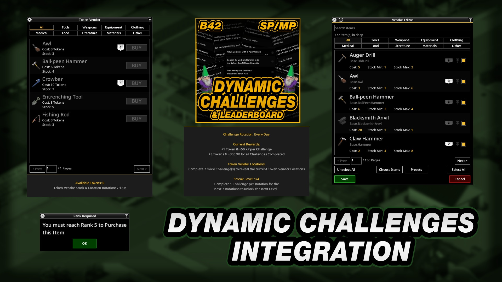
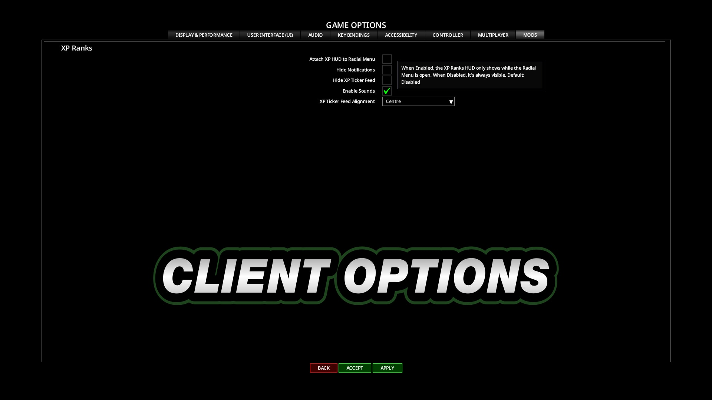

# **XP Ranks**

<div class="mod-hero" markdown>

{ .mod-icon }

<span class="pz-tag">B42</span><span class="pz-tag">SP/MP</span>

[:fontawesome-brands-steam-symbol: Steam Workshop](https://steamcommunity.com/sharedfiles/filedetails/?id=3799796873)

**Recommended Build:** 42.19+

</div>

## Overview

*'999 Levels of Progression. 9 Leaderboard Categories. Zero Modifiers'*

XP Ranks adds a progression layer on top of Project Zomboid's Skill XP. Every action across all Skill categories (Combat, Crafting, Farming, Physical and Survival) feeds a single Global Rank.

Rank XP is completely independent of Traits, Professions, Skill Books and Sandbox settings that change Skill XP gain. Two Players doing the same action always earn the same Rank XP, whatever their Character build or game settings.

## Gallery

<div class="gallery-grid" markdown>
         
</div>

## Features

- **Rank Progression:** The XP needed for each Rank rises by a fixed step (by default 40 XP for Rank 2, 60 XP for Rank 3 and so on). Players start at Rank 1. The maximum Rank is 999
- **Rank Rewards:** Every Rank that is a multiple of 5 (configurable) grants a Reward Box. Opening one awards 1 random Item, weighted by the Rarity table. In Multiplayer, Reward Boxes record who they were awarded to and can be dropped, picked up and opened by other Players
- **Item Rarity:** Items sit in 3 Rarity tiers: Common, Uncommon and Rare. Low Ranks lean towards Common Items, middle Ranks towards Uncommon and high Ranks towards Rare (see [Reward Settings](#reward-settings))
- **XP Categories:** Every vanilla Skill feeds one of six categories, mirroring the game's own Skills panel: Combat - Melee, Combat - Firearms, Crafting, Farming, Physical and Survival. Zombie Kills award XP separately, feeding both their Combat category and a Zombie Kill total
- **Rank Leaderboard:** Compete for the highest Rank, filtered by Overall, Zombie Kills, Combat - Firearms, Combat - Melee, Crafting, Farming, Physical, Survival, Time Survived and Travel
- **Dynamic Challenges:** With [Dynamic Challenges & Leaderboard](daily-challenge-system.md) installed, Players earn extra XP for completing Challenges and keeping a Streak. The Leaderboard also gains a Dynamic Challenges section
- **Toast Notifications:** A notification for each new Rank and each Reward Box
- **Persistence:** In Singleplayer, Rank and Rank XP belong to the Character. Dead Characters stay on the Leaderboard (Hall of Fame). In Multiplayer, they belong to the Player's username: a new Character picks up where the last one left off
- **Admin Tools:** View and edit Rewards, add XP, exclude a Player from the Leaderboard, set a Player's Rank and back up or reload every Player's XP and Ranks between wipes
- **Sounds and Notifications:** Audio cues for XP gains, Rank Ups and Reward Boxes. Turn them off in Options > Mods
- **HUD and UI:** Left-click and drag the HUD to move it, right-click and drag to scale it. Every window scales with the Font Size setting
- A [public API](../documentation/api/xp-ranks.md) for other Mods to award Rank XP, read Ranks and react to Rank Ups
- Translations for all supported Project Zomboid languages

## Mechanics

XP Ranks listens to the game's `AddXP` event, which fires after every Skill XP grant whatever its source. It reads the Skill, maps it to a category and awards a fixed amount of Rank XP from a configurable table. The vanilla Skill XP itself is untouched.

Listening to the game's event (rather than wrapping the Lua function) also catches grants made by the game's Java code, such as cooking and evolved recipes.

XP from Skill Recovery Journals is deliberately excluded to stop Rank XP farming.

## Installation

**Singleplayer:** Subscribe to the Mod on the Steam Workshop and enable it from the 'Choose Mods' screen.

**Multiplayer (Hosted and Dedicated):** Subscribe to the Mod on the Steam Workshop and add the lines below to the server's `.ini` file.

```ini
Mods=[B42]XPRanks
WorkshopItems=3799796873
```

### Getting Started

- **Players:** The XP Ranks Sidebar Icon opens the Rank panel and the Leaderboard.
- **Admins:** Right-click the Sidebar Icon and choose the Admin Menu (Admin access is needed in Multiplayer). **XPR Settings** is in the Admin Menu.

## Configuration

Open the Admin Menu (right-click the Sidebar Icon) and choose **XPR Settings**. Pick a **Category** to show its settings.

### Admin Tools

Right-click the XP Ranks Sidebar Icon to open the **XP Ranks Admin Menu** (Admin access is needed in Multiplayer).

| Tool | What It Does |
|:---|:---|
| XPR Settings | Opens the Settings described below |
| Set Rank | Sets a Player's Rank |
| Add XP | Adds Rank XP to a Player |
| Reset Rank to 1 | Resets a Player's Rank and Rank XP |
| Exclude from Leaderboard | Removes a Player from every Leaderboard category, or from one |
| Edit Reward Items | Edits the Reward Box Items and their Rarity |
| Backup XP Ranks Data | Saves every Player's XP and Ranks to a backup file, for carrying them across server wipes |
| Load Data from Backup | Restores XP and Ranks from a backup file |

### Rank Settings

| Setting | Default | Description |
|:---|:---:|:---|
| Base XP (Rank 1->2) | 40 | XP needed to go from Rank 1 to Rank 2 |
| Step (per Rank after) | 20 | Extra XP needed for each Rank after that |
| Reset XP Rank on Death | Off | Resets the Player's Rank and Rank XP when the Character dies |

### XP Settings

**XP Activity Yield:** Rank XP per Skill XP grant, by category.

| Category | Default |
|:---|:---:|
| Combat - Firearms (Reloading) | 1 |
| Combat - Melee (Maintenance) | 2 |
| Crafting | 5 |
| Farming | 5 |
| Physical | 1 |
| Survival | 5 |

| Setting | Default | Description |
|:---|:---:|:---|
| Zombie Kill (Firearms / Melee / Vehicle) | 10 / 10 / 10 | Rank XP per Zombie Kill |
| Time Survived: XP Gained | 10 | Rank XP for each interval survived |
| Time Survived: Interval (In-Game Hours) | 6 | How often Time Survived XP is awarded |
| Travel: On-Foot XP Gained / Interval (Tiles) | 10 / 150 | Rank XP for each distance travelled on foot |
| Travel: Driving XP Gained / Interval (Tiles) | 10 / 500 | Rank XP for each distance driven |
| PVP Kill XP | Off | Awards Rank XP for killing another Player |
| PVP Kill XP Gained | 50 | Rank XP per Player Kill |
| Per-Victim Cooldown (Minutes) | 30 | Time before killing the same Player awards XP again |

**Skill Mods:** XP from these Skill Mods has its own yield.

| Skill Mod | Default |
|:---|:---:|
| [Efficiency Skill Mod 2](https://steamcommunity.com/sharedfiles/filedetails/?id=3374408921){target="_blank"} (Crafting) | 1 |
| [Combat Mastering Skill](https://steamcommunity.com/sharedfiles/filedetails/?id=3435985650){target="_blank"} (Melee) | 2 |
| [Toughness Skill](https://steamcommunity.com/sharedfiles/filedetails/?id=3545533939){target="_blank"} (Survival) | 5 |

### Reward Settings

| Setting | Default | Description |
|:---|:---:|:---|
| Grant Reward Boxes | On | Awards Reward Boxes at Rank milestones |
| Reward Box Interval | 5 | A Reward Box every this many Ranks |

Reward Box rolls are weighted by Rank:

| Ranks | Common | Uncommon | Rare |
|:---|:---:|:---:|:---:|
| 1-99 | 70% | 25% | 5% |
| 100-300 | 35% | 45% | 20% |
| 301+ | 10% | 30% | 60% |

The Rank boundaries, the weights and every Reward Item can be changed from the Admin Menu.

### Leaderboard Settings

| Setting | Default | Description |
|:---|:---:|:---|
| Show Kill Counts instead of XP Value | Off | The Zombie Kills Leaderboard shows kills instead of XP |
| Show Time Survived instead of XP Value | Off | The Time Survived Leaderboard shows time instead of XP |
| Enable Server Logging / Enable Log Output | Off | Logs changed Settings, Reward Box grants and openings, Admin XP actions and Backups. Errors, warnings and refused actions are always logged |

### Player Options

In Options > Mods > XP Ranks:

| Option | Default | Description |
|:---|:---:|:---|
| Attach XP HUD to Radial Menu | Off | Shows the HUD only while the Radial Menu is open |
| Hide Notifications | Off | Hides XP Ranks Toast Notifications |
| Hide XP Ticker Feed | Off | Hides the XP Ticker Feed |
| Enable Sounds | On | Notification and Ticker Feed sounds |
| XP Ticker Feed Alignment | Right | Right, Centre or Left |

## Integrations

| Mod | What It Adds |
|:---|:---|
| [Dynamic Challenges & Leaderboard](daily-challenge-system.md) | Rank XP for completing Challenges, completing every Challenge in a Rotation, keeping a Streak and finishing a full Streak cycle (amounts set in DCS Settings). A Dynamic Challenges Leaderboard section. Dynamic Challenges Vendor Items can require a minimum Rank |
| [Efficiency Skill Mod 2](https://steamcommunity.com/sharedfiles/filedetails/?id=3374408921){target="_blank"}, [Combat Mastering Skill](https://steamcommunity.com/sharedfiles/filedetails/?id=3435985650){target="_blank"}, [Toughness Skill](https://steamcommunity.com/sharedfiles/filedetails/?id=3545533939){target="_blank"} | XP from these Skills counts towards Rank XP, with its own yield in [XP Settings](#xp-settings) |

Each integration becomes available when both Mods are enabled.

## Compatibility

| Build | SP | Hosted MP | Dedicated MP |
|:---:|:---:|:---:|:---:|
| 42.19+ | ✅ | ✅ | ✅ |
| 41 | ❌ | ❌ | ❌ |

!!! success "Is this Mod safe to add to or remove from existing Saves?"
    Yes.

!!! success "Is this Mod compatible with 'X' Mod?"
    Compatible with most other Mods. XP Ranks listens to the game's `AddXP` event, which automatically includes modded actions that grant vanilla Skill XP. A Mod that awards unrealistic Rank XP can be reported as a bug.

!!! success "Does this Mod support 'X' Language?"
    Yes. It has translations for all supported Project Zomboid languages and supports every Font Size setting.

## FAQ / Troubleshooting

!!! question "Do Traits, Professions or Skill Books change Rank XP?"
    No. Rank XP is a fixed amount per action, independent of every XP modifier.

!!! question "Why does a Skill Recovery Journal not give Rank XP?"
    Journal XP is excluded on purpose, to stop Players farming Rank XP.

!!! question "Can another Mod award Rank XP?"
    Yes, through the [XP Ranks API](../documentation/api/xp-ranks.md).

## Credits

- Translations: Nycotex (Italian)

## Changelog

[:fontawesome-brands-steam-symbol: View Patch Notes](https://steamcommunity.com/sharedfiles/filedetails/changelog/3799796873)
