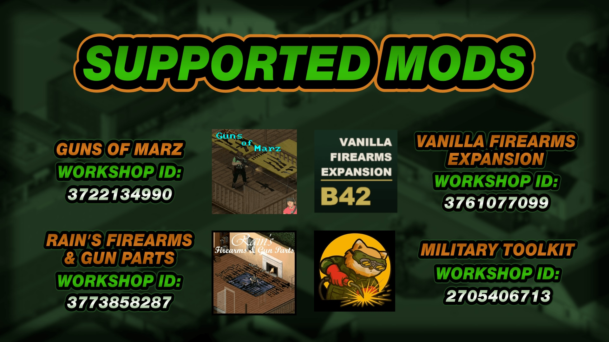
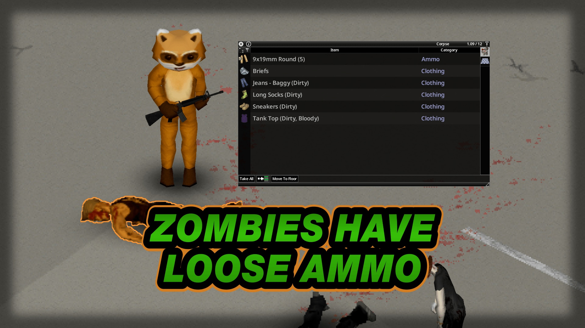
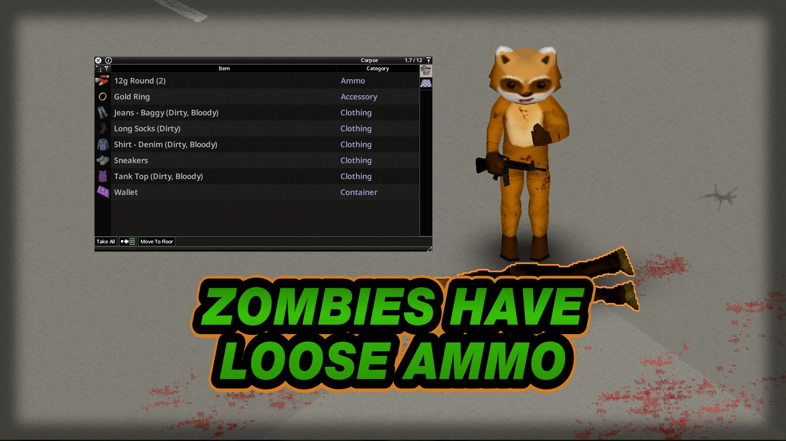
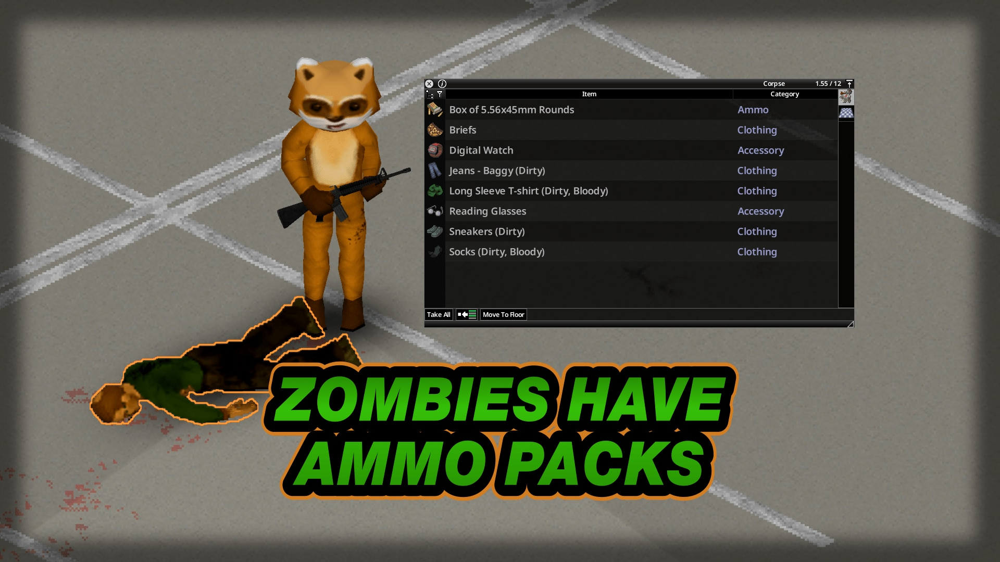
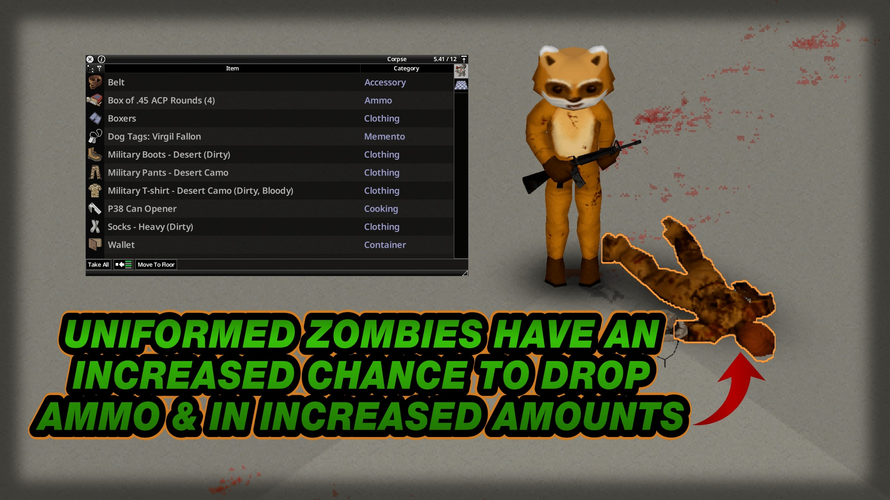
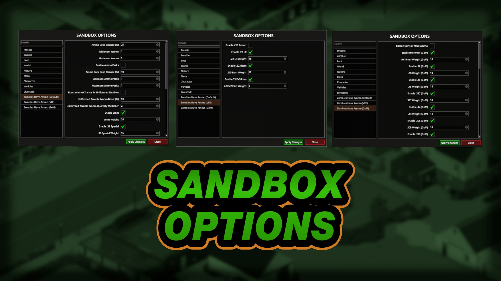
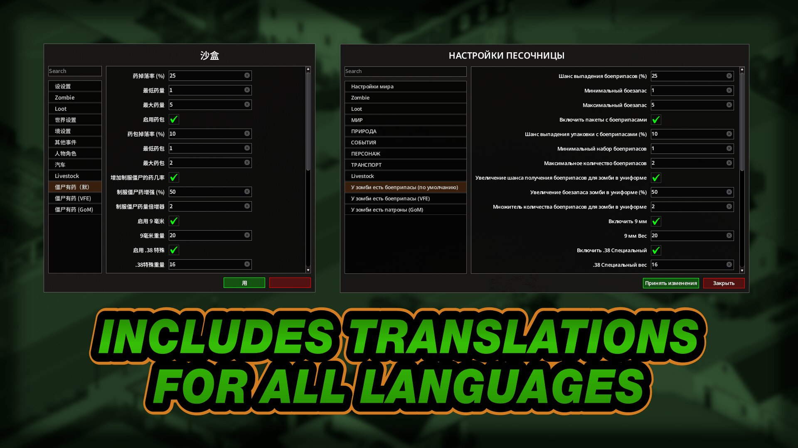

# **Zombies Have Ammo**

<div class="mod-hero" markdown>

{ .mod-icon }

<span class="pz-tag">B42</span><span class="pz-tag">SP/MP</span>

[:fontawesome-brands-steam-symbol: Steam Workshop](https://steamcommunity.com/sharedfiles/filedetails/?id=3728283972)

**Recommended Build:** 42.15+

</div>

## Overview

*'Is that 1-5 9mm rounds in your pocket, or are you just happy to see me?'*

Adds a configurable chance for Zombies to drop loose Ammo or Ammo Boxes on death, on top of vanilla drop behaviour. Uniformed Zombies can drop Ammo more often and in larger amounts. Optional pools add the Ammo of Vanilla Firearms Expansion, Guns of Marz, Rain's Firearms & Gun Parts and Military Tool Kit.

## Gallery

<div class="gallery-grid" markdown>
       
</div>

## Features

- Configurable chance for Zombies to drop loose Ammo or Ammo Boxes
- A weighted rarity system: common calibres (9mm, .38 Special, .45 ACP) drop more often than rare ones (.44 Magnum)
- An Enable toggle and a Weight for every calibre
- A Uniformed Zombie Boost for military, police, ranger, hunter and similar outfits
- Optional Ammo pools for Vanilla Firearms Expansion (3 calibres), Guns of Marz (26), Rain's Firearms & Gun Parts (2) and Military Tool Kit (12), each with its own toggle
- All drops are handled on the server, preventing duplication and desync
- Translations for all 28 supported Project Zomboid languages

The default Weights follow vanilla Ammo rarity. [This spreadsheet](https://docs.google.com/spreadsheets/d/1jyMDCzuaRMEdNE0QTT5A87inBiy1Ob_tLvu35FuWstA/edit?usp=sharing){target="_blank"} lists them. Weights are not percentages: a higher Weight is more common.

## How It Works

Every Zombie death triggers a single Ammo roll on the server.

- If the roll fails, nothing drops.
- If it succeeds, the calibre is picked from the weighted pool of every enabled calibre.
- With **Enable Ammo Packs** on, a second roll (Ammo Pack Drop Chance) decides whether the drop is an Ammo Box instead of loose rounds. A Zombie never drops both.
- A calibre with no Ammo Box item always drops as loose rounds.

### Uniformed Zombie Boost

With **Boost Ammo Chance for Uniformed Zombies** on, these outfits get the boost: Army (desert camo, green camo, service uniform and instructor), Ghillie, Police (including State, Riot and SWAT), Sheriff Deputy, Prison Guard, Ranger, Hunter, Private Militia, Bounty Hunter and Agent.

For those Zombies, **Uniformed Zombie Ammo Boost** is added to both the Ammo Drop Chance and the Ammo Pack Drop Chance (the Pack chance stops at 100%). **Uniformed Zombie Ammo Quantity Multiplier** multiplies the minimum and maximum of both loose rounds and Ammo Boxes.

## Installation

**Singleplayer:** Subscribe to the Mod on the Steam Workshop and enable it from the 'Choose Mods' screen.

**Multiplayer (Hosted and Dedicated):** Subscribe to the Mod on the Steam Workshop and add the lines below to the server's `.ini` file.

```ini
Mods=ZombiesHaveAmmoB42
WorkshopItems=3728283972
```

### Supported Gun Mods

Each pool is off by default. Subscribe to and enable the gun Mod (adding its own Mod ID and Workshop ID to the server's `.ini` in Multiplayer), then turn its pool on in the matching Sandbox tab.

| Gun Mod | Workshop ID | Sandbox Tab |
|:---|:---:|:---|
| [Vanilla Firearms Expansion](https://steamcommunity.com/sharedfiles/filedetails/?id=3761077099){target="_blank"} | `3761077099` | Zombies Have Ammo (VFE) |
| [Guns of Marz](https://steamcommunity.com/sharedfiles/filedetails/?id=3722134990){target="_blank"} | `3722134990` | Zombies Have Ammo (GoM) |
| [B42 Rain's Firearms & Gun Parts](https://steamcommunity.com/sharedfiles/filedetails/?id=3773858287){target="_blank"} | `3773858287` | Zombies Have Ammo (Rain's) |
| [Military Tool Kit](https://steamcommunity.com/sharedfiles/filedetails/?id=2705406713){target="_blank"} (Papa_Chad's vehicles) | `2705406713` | Zombies Have Ammo (Papa_Chad's) |

## Configuration

Settings are split across five tabs in the Custom Sandbox options.

### Zombies Have Ammo (Default)

| Setting | Default | Range | Description |
|:---|:---:|:---:|:---|
| Ammo Drop Chance (%) | 25 | 0-100 | Chance a Zombie drops Ammo on death |
| Minimum / Maximum Ammo | 1 / 5 | 1-100 | Loose rounds in a drop |
| Enable Ammo Packs | Off | On/Off | Lets a drop be an Ammo Box instead of loose rounds |
| Ammo Pack Drop Chance (%) | 10 | 0-100 | Of the drops that happen, the chance it is an Ammo Box |
| Minimum / Maximum Ammo Packs | 1 / 2 | 1-20 | Ammo Boxes in a box drop |
| Boost Ammo Chance for Uniformed Zombies | Off | On/Off | Turns on the [Uniformed Zombie Boost](#uniformed-zombie-boost) |
| Uniformed Zombie Ammo Boost (%) | 50 | 0-200 | Added to the Ammo Drop Chance and the Ammo Pack Drop Chance of Uniformed Zombies (25% + 50% = 75% by default) |
| Uniformed Zombie Ammo Quantity Multiplier | 2 | 1-10 | Multiplies the rounds and Ammo Boxes a Uniformed Zombie drops (a drop of 2 Boxes becomes 4) |

Every calibre below has its own Enable toggle (on by default) and a Weight from 1 to 100.

| Calibre | Weight |
|:---|:---:|
| 9mm | 20 |
| .38 Special | 16 |
| .45 ACP | 14 |
| 12 Gauge Shells | 14 |
| .30-30 | 12 |
| 5.56x45mm | 10 |
| .308 | 6 |
| .357 Magnum | 4 |
| .44 Magnum | 2 |

!!! note "Minimum Higher than Maximum"
    If a Minimum is set higher than its Maximum by mistake, the Mod swaps the two values to prevent an error.

### Zombies Have Ammo (VFE)

Needs Vanilla Firearms Expansion. **Enable VFE Ammo** is off by default.

| Calibre | Weight |
|:---|:---:|
| .22 LR | 18 |
| .223 Rem | 12 |
| 7.62x39mm | 8 |

### Zombies Have Ammo (GoM)

Needs Guns of Marz. **Enable Guns of Marz Ammo** is off by default.

!!! note "Guns of Marz Vanilla Ammo Replacement"
    When Guns of Marz's own vanilla ammo replacement option is on, the vanilla calibres leave the drop pool and only Guns of Marz calibres drop.

| Calibre | Weight |
|:---|:---:|
| 9x19mm | 18 |
| .38 | 18 |
| .45 | 18 |
| .357 | 18 |
| .44 | 18 |
| .308 | 18 |
| .223 | 18 |
| .30-30 | 18 |
| 12 Gauge Buckshot | 18 |
| 7.62x51mm | 9 |
| 5.56x45mm | 9 |
| .50 AE | 9 |
| 7.62x39mm | 9 |
| 5.45x39mm | 9 |
| 7.62x54mm | 9 |
| .45-70 | 5 |
| 9x39mm | 5 |
| .30-06 | 5 |
| 12 Gauge Slug | 5 |
| 5.56x45mm Hollow Point | 2 |
| 5.56x45mm Armor Piercing | 2 |
| 5.56x45mm Subsonic | 1 |
| 40mm Buckshot | 1 |
| 40mm HE | 1 |
| 40mm Incendiary | 1 |
| 5.56x45mm Overpressured | 1 |

### Zombies Have Ammo (Rain's)

Needs B42 Rain's Firearms & Gun Parts. **Enable Rain's Firearms Ammo** is off by default.

| Calibre | Weight |
|:---|:---:|
| 7.62x39mm | 10 |
| 7.62x51mm | 8 |

### Zombies Have Ammo (Papa_Chad's)

Needs Military Tool Kit. **Enable Papa_Chad's Military Vehicle Ammo** is off by default. Its calibres come in two groups with their own toggles.

| Setting | Default | Range | Description |
|:---|:---:|:---:|:---|
| Enable Machine Gun/Coaxial Ammo | On | On/Off | 7.62mm NATO and .50 BMG |
| Enable Cannon Ammo | Off | On/Off | 14.5mm, 20mm, 30mm, 76mm and 105mm, plus their HE rounds |
| Minimum / Maximum Cannon Ammo | 1 / 1 | 1-20 | Cannon rounds in a drop (replaces Minimum / Maximum Ammo for these) |

| Calibre | Vehicle | Group | Weight |
|:---|:---|:---|:---:|
| 7.62mm NATO | M4A1 Sherman, M41 Walker Bulldog, BMP-2 | Machine Gun/Coaxial | 9 |
| 12.7x99mm .50 BMG | M998 Humvee | Machine Gun/Coaxial | 9 |
| 14.5x114mm and HE | R.U. BTR-80 | Cannon | 2 each |
| 20mm and HE | M163 VADS | Cannon | 2 each |
| 30mm and HE | BMP-2 | Cannon | 2 each |
| 76mm and HE | M4A1 Sherman, M41 Walker Bulldog | Cannon | 2 each |
| 105mm and HE | M60A3 | Cannon | 2 each |

The 14.5mm, 30mm and 105mm rounds have no Ammo Box item and always drop loose.

## Compatibility

| Build | SP | Hosted MP | Dedicated MP |
|:---:|:---:|:---:|:---:|
| 42.15+ | ✅ | ✅ | ✅ |
| 41 | ❌ | ❌ | ❌ |

!!! note "Earlier Build 42 Versions"
    Builds of 42 before 42.15 still run the Mod, but the Sandbox Settings screen shows untranslated setting names.

!!! success "Is this Mod safe to add to or remove from existing Saves?"
    Yes. Ammo already looted from Zombies stays in the Save after removal.

!!! success "Is this Mod compatible with 'X' Mod?"
    Yes, with all other loot Mods. It does not change any existing loot tables or distributions.

!!! success "Does this Mod support 'X' Language?"
    Yes. It has translations for all 28 supported Project Zomboid languages.

## FAQ / Troubleshooting

!!! question "I enabled a gun Mod's Ammo but those calibres never drop."
    Check that the gun Mod itself is active in the Mod list (see [Supported Gun Mods](#supported-gun-mods)), then that both the pool's master toggle and the calibre's own Enable toggle are on.

!!! question "Vanilla calibres stopped dropping after adding Guns of Marz."
    Guns of Marz's own vanilla ammo replacement option is on. With it on, only Guns of Marz calibres drop.

## Roadmap

- Support for more gun Mods. Requests are welcome in the pinned Discussions thread on the Workshop page or on [Nox's Discord Server](https://obnox.dev/discord){target="_blank"}.

## Changelog

[:fontawesome-brands-steam-symbol: View Patch Notes](https://steamcommunity.com/sharedfiles/filedetails/changelog/3728283972)
