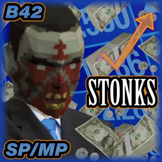
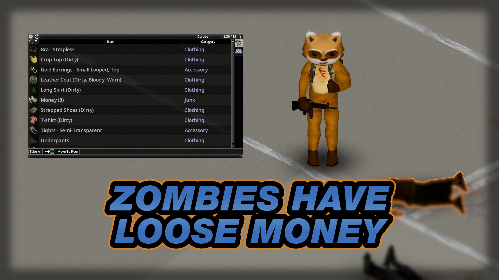
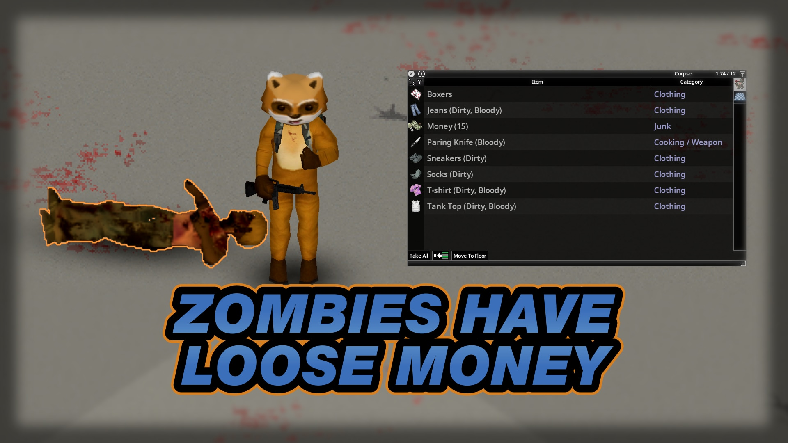
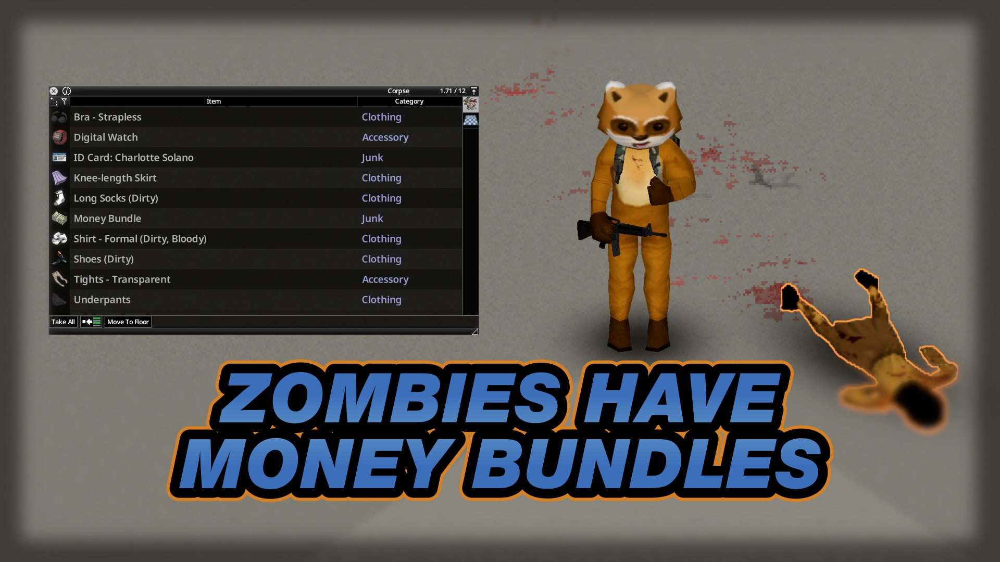
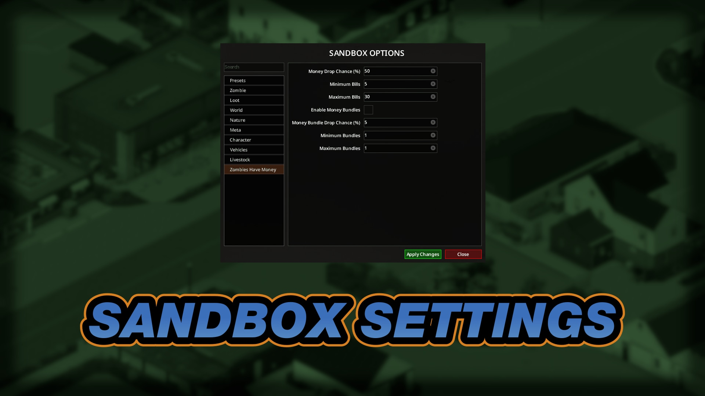
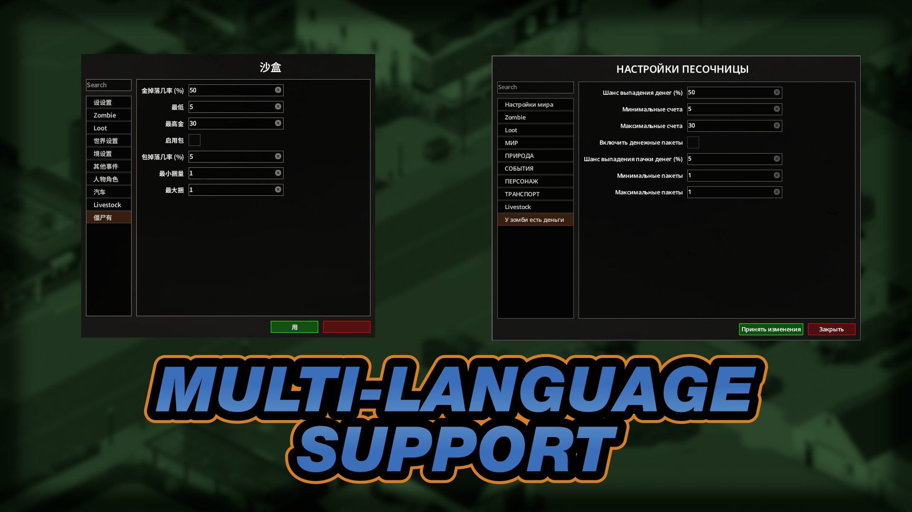

# **Zombies Have Money**

<div class="mod-hero" markdown>

{ .mod-icon }

<span class="pz-tag">B42</span><span class="pz-tag">SP/MP</span>

[:fontawesome-brands-steam-symbol: Steam Workshop](https://steamcommunity.com/sharedfiles/filedetails/?id=3728275018)

**Recommended Build:** 42.15+

</div>

## Overview

*'Civilisation might be Dead, but Capitalism is still Alive'*

Adds a configurable chance for Zombies to drop Money on death, on top of vanilla drop behaviour. Money Bundles (100 Money each) can also drop as a rare alternative.

## Gallery

<div class="gallery-grid" markdown>
    
</div>

## Features

- Configurable chance for Zombies to drop Money on death
- Adjustable minimum and maximum number of Bills per drop
- Optional Money Bundle drops (100 Money each) with their own chance and range, off by default
- All drops are handled on the server, with no client drop logic and no duplication risk
- Translations for all 28 supported Project Zomboid languages

## How It Works

Every time a Zombie is killed, the Mod rolls for a drop on the server.

1. With **Enable Money Bundles** on, the Mod first rolls for a Money Bundle drop. If that roll succeeds, a random number of Money Bundles between Minimum Bundles and Maximum Bundles is added to the Zombie's inventory and the check ends there.
2. Otherwise the Mod rolls for individual Bills. If that roll succeeds, a random amount of Money between Minimum Bills and Maximum Bills is added instead.

A Zombie never drops both Bundles and Bills on the same kill. The rolls only happen on the server, preventing item duplication and desync in Multiplayer.

## Installation

**Singleplayer:** Subscribe to the Mod on the Steam Workshop and enable it from the 'Choose Mods' screen.

**Multiplayer (Hosted and Dedicated):** Subscribe to the Mod on the Steam Workshop and add the lines below to the server's `.ini` file.

```ini
Mods=ZombiesHaveMoneyB42
WorkshopItems=3728275018
```

## Configuration

Found under the **Zombies Have Money** tab in the Custom Sandbox options.

| Setting | Default | Range | Description |
|:---|:---:|:---:|:---|
| Money Drop Chance (%) | 50 | 0-100 | Chance a Zombie drops Money on death |
| Minimum Bills | 5 | 1-100 | Fewest Money items in a drop |
| Maximum Bills | 30 | 1-100 | Most Money items in a drop |
| Enable Money Bundles | Off | On/Off | Lets Zombies drop Money Bundles |
| Money Bundle Drop Chance (%) | 5 | 0-100 | Chance a Zombie drops Money Bundles on death |
| Minimum Bundles | 1 | 1-100 | Fewest Money Bundles in a drop |
| Maximum Bundles | 1 | 1-100 | Most Money Bundles in a drop |

!!! note "Minimum Higher than Maximum"
    If a Minimum is set higher than its Maximum by mistake, the Mod swaps the two values to prevent an error.

!!! note "Money Bundles Are Off by Default"
    Turn on **Enable Money Bundles** and set a **Money Bundle Drop Chance** to use them.

## Compatibility

| Build | SP | Hosted MP | Dedicated MP |
|:---:|:---:|:---:|:---:|
| 42.15+ | ✅ | ✅ | ✅ |
| 41 | ❌ | ❌ | ❌ |

!!! note "Earlier Build 42 Versions"
    Builds of 42 before 42.15 still run the Mod, but the Sandbox Settings screen shows untranslated setting names.

!!! success "Is this Mod safe to add to or remove from existing Saves?"
    Yes. Money already looted from Zombies stays in the Save after removal.

!!! success "Is this Mod compatible with 'X' Mod?"
    Yes, with all other loot Mods. It does not change any existing loot tables or distributions.

!!! success "Does this Mod support 'X' Language?"
    Yes. It has translations for all 28 supported Project Zomboid languages.

## FAQ / Troubleshooting

!!! question "Does this Mod add a use for Money?"
    No. The Mod only adds Money to Zombie loot. Spending or using it needs another Mod.

## Credits

Inspired by Chromaa's ['More Money On Zombies'](https://steamcommunity.com/sharedfiles/filedetails/?id=3673644380), which has since been removed from the Workshop.

## Changelog

[:fontawesome-brands-steam-symbol: View Patch Notes](https://steamcommunity.com/sharedfiles/filedetails/changelog/3728275018)
