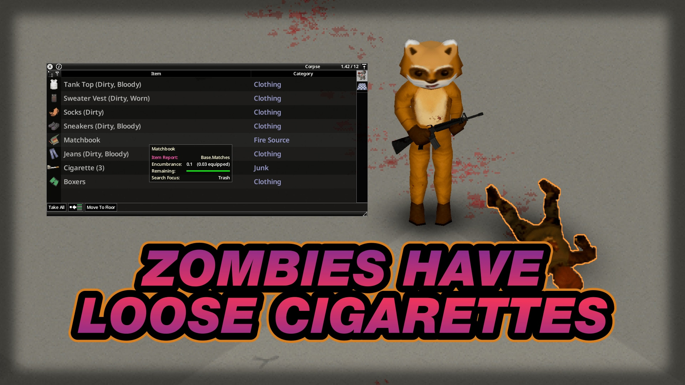
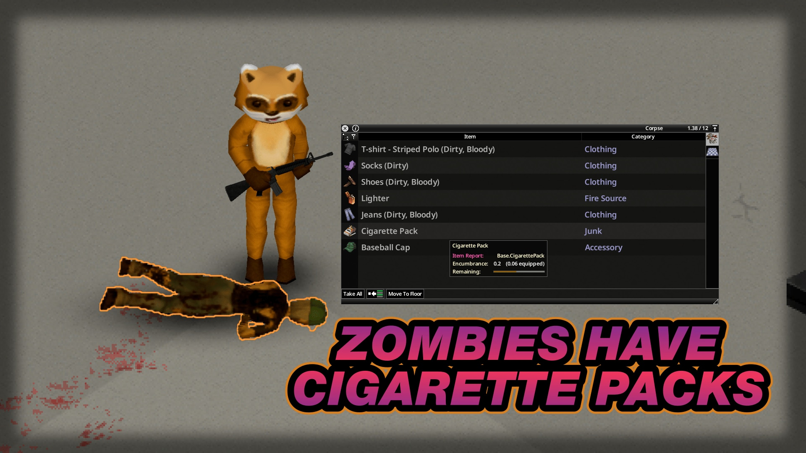
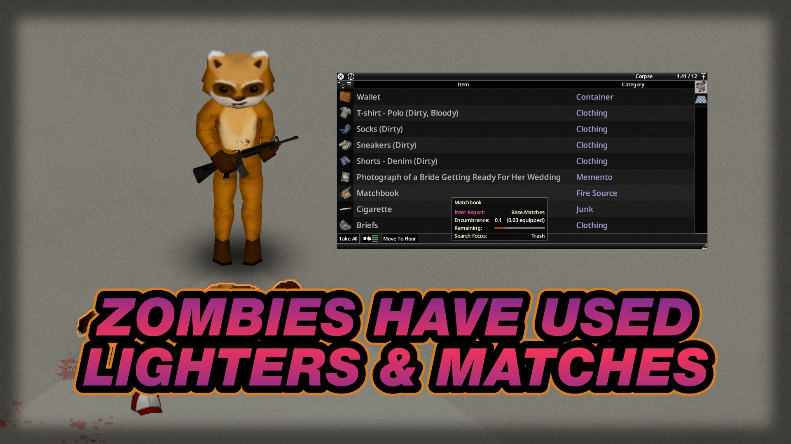
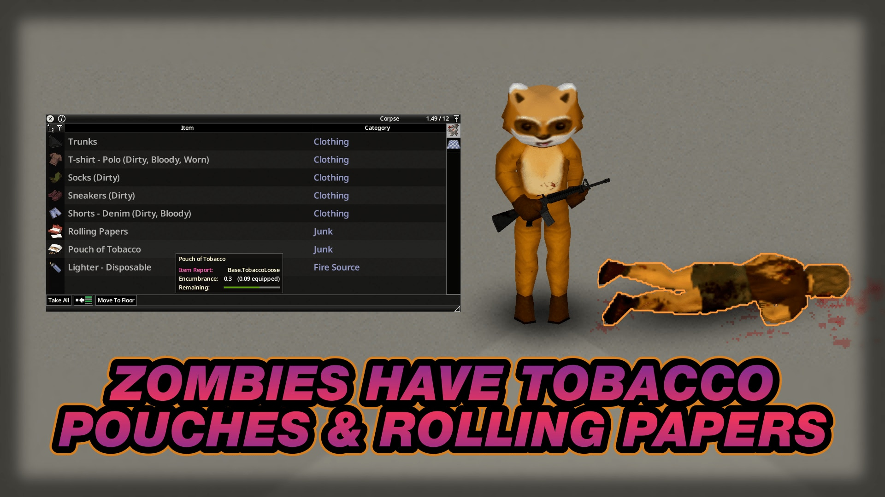
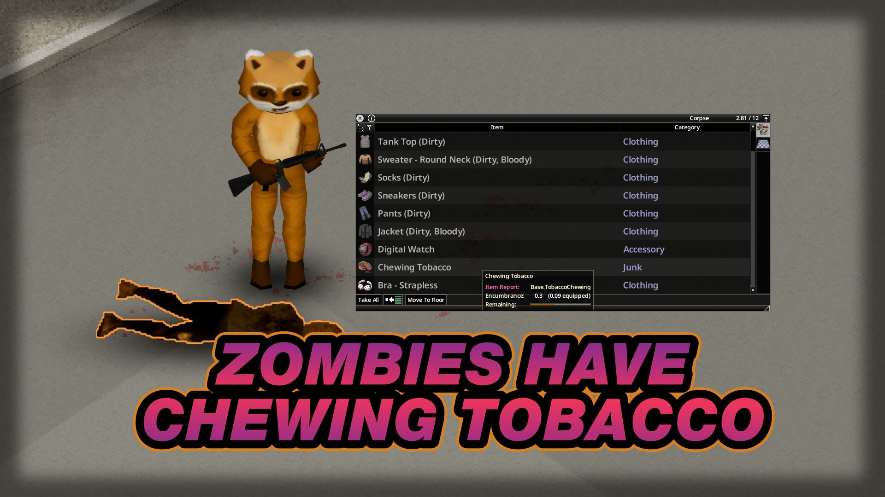
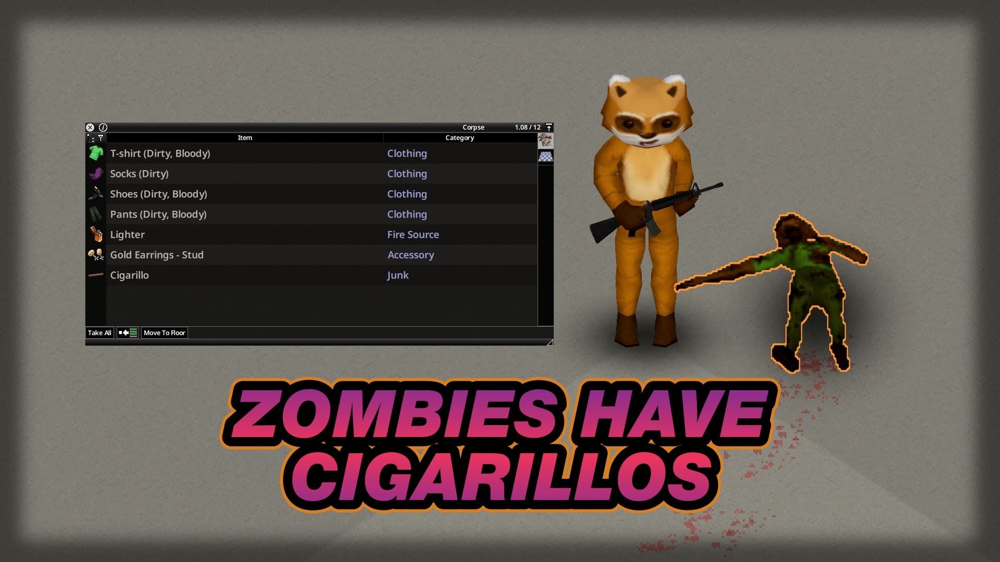
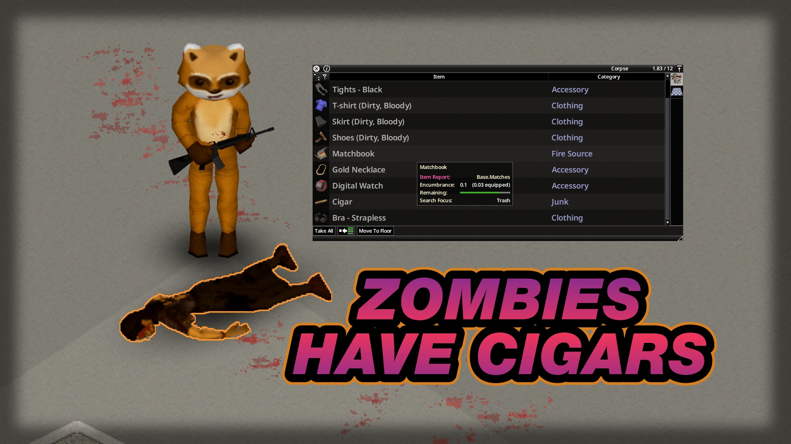
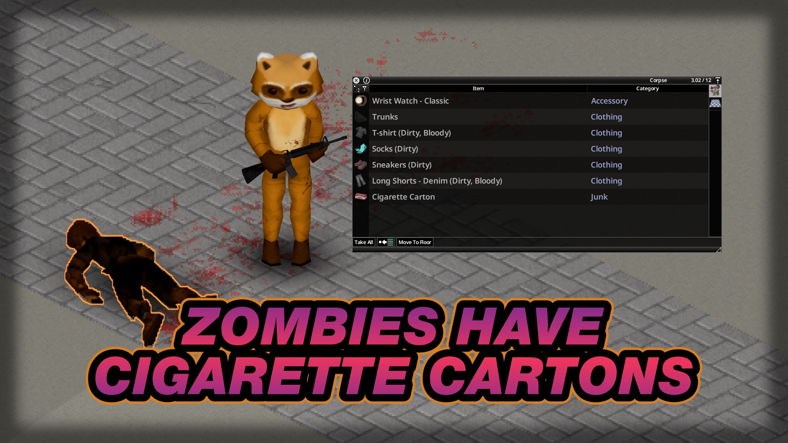
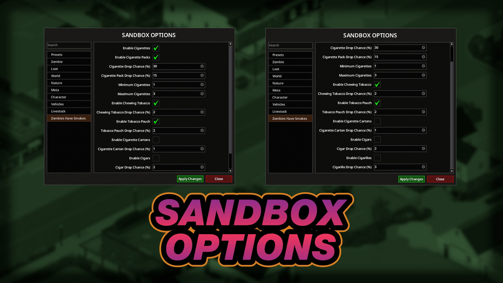
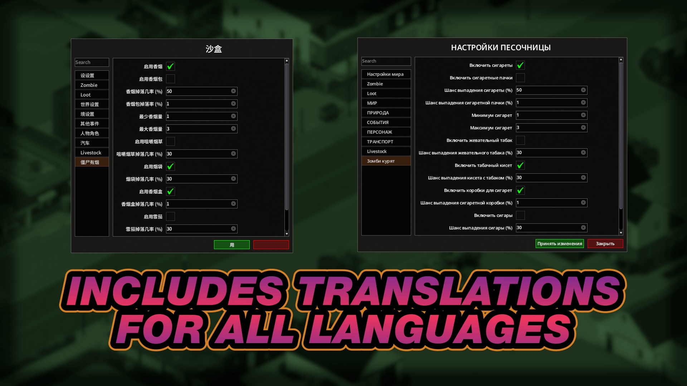

# **Zombies Have Smokes**

<div class="mod-hero" markdown>

{ .mod-icon }

<span class="pz-tag">B42</span><span class="pz-tag">SP/MP</span>

[:fontawesome-brands-steam-symbol: Steam Workshop](https://steamcommunity.com/sharedfiles/filedetails/?id=3728443049)

**Recommended Build:** 42.15+

</div>

## Overview

*'Let's be real... Smoking gives you emphysema and kills you slowly. But you know what's worse and kills you faster? The Knox Infection. Pick your Poison'*

Adds a configurable chance for Zombies to drop Cigarettes, Cigarette Packs, Cigarette Cartons, Cigars, Cigarillos, Chewing Tobacco and Tobacco Pouches on death, often with a Lighter or Matches, on top of vanilla drop behaviour.

## Gallery

<div class="gallery-grid" markdown>
          
</div>

## Features

- Loose Cigarettes, Cigarette Packs, Cigarette Cartons, Cigars, Cigarillos, Chewing Tobacco and Tobacco Pouches (with Rolling Papers) can drop from Zombies
- Every drop type has its own Enable toggle and drop chance
- Tobacco Pouches, Cigars, Cigarillos and Cigarettes come with a Lighter, a Disposable Lighter or Matches
- Cigarette Packs, Chewing Tobacco, Tobacco Pouches, Rolling Papers, Lighters and Matches drop partly used, for balance and realism
- All drops are handled on the server. Clients run no drop logic, preventing duplication and inventory desync
- Translations for all 28 supported Project Zomboid languages

## Mechanics

Every Zombie death runs through a series of rolls in order. Only enabled drop types roll. The first roll to succeed decides the drop: a Zombie never receives items from more than one roll.

1. Chewing Tobacco
2. Tobacco Pouch, with Rolling Papers and a Lighter or Matches
3. Cigarette Carton
4. Cigar, with a Lighter or Matches
5. Cigarillo, with a Lighter or Matches
6. Cigarettes. With **Enable Cigarette Packs** on, a second roll decides whether the drop is a Cigarette Pack or loose Cigarettes. A Lighter or Matches always comes with them

The rolls only happen on the server, preventing item duplication and desync in Multiplayer.

## Installation

**Singleplayer:** Subscribe to the Mod on the Steam Workshop and enable it from the 'Choose Mods' screen.

**Multiplayer (Hosted and Dedicated):** Subscribe to the Mod on the Steam Workshop and add the lines below to the server's `.ini` file.

```ini
Mods=ZombiesHaveSmokesB42
WorkshopItems=3728443049
```

## Configuration

Found under the **Zombies Have Smokes** tab in the Custom Sandbox options.

| Setting | Default | Range | Description |
|:---|:---:|:---:|:---|
| Enable Cigarettes | On | On/Off | Master toggle for Cigarette drops (loose and Packs) |
| Enable Cigarette Packs | On | On/Off | Lets a Cigarette drop be a Pack instead of loose Cigarettes |
| Cigarette Drop Chance (%) | 30 | 1-100 | Chance a Zombie drops Cigarettes on death |
| Cigarette Pack Drop Chance (%) | 15 | 1-100 | Chance a Cigarette drop is a Pack rather than loose Cigarettes |
| Minimum / Maximum Cigarettes | 1 / 3 | 1-100 | Number of loose Cigarettes when the drop is not a Pack |
| Enable Chewing Tobacco | On | On/Off | Lets Zombies drop Chewing Tobacco |
| Chewing Tobacco Drop Chance (%) | 2 | 1-100 | Chance a Zombie drops Chewing Tobacco on death |
| Enable Tobacco Pouch | On | On/Off | Lets Zombies drop a Tobacco Pouch with Rolling Papers and a Lighter or Matches |
| Tobacco Pouch Drop Chance (%) | 2 | 1-100 | Chance a Zombie drops a Tobacco Pouch on death |
| Enable Cigarette Cartons | Off | On/Off | Lets Zombies drop a Cigarette Carton |
| Cigarette Carton Drop Chance (%) | 1 | 1-100 | Chance a Zombie drops a Cigarette Carton on death |
| Enable Cigars | Off | On/Off | Lets Zombies drop a Cigar with a Lighter or Matches |
| Cigar Drop Chance (%) | 2 | 1-100 | Chance a Zombie drops a Cigar on death |
| Enable Cigarillos | Off | On/Off | Lets Zombies drop a Cigarillo with a Lighter or Matches |
| Cigarillo Drop Chance (%) | 3 | 1-100 | Chance a Zombie drops a Cigarillo on death |

!!! note "Minimum Higher than Maximum"
    If Minimum Cigarettes is set higher than Maximum Cigarettes by mistake, the Mod swaps the two values to prevent an error.

## Compatibility

| Build | SP | Hosted MP | Dedicated MP |
|:---:|:---:|:---:|:---:|
| 42.15+ | ✅ | ✅ | ✅ |
| 41 | ❌ | ❌ | ❌ |

!!! note "Earlier Build 42 Versions"
    Builds of 42 before 42.15 still run the Mod, but the Sandbox Settings screen shows untranslated setting names.

!!! success "Is this Mod safe to add to or remove from existing Saves?"
    Yes. Tobacco products already looted from Zombies stay in the Save after removal.

!!! success "Is this Mod compatible with 'X' Mod?"
    Yes, with all other loot Mods. It does not change any existing loot tables or distributions.

!!! success "Does this Mod support 'X' Language?"
    Yes. It has translations for all 28 supported Project Zomboid languages.

## Credits

- Translations: Nycotex (Italian)

## Changelog

[:fontawesome-brands-steam-symbol: View Patch Notes](https://steamcommunity.com/sharedfiles/filedetails/changelog/3728443049)
